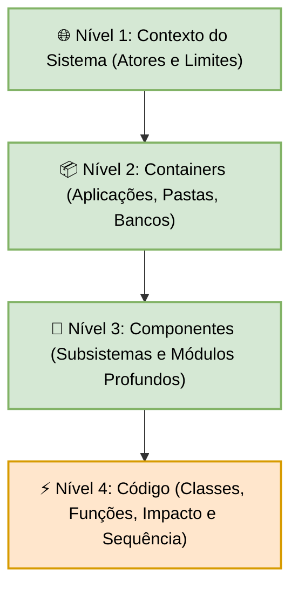
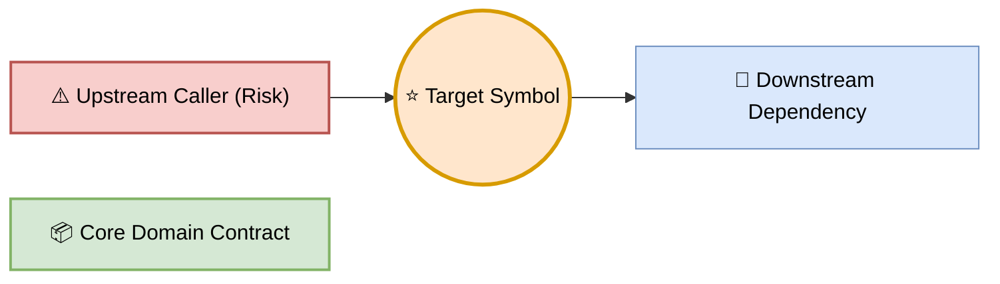

# C4 Architecture Model & Automated Code Visualization

This skill defines the standard practice for modeling and maintaining software architecture using the **C4 Model** (Context, Containers, Components, Code) rendered in **Git-versioned Markdown with Mermaid diagrams**.

It is designed to be domain-agnostic and reusable across any software project.

---

## 1. The Core Philosophy

Software diagrams rot when they require manual labor to reflect daily code edits. The C4 Model solves this by establishing strict boundaries between **curated architectural intent** and **derived implementation detail**:



> [!IMPORTANT]
> **The Golden Rule of C4:**
> - **Levels 1, 2, and 3 are curated by engineers/agents** in Markdown (`docs/arquitetura/`). They capture architectural boundaries, domain contracts, and subsystem responsibilities.
> - **Level 4 (Code) is NEVER drawn by hand.** It must always be derived dynamically from the Abstract Syntax Tree (AST) of the source code. If code changes, Level 4 updates automatically with zero documentation debt.

---

## 2. Directory Layout Standard

A project adopting this model structures its documentation as:

```
project-root/
├── docs/
│   └── arquitetura/
│       ├── c1-contexto.md                # Macro system boundaries & external actors
│       ├── c2-containers.md              # Packages, layers, and unidirectional rules
│       ├── c3-<subsystem-a>.md           # Deep component architecture for subsystem A
│       ├── c3-<subsystem-b>.md           # Deep component architecture for subsystem B
│       └── _gerados_c4/                  # Automated Level 4 outputs (generated via AST)
│           ├── <module-1>.c4.md
│           └── <module-2>.c4.md
├── centralControle/ (or tools/)
│   ├── GUIA_VISUALIZACAO.md              # Human-facing visual guide & shortcuts
│   ├── rodar.py (or cli.py)              # CLI with `c4` and `guia-c4` subcommands
│   └── bin/
│       └── a2m                           # Standalone AST-to-Mermaid engine
└── src/
    └── c4_gerador.py                     # AST extractor & Level 4 Markdown synthesizer
```

---

## 3. Specifications of the 4 Levels

### Level 1: System Context (`c1-contexto.md`)
- **Audience:** Everyone (stakeholders, new developers, AI agents).
- **Scope:** The system as a black box, showing external systems, third-party libraries, input files, and human users.
- **Diagram:** `flowchart TD` or `flowchart LR`.
- **Content:**
  - System boundary box.
  - External dependencies (APIs, simulation engines, databases).
  - User roles and entry points.

### Level 2: Containers (`c2-containers.md`)
- **Audience:** Developers, software architects, agents.
- **Scope:** Major deployable units, folders, packages, and data persistence boundaries.
- **Diagram:** `flowchart TD` with styled subgraphs representing architectural layers.
- **Content:**
  - Layer dependency rules (e.g., Domain must never import Configs).
  - Data stores and file queues.
  - Navigable index mapping each module to its Level 4 code document.

### Level 3: Components (`c3-<subsystem>.md`)
- **Audience:** Engineers modifying a specific feature or subsystem.
- **Scope:** Deep modules within a container.
- **Diagram:** `flowchart TD` or `flowchart LR` detailing module interfaces.
- **Content:**
  - Contracts (`@dataclass` specs, interfaces, pure functions).
  - Pipeline execution order.
  - Performance characteristics and invariants.

### Level 4: Code (`_gerados_c4/<path>.c4.md`)
- **Audience:** Developers writing, debugging, or reviewing code.
- **Scope:** A single source file or critical class/function.
- **Generation:** Derived on-demand by inspecting the AST + call graphs.
- **Required Sections in Level 4 Documents:**
  1. **Navigation Breadcrumbs:** Clickable links to C1, C2, C3, and the raw source file.
  2. **File Boundaries:** `flowchart LR` showing internal module imports and external packages.
  3. **Systemic Impact Analysis:** Two subgraphs showing:
     - *🚨 Risco de Quebra Ascendente (Red/Orange):* Upstream callers that will break if this symbol changes.
     - *🧩 Impacto Descendente (Blue):* Downstream subroutines and data structures consumed.
  4. **Execution Sequence Diagram:** `sequenceDiagram` showing real control flow, including `alt ... else` branches and `loop` constructs.
  5. **Class & Contract Structure:** `classDiagram` detailing `@dataclass` fields, types, and properties.
  6. **Local Call Graph:** `flowchart TD` with public vs private (`_`) function distinction.
  7. **Symbol Catalog:** Markdown table with clickable links to line ranges (`#L10-L45`).

---

## 4. Mermaid Conventions & Color Palette

To keep diagrams consistent, legible in both dark and light IDE themes, and easy to parse:

### Semantic Color Classes


### Type Sanitization Rules for `classDiagram`
Mermaid `classDiagram` does not support raw Python generics (`list[str]` or `tuple[float, float]`).
The generator must sanitize annotations:
- `tuple[float, float]` → `tuple~float, float~`
- `list[MyClass]` → `list~MyClass~`
- `dict[str, Any]` → `dict~str, Any~`
- `T | None` → `T?`

---

## 5. Integrating with IDEs (1-Click Workflow)

In editors like **Positron** or **VS Code**, provide a Title Bar Action button:
- Extension: `.vscode/extensions/<project>-visualizer/`
- Manifest `package.json` contributes `editor/title` menu action:
  ```json
  {
    "command": "hefesto.showC4",
    "title": "Ver C4 Nível 4 (Código)",
    "icon": "$(graph)",
    "when": "resourceExtname == .py",
    "group": "navigation"
  }
  ```
- Handler runs the AST generator in ~30ms and opens the corresponding `.c4.md` in side-by-side markdown preview.

---

## 6. How Agents Should Apply this Skill

When tasked with designing, documenting, or refactoring in a project adopting C4:
1. **Never hand-edit Level 4 files:** If a file's logic changes, run `python centralControle/rodar.py c4 <file>` or `c4 --todos` to regenerate.
2. **Consult Systemic Impact before modifying signatures:** Read Section 3 of the file's `.c4.md` to identify all upstream callers that depend on it.
3. **Keep Levels 1–3 synchronous with architectural shifts:** When adding a new container or deep module, update `c2-containers.md` and create a dedicated `c3-<subsystem>.md`.
4. **Preserve Navigation Links:** Every generated or curated artifact must provide upward and downward links so users can seamlessly zoom in and out.
