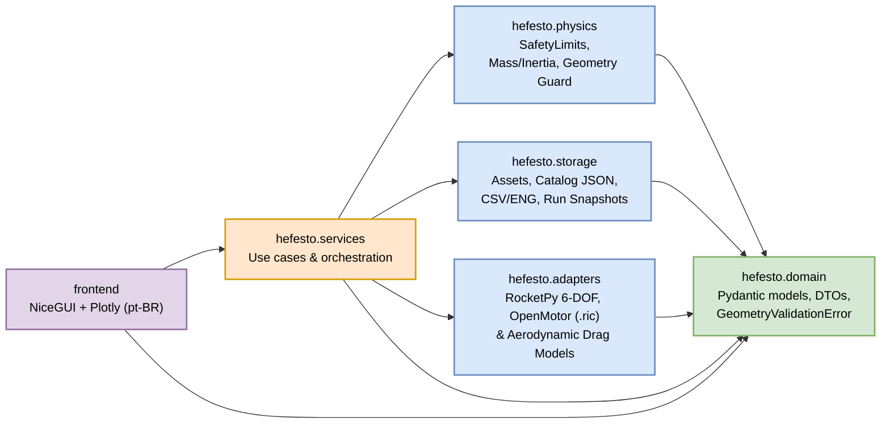

# Arquitetura — Hefesto V1 (Reconstrução)

Este documento define as fronteiras arquiteturais, invariantes físicos e regras de dependência da plataforma de engenharia e simulação 6-DOF do foguete **Hefesto (IREC)**.

---

## 1. Convenções Gerais e Diretório Único

- **Repositório alvo único:** `/mnt/ssd_jogos/Hub/01-Projetos_e_UFJF/supernova/simulacoes/github/hefesto-rebuild` (a pasta raiz não deve ser renomeada).
- **Idioma:** 100% **inglês** em pastas, arquivos, classes, funções, variáveis, campos Pydantic e chaves/valores JSON. **Português** apenas na UI (`frontend/`), comentários e documentação (`ARCHITECTURE.md`).
- **Unidades físicas:** SI em todo o sistema (`m`, `kg`, `s`, `Pa`, `N`, `N·s`, `kg/(m²·s)`, `kg·m²`), exceto ângulos em graus que devem sempre usar o sufixo `*_deg`.
- **Sistemas de coordenadas e inércia:**
  - Foguete: `nose_to_tail`
  - Motor: `nozzle_to_combustion_chamber`
  - Tensor de inércia: `(I_t, I_t, I_l)` (dois eixos transversais iguais + eixo longitudinal)
- **Diretórios proibidos:** É proibido criar `basic/`, `utils/`, `helpers/`, `misc/`, `API/` ou `usuario/` em `src/hefesto/` ou `frontend/`, bem como trafegar `dict[str, Any]` de domínio entre camadas.

---

## 2. Arquitetura em Camadas e Dependência Unidirecional

Fluxo estrito de dependência (cada camada à direita só pode importar camadas permitidas à sua esquerda; é proibido importar irmãos da mesma camada, camadas superiores ou ciclos):

```text
hefesto.domain -> (hefesto.physics | hefesto.storage | hefesto.adapters) -> hefesto.services -> frontend
```



### Responsabilidades e Proibições por Camada

| Camada | Caminho | Pode importar | Proibições explícitas |
|---|---|---|---|
| `hefesto.domain` | `src/hefesto/domain/` | Stdlib pura (`math`, `enum`, `typing`, `datetime`, `dataclasses`) + `pydantic` | Sem I/O (`io`, `os`, `pathlib`, `shutil`, `json`, `csv`, `open()`), sem `yaml`, `rocketpy`, `openmotor`, `motorlib`, `uilib`, `netCDF4`, `nicegui`, `plotly`, `print()`, sem outras camadas. Contém `AssetCategory`, `CatalogOverview`, `RunSummary` e `GeometryValidationError`. |
| `hefesto.physics` | `src/hefesto/physics/` | `hefesto.domain`, `numpy`, `scipy` | Sem `storage`, `adapters`, `services`, `frontend`, `rocketpy`, `yaml`, `motorlib`, `uilib`, `nicegui`, `plotly`, `print()`. |
| `hefesto.storage` | `src/hefesto/storage/` | `hefesto.domain`, stdlib (`json`, `csv`, `pathlib`, etc.) | **Nunca importa `yaml` (`PyYAML`)** nem lê `.ric`. Sem `physics`, `adapters`, `services`, `frontend`, `rocketpy`, `motorlib`, `uilib`, `nicegui`, `plotly`. |
| `hefesto.adapters` | `src/hefesto/adapters/` | `hefesto.domain`, `rocketpy` (exclusivo em `adapters/rocketpy/`), `motorlib` e `uilib` (exclusivos em `adapters/openmotor/`), `matplotlib` (isolado em `adapters/openmotor/`), `numpy` | Sem `physics`, `storage`, `services`, `frontend`, `nicegui`, `plotly`. Isola `uilib` (`matplotlib.use` sem Qt, restaura `sys.excepthook`, silencia `uilib.logger` para não gerar `openMotor.log`) exclusivamente em `hefesto.adapters.openmotor`, e isola `rocketpy` exclusivamente em `hefesto.adapters.rocketpy`. |
| `hefesto.services` | `src/hefesto/services/` | `hefesto.domain`, `hefesto.physics`, `hefesto.storage`, `hefesto.adapters` | Sem `frontend`, `nicegui`, `plotly`, `rocketpy`, `motorlib`, `uilib`, `yaml`, `print()`. |
| `frontend` | `frontend/` | `hefesto.domain`, `hefesto.services`, `nicegui`, `plotly` | Sem `physics`, `storage`, `adapters`, `rocketpy`, `motorlib`, `uilib`, `yaml`, `netCDF4`. |

---

## 3. Invariantes de Engenharia e Segurança

1. **Bloqueio geométrico antes do RocketPy:**
   Em `hefesto.physics` e `hefesto.adapters.rocketpy`, antes de instanciar `SolidMotor`/`Rocket`, validar:
   - `stack_length <= casing_length_m - internal_clearance_m` (soma dos comprimentos de todos os grãos + `(n - 1) * grain_separation_m`)
   - `grain_outer_radius <= casing_inner_radius`
   Qualquer overflow lança `GeometryValidationError` (definida em `hefesto.domain`), bloqueando a execução.
2. **Critérios de segurança (`physics/safety.py`):**
   Os 5 critérios de `SafetyLimits` (`case_safety_factor`, `peak_chamber_pressure_pa`, `peak_kn`, `peak_mass_flux_kg_m2_s`, `port_to_throat_ratio`) operam em modo **fail-closed** (`None`, `NaN`, `inf` ou valor inválido não-positivo → `SafetyCheck(passed=False)`) e **não-bloqueante** (nunca abortam a simulação).
3. **Curvas e atmosfera:**
   - Curvas de empuxo são passadas ao `SolidMotor` apenas em memória como `list[tuple[float, float]]` finita (evitando `NaN` inicial ao passar `Path` de `.eng` e tolerando linhas vazias pós-cabeçalho).
   - Atmosfera opera **exclusivamente** via arquivo `.nc` existente (sem fallback para ISA), suportando tanto conjuntos ERA5 `enda` (com dimensão `number`) quanto determinísticos `oper` (sem `number`).
   - Exceção explícita (não é fallback): missões com `atmosphere: {"type": "isa", ...}` (ex.: `data/catalog/missions/ork_parity.json`) usam o perfil ISA declarado no preset e **não** leem o `.nc` do site; sem esse bloco, o caminho ERA5 permanece obrigatório e fail-closed.
   - Em `RocketPy 1.13.0`, usar `effective_1rl` / `effective_2rl` (nunca `effective1rl`).

---

## 4. Assets Brutos, Catálogo, Snapshots e Golden Baseline

### Assets Brutos em `data/assets/` (copiados de `data/entrada/`)

| Destino (`data/assets/...`) | Origem (`data/entrada/...`) | Tipo |
|---|---|---|
| `motors/medusa_knsb_a.ric` | `openmotor/m18112026.ric` | OpenMotor `.ric` |
| `motors/medusa_knsb_a.eng` | `motores/medusa-knsb-a.eng` | Curva RASP `.eng` |
| `motors/medusa_n2792_v1.ric` | `openmotor/MotorNovo.ric` | OpenMotor `.ric` |
| `motors/medusa_n2792_v1.eng` | `motores/jul1semMedidas.eng` | Curva RASP `.eng` |
| `motors/medusa_n3002_v2.ric` | `openmotor/MotorNovo2.ric` | OpenMotor `.ric` |
| `motors/medusa_n3002_v2.eng` | `motores/jul2semMedidas.eng` | Curva RASP `.eng` |
| `motors/medusa_n3174.eng` | `motores/motor_novo.eng` | Curva RASP `.eng` |
| `drag/power_off.csv` | `arrasto/power_off.csv` | Arrasto Mach × Cd |
| `drag/power_on.csv` | `arrasto/power_on.csv` | Arrasto Mach × Cd |
| `atmosphere/irec_era5_oper.nc` | `atmosfera/irec/data_stream-oper_stepType-instant.nc` | ERA5 `oper` IREC |
| `atmosphere/irec_era5_enda.nc` | `atmosfera/irec/data_stream-enda_stepType-instant.nc` | ERA5 `enda` IREC (ponto) |
| `atmosphere/irec_era5_enda_grid.nc` | `atmosfera/irec/data_stream-enda_stepType-instantCerto.nc` | ERA5 `enda` IREC (grade 5×5) |
| `atmosphere/iacanga_lasc_era5_oper.nc` | `atmosfera/iacanga-25-24_nov_6-7_11a15hLASC/data_stream-oper_stepType-instant.nc` | ERA5 `oper` Iacanga/LASC |
| `atmosphere/iacanga_lasc_era5_enda.nc` | `atmosfera/iacanga-25-24_nov_6-7_11a15hLASC/data_stream-enda_stepType-instant.nc` | ERA5 `enda` Iacanga/LASC |

- **Catálogo (`data/catalog/`):** Gerado apenas na Fase 3 via modelos Pydantic de `hefesto.domain`, referenciando somente nomes relativos dos assets (nunca caminhos absolutos).
- **Snapshots (`data/runs/`):** Gravados apenas sob demanda (gitignored).
- **Golden Baseline (`tests/golden/hefesto_baseline.json`):** Métricas de referência extraídas do runtime legado validado (`dry_mass`, `rocketpy_baseline_88deg`, `openmotor_baselines`, `safety_baseline_medusa_knsb_a`).

---

## 5. Remoção do Legado e Portões de Qualidade (Gates)

- Pós-paridade da Fase 4, os artefatos legados (`backend/`, `usuario/`, `data/entrada/`, `data/saida/`, `sitecustomize.py`, `tests/test_adaptador_openmotor.py` e `tests/test_dicionario.py`) e suas exclusões temporárias foram removidos.
- **Gate obrigatório por fase:**
  ```fish
  uv run ruff check . && uv run pyrefly check && uv run pytest
  ```
- O arquivo `tests/test_architecture.py` executa a verificação AST automática de camadas, ciclos, `yaml` em `storage`, `print()` em `domain`/`physics`/`services`, `dict[str, Any]` entre camadas e diretórios proibidos.
