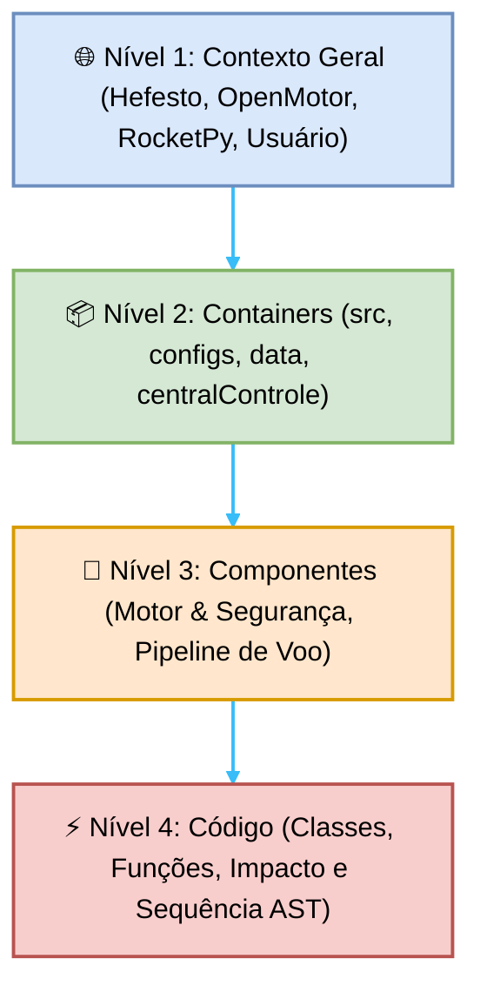
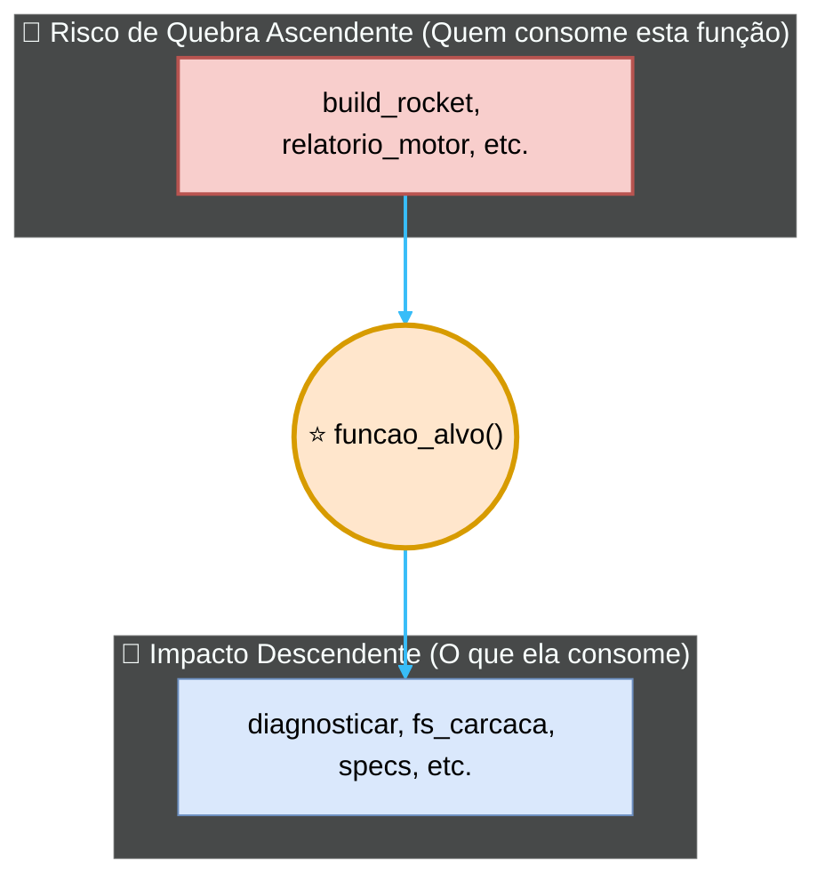

# 📖 Guia de Visualização Arquitetural (Modelo C4 & Mermaid)

Este guia ensina como explorar, visualizar e navegar na arquitetura do projeto **Hefesto** utilizando o **Modelo C4 Híbrido** e diagramas interativos renderizados em **Mermaid**.

C1, C2 e C3 sao atualizados manualmente

---

## 1. Como Visualizar os Diagramas no Positron (1 Clique)

Você não precisa abrir pastas manualmente para ver a arquitetura do código em que está trabalhando.

```
┌─────────────────────────────────────────────────────────────┬───┬───┬───┐
│ motor.py                                                    │ 📊│ ⚙️│ ✕ │  <-- Botão $(graph)
├─────────────────────────────────────────────────────────────┴───┴───┴───┤
│ 1  # src/calculos/motor.py                                              │
│ 2  from dataclasses import dataclass                                    │
│ ...                                                                     │
└─────────────────────────────────────────────────────────────────────────┘
```

1. Abra qualquer arquivo `.py` do projeto no Positron (ex.: [`src/calculos/motor.py`](../src/calculos/motor.py)).
2. Olhe no canto superior direito do editor (na barra de títulos da aba, ao lado do botão de *More Actions* `...`).
3. Clique no ícone de grafo **`$(graph)`**:
   - O Positron executará o gerador AST em ~30ms;
   - Uma coluna lateral será aberta automaticamente exibindo o diagrama Mermaid renderizado e o catálogo de símbolos com links diretos para as linhas de código!

> [!TIP]
> **Primeira vez configurando um novo notebook?**
> Execute no terminal:
> ```bash
> python centralControle/rodar.py setup
> ```
> Isso vinculará a extensão do Hefesto ao Positron e garantirá que a extensão de renderização Mermaid esteja ativa.

---

## 2. A Hierarquia do Modelo C4

O modelo organiza a complexidade do sistema em 4 níveis concêntricos de zoom.



| Nível | O que mostra | Arquivo / Localização | Como é mantido |
| :--- | :--- | :--- | :--- |
| **Nível 1 (Contexto)** | Visão macro: interação com OpenMotor, RocketPy e arquivos do foguete | [docs/arquitetura/c1-contexto.md](../docs/arquitetura/c1-contexto.md) | ✍️ Curado manualmente |
| **Nível 2 (Containers)** | Módulos principais, scripts, pastas e fluxo de dados | [docs/arquitetura/c2-containers.md](../docs/arquitetura/c2-containers.md) | ✍️ Curado manualmente |
| **Nível 3 (Componentes)** | Arquitetura profunda de cada subsistema aeroespacial | [c3-subsistema-motor.md](../docs/arquitetura/c3-subsistema-motor.md)<br>[c3-execucao-voo.md](../docs/arquitetura/c3-execucao-voo.md) | ✍️ Curado manualmente |
| **Nível 4 (Código)** | Classes, `@dataclass`, impacto sistêmico e sequência de chamadas | [docs/arquitetura/_gerados_c4/](../docs/arquitetura/_gerados_c4/) | 🤖 **100% Automático sob demanda (AST + a2m)** |

> [!IMPORTANT]
> **A Regra de Ouro do C4:**
> Nunca desenhe o Nível 4 à mão! O código muda frequentemente. Deixar o gerador inspecionar a AST garante que a documentação de código **nunca fica desatualizada**.

---

## 3. Como Ler a Análise de Impacto Sistêmico

Ao abrir qualquer documento C4 Nível 4 gerado, você verá a seção de **Impacto Sistêmico**:



- **Caixa Vermelha Superior (Risco Ascendente):** Lista todos os pontos externos do projeto que chamam esta função. Se você alterar a assinatura, parâmetros ou retorno desta função, **estes arquivos vão quebrar**.
- **Nó Central (Alvo Dourado):** A função ou módulo que você está inspecionando no momento.
- **Caixa Azul Inferior (Impacto Descendente):** Mostra todas as dependências internas e funções de cálculo que esta rotina consome.

### Navegando entre Módulos
Você pode pular de um documento para outro de duas maneiras:
1. **Clique no Próprio Diagrama:** Ao clicar em um nó do grafo (ex.: `relatorio_estrutura`), o cursor de link redirecionará para o documento C4 daquele módulo.
2. **Tabela de Atalhos Rápidos:** Logo abaixo de cada diagrama, há uma tabela com links nativos diretos (`[⚡ src__inspecao.c4.md]`) que também permitem abrir lado a lado (`Ctrl + Clique`).

---

## 4. Comandos Disponíveis no Terminal (`centralControle/rodar.py`)

Se você preferir operar via terminal (ou estiver em um servidor headless sem interface gráfica):

```bash
# 1. Gerar C4 de um arquivo específico:
python centralControle/rodar.py c4 src/calculos/motor.py

# 2. Gerar ou atualizar a documentação C4 de TODO o projeto em lote:
python centralControle/rodar.py c4 --todos

# 3. Exibir o resumo do guia arquitetural no terminal:
python centralControle/rodar.py guia-c4

# 4. Configurar a extensão do Positron em uma nova máquina ou notebook:
python centralControle/rodar.py setup
```

---

## 5. Como Estender para Novos Módulos

Sempre que criar um novo arquivo `.py` em `src/`:
1. Use tipos nos argumentos e retorno (`def minha_func(spec: FogueteSpec) -> DiagnosticoFS:`).
2. Escreva uma docstring clara na primeira linha do módulo, da classe e da função.
3. Clique no botão de Grafo do Positron ou rode `python centralControle/rodar.py c4 src/meu_modulo.py`.
4. Pronto! O diagrama, os nós de impacto, as tabelas de dataclasses e os links de código já estarão disponíveis.
