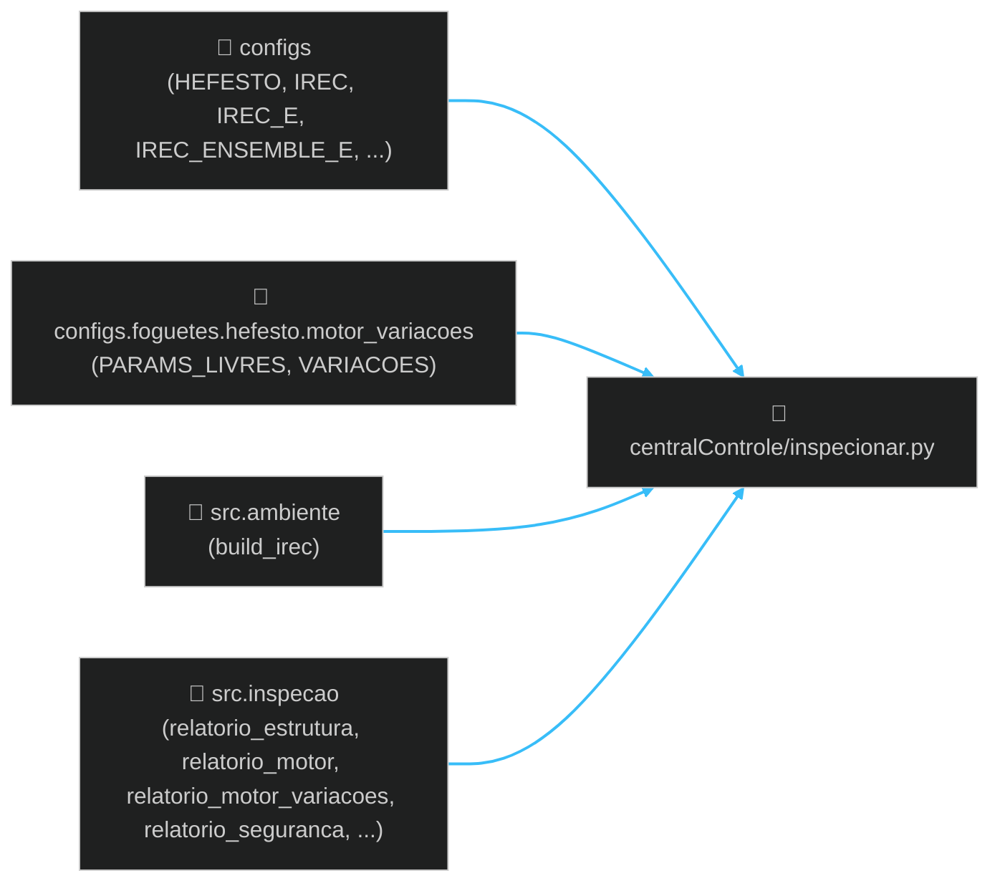
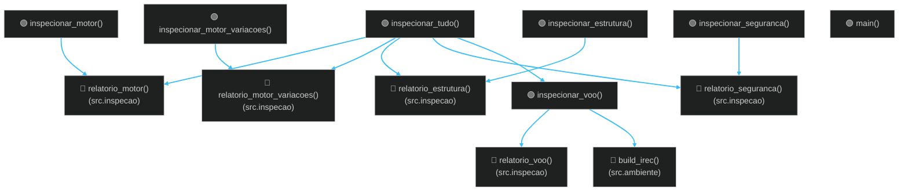

# ⚡ C4 Nível 4 (Código) — `centralControle/inspecionar.py`

> [!NOTE]
> **Gerado automaticamente a partir da AST do código-fonte e motor a2m.**
> Pela regra do modelo C4, o Nível 4 nunca é desenhado manualmente — ele reflete
> em tempo real as classes, funções, impacto e chamadas presentes em [`inspecionar.py`](../../../centralControle/inspecionar.py).

**Navegação na Hierarquia C4:**
[🌐 Nível 1: Contexto](../c1-contexto.md) · [📦 Nível 2: Containers](../c2-containers.md) · [🧩 C3: Pipeline de Execução & Voo](../c3-execucao-voo.md) · **⚡ Nível 4: `inspecionar.py`** · [📖 Guia de Visualização](../../../centralControle/GUIA_VISUALIZACAO.md)

---

## 1. Propósito do Módulo

Inspeção da configuração do foguete Hefesto.

Delega a formatação e os relatórios para `src.inspecao`, injetando as
especificações concretas de `configs`.

Uso pela CLI:
    python centralControle/inspecionar.py motor       # só o motor
    python centralControle/inspecionar.py variacoes   # comparativo das variações
    python centralControle/inspecionar.py estrutura   # calculado vs medido + componentes
    python centralControle/inspecionar.py seguranca   # FS e limites
    python centralControle/inspecionar.py voo         # parâmetros de voo
    python centralControle/inspecionar.py tudo        # tudo acima

---

## 2. Fronteiras e Dependências do Arquivo

#### 🧭 Dependências Internas Navegáveis

| Dependência | Símbolos Importados | Documento C4 |
| :--- | :--- | :--- |
| `🧩 configs` | `HEFESTO`, `IREC`, `IREC_E`, `IREC_ENSEMBLE_E`, `MOTOR_IREC` | [⚡ `configs.c4.md`](configs.c4.md) |
| `🧩 configs.foguetes.hefesto.motor_variacoes` | `PARAMS_LIVRES`, `VARIACOES` | [⚡ `configs__foguetes__hefesto__motor_variacoes.c4.md`](configs__foguetes__hefesto__motor_variacoes.c4.md) |
| `🧩 src.ambiente` | `build_irec` | [⚡ `src__ambiente.c4.md`](src__ambiente.c4.md) |
| `🧩 src.inspecao` | `relatorio_estrutura`, `relatorio_motor`, `relatorio_motor_variacoes`, `relatorio_seguranca`, `relatorio_voo` | [⚡ `src__inspecao.c4.md`](src__inspecao.c4.md) |

---

## 3. Fluxo Lógico de Funções Locais (`flowchart TD`)

#### 🧭 Chamadas Externas Identificadas

| Chamada Local | Módulo de Origem | Documento C4 |
| :--- | :--- | :--- |
| `🔗 relatorio_motor()` | `src.inspecao` | [⚡ `src__inspecao.c4.md`](src__inspecao.c4.md) |
| `🔗 relatorio_motor_variacoes()` | `src.inspecao` | [⚡ `src__inspecao.c4.md`](src__inspecao.c4.md) |
| `🔗 relatorio_estrutura()` | `src.inspecao` | [⚡ `src__inspecao.c4.md`](src__inspecao.c4.md) |
| `🔗 relatorio_seguranca()` | `src.inspecao` | [⚡ `src__inspecao.c4.md`](src__inspecao.c4.md) |
| `🔗 relatorio_voo()` | `src.inspecao` | [⚡ `src__inspecao.c4.md`](src__inspecao.c4.md) |
| `🔗 build_irec()` | `src.ambiente` | [⚡ `src__ambiente.c4.md`](src__ambiente.c4.md) |

---

## 4. Catálogo de Símbolos (Links Diretos para o Código)

### Funções do Módulo

| Função | Linhas | Retorno | Resumo |
| :--- | :--- | :--- | :--- |
| [`inspecionar_motor`](../../../centralControle/inspecionar.py#L37-L38) | `L37–L38` | `None` | — |
| [`inspecionar_motor_variacoes`](../../../centralControle/inspecionar.py#L41-L42) | `L41–L42` | `None` | — |
| [`inspecionar_estrutura`](../../../centralControle/inspecionar.py#L45-L46) | `L45–L46` | `None` | — |
| [`inspecionar_seguranca`](../../../centralControle/inspecionar.py#L49-L50) | `L49–L50` | `None` | — |
| [`inspecionar_voo`](../../../centralControle/inspecionar.py#L53-L59) | `L53–L59` | `None` | — |
| [`inspecionar_tudo`](../../../centralControle/inspecionar.py#L62-L68) | `L62–L68` | `None` | — |
| [`main`](../../../centralControle/inspecionar.py#L81-L93) | `L81–L93` | `None` | — |
