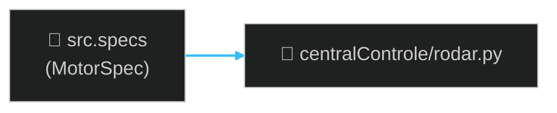
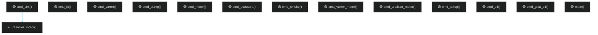

# ⚡ C4 Nível 4 (Código) — `centralControle/rodar.py`

> [!NOTE]
> **Gerado automaticamente a partir da AST do código-fonte e motor a2m.**
> Pela regra do modelo C4, o Nível 4 nunca é desenhado manualmente — ele reflete
> em tempo real as classes, funções, impacto e chamadas presentes em [`rodar.py`](../../../centralControle/rodar.py).

**Navegação na Hierarquia C4:**
[🌐 Nível 1: Contexto](../c1-contexto.md) · [📦 Nível 2: Containers](../c2-containers.md) · [🧩 C3: Pipeline de Execução & Voo](../c3-execucao-voo.md) · **⚡ Nível 4: `rodar.py`** · [📖 Guia de Visualização](../../../centralControle/GUIA_VISUALIZACAO.md)

---

## 1. Propósito do Módulo

CLI unificada do projeto Hefesto.

🧩 Arquitetura C4 (Nível 3): docs/arquitetura/c3-execucao-voo.md
⚡ Arquitetura C4 (Nível 4): clique no botão de Grafo no topo direito ao lado de 'More Actions'

Pode ser executada tanto pelo terminal (passando subcomandos) quanto clicando
diretamente em "Run" na IDE/Positron (nesse caso executa `ACAO_PADRAO`).

Uso no terminal:
    python centralControle/rodar.py sim                      # simulação determinística
    python centralControle/rodar.py sim --modo medido        # simulação no modo medido
    python centralControle/rodar.py motor                    # relatório do motor
    python centralControle/rodar.py estrutura                # relatório estrutural (calculado vs medido)
    python centralControle/rodar.py fs                       # diagnósticos de segurança
    python centralControle/rodar.py dump                     # relatório completo
    python centralControle/rodar.py varrer                   # varredura de voo (empuxo × arrasto)
    python centralControle/rodar.py varrer-motor -p ...      # varredura paramétrica do motor
    python centralControle/rodar.py analisar-motor           # análise da última varredura do motor
    python centralControle/rodar.py smoke                    # suíte de testes e contratos

---

## 2. Fronteiras e Dependências do Arquivo

#### 🧭 Dependências Internas Navegáveis

| Dependência | Símbolos Importados | Documento C4 |
| :--- | :--- | :--- |
| `🧩 src.specs` | `MotorSpec` | [⚡ `src__specs.c4.md`](src__specs.c4.md) |

---

## 3. Fluxo Lógico de Funções Locais (`flowchart TD`)

---

## 4. Catálogo de Símbolos (Links Diretos para o Código)

### Funções do Módulo

| Função | Linhas | Retorno | Resumo |
| :--- | :--- | :--- | :--- |
| [`_resolver_motor`](../../../centralControle/rodar.py#L43-L60) | `L43–L60` | `MotorSpec | None` | Resolve uma string de preset de variação para um `MotorSpec`. |
| [`cmd_sim`](../../../centralControle/rodar.py#L63-L101) | `L63–L101` | `None` | Executa a simulação determinística de voo. |
| [`cmd_fs`](../../../centralControle/rodar.py#L104-L107) | `L104–L107` | `None` | — |
| [`cmd_varrer`](../../../centralControle/rodar.py#L110-L113) | `L110–L113` | `None` | — |
| [`cmd_dump`](../../../centralControle/rodar.py#L116-L119) | `L116–L119` | `None` | — |
| [`cmd_motor`](../../../centralControle/rodar.py#L122-L125) | `L122–L125` | `None` | — |
| [`cmd_estrutura`](../../../centralControle/rodar.py#L128-L131) | `L128–L131` | `None` | — |
| [`cmd_smoke`](../../../centralControle/rodar.py#L134-L137) | `L134–L137` | `None` | — |
| [`cmd_varrer_motor`](../../../centralControle/rodar.py#L140-L154) | `L140–L154` | `None` | — |
| [`cmd_analisar_motor`](../../../centralControle/rodar.py#L157-L161) | `L157–L161` | `None` | — |
| [`cmd_setup`](../../../centralControle/rodar.py#L164-L219) | `L164–L219` | `None` | Configura e ativa a extensão do visualizador no Positron local. |
| [`cmd_c4`](../../../centralControle/rodar.py#L222-L233) | `L222–L233` | `None` | Gera sob demanda o documento C4 Nível 4 (Código) via AST para um arquivo `.py` ou em lote. |
| [`cmd_guia_c4`](../../../centralControle/rodar.py#L236-L254) | `L236–L254` | `None` | Exibe instruções e caminhos para visualizar a arquitetura C4. |
| [`main`](../../../centralControle/rodar.py#L257-L326) | `L257–L326` | `None` | — |
