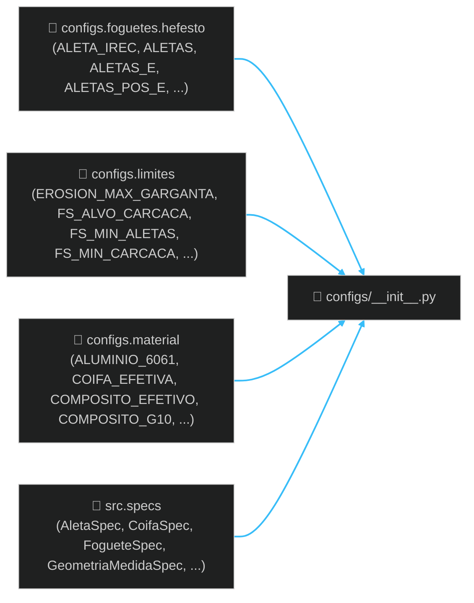

# ⚡ C4 Nível 4 (Código) — `configs/__init__.py`

> [!NOTE]
> **Gerado automaticamente a partir da AST do código-fonte e motor a2m.**
> Pela regra do modelo C4, o Nível 4 nunca é desenhado manualmente — ele reflete
> em tempo real as classes, funções, impacto e chamadas presentes em [`__init__.py`](../../../configs/__init__.py).

**Navegação na Hierarquia C4:**
[🌐 Nível 1: Contexto](../c1-contexto.md) · [📦 Nível 2: Containers](../c2-containers.md) · [🧩 C3: Pipeline de Execução & Voo](../c3-execucao-voo.md) · **⚡ Nível 4: `__init__.py`** · [📖 Guia de Visualização](../../../centralControle/GUIA_VISUALIZACAO.md)

---

## 1. Propósito do Módulo

Fachada pública de configurações do projeto.

Reexporta os tipos de especificação (`src.specs`), recursos globais
(`configs.material`, `configs.limites`) e a instância concreta do foguete
`HEFESTO` (`configs.foguetes.hefesto`).

---

## 2. Fronteiras e Dependências do Arquivo

#### 🧭 Dependências Internas Navegáveis

| Dependência | Símbolos Importados | Documento C4 |
| :--- | :--- | :--- |
| `🧩 configs.foguetes.hefesto` | `ALETA_IREC`, `ALETAS`, `ALETAS_E`, `ALETAS_POS_E`, `ALETAS_TRAPEZIO_EQUIV`, ... | [⚡ `configs__foguetes__hefesto.c4.md`](configs__foguetes__hefesto.c4.md) |
| `🧩 configs.limites` | `EROSION_MAX_GARGANTA`, `FS_ALVO_CARCACA`, `FS_MIN_ALETAS`, `FS_MIN_CARCACA`, `FS_MIN_ESTRUTURA`, ... | [⚡ `configs__limites.c4.md`](configs__limites.c4.md) |
| `🧩 configs.material` | `ALUMINIO_6061`, `COIFA_EFETIVA`, `COMPOSITO_EFETIVO`, `COMPOSITO_G10`, `FIBRA_CARBONO`, ... | [⚡ `configs__material.c4.md`](configs__material.c4.md) |
| `🧩 src.specs` | `AletaSpec`, `CoifaSpec`, `FogueteSpec`, `GeometriaMedidaSpec`, `GrainSpec`, ... | [⚡ `src__specs.c4.md`](src__specs.c4.md) |

---

## 3. Catálogo de Símbolos (Links Diretos para o Código)
