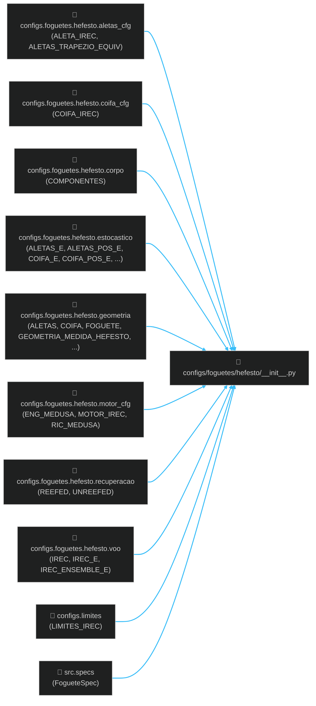

# ⚡ C4 Nível 4 (Código) — `configs/foguetes/hefesto/__init__.py`

> [!NOTE]
> **Gerado automaticamente a partir da AST do código-fonte e motor a2m.**
> Pela regra do modelo C4, o Nível 4 nunca é desenhado manualmente — ele reflete
> em tempo real as classes, funções, impacto e chamadas presentes em [`__init__.py`](../../../configs/foguetes/hefesto/__init__.py).

**Navegação na Hierarquia C4:**
[🌐 Nível 1: Contexto](../c1-contexto.md) · [📦 Nível 2: Containers](../c2-containers.md) · [🧩 C3: Pipeline de Execução & Voo](../c3-execucao-voo.md) · **⚡ Nível 4: `__init__.py`** · [📖 Guia de Visualização](../../../centralControle/GUIA_VISUALIZACAO.md)

---

## 1. Propósito do Módulo

Instância concreta: foguete Hefesto.

---

## 2. Fronteiras e Dependências do Arquivo

#### 🧭 Dependências Internas Navegáveis

| Dependência | Símbolos Importados | Documento C4 |
| :--- | :--- | :--- |
| `🧩 configs.foguetes.hefesto.aletas_cfg` | `ALETA_IREC`, `ALETAS_TRAPEZIO_EQUIV` | [⚡ `configs__foguetes__hefesto__aletas_cfg.c4.md`](configs__foguetes__hefesto__aletas_cfg.c4.md) |
| `🧩 configs.foguetes.hefesto.coifa_cfg` | `COIFA_IREC` | [⚡ `configs__foguetes__hefesto__coifa_cfg.c4.md`](configs__foguetes__hefesto__coifa_cfg.c4.md) |
| `🧩 configs.foguetes.hefesto.corpo` | `COMPONENTES` | [⚡ `configs__foguetes__hefesto__corpo.c4.md`](configs__foguetes__hefesto__corpo.c4.md) |
| `🧩 configs.foguetes.hefesto.estocastico` | `ALETAS_E`, `ALETAS_POS_E`, `COIFA_E`, `COIFA_POS_E`, `FOGUETE_E`, ... | [⚡ `configs__foguetes__hefesto__estocastico.c4.md`](configs__foguetes__hefesto__estocastico.c4.md) |
| `🧩 configs.foguetes.hefesto.geometria` | `ALETAS`, `COIFA`, `FOGUETE`, `GEOMETRIA_MEDIDA_HEFESTO`, `MOTOR_POSITION`, ... | [⚡ `configs__foguetes__hefesto__geometria.c4.md`](configs__foguetes__hefesto__geometria.c4.md) |
| `🧩 configs.foguetes.hefesto.motor_cfg` | `ENG_MEDUSA`, `MOTOR_IREC`, `RIC_MEDUSA` | [⚡ `configs__foguetes__hefesto__motor_cfg.c4.md`](configs__foguetes__hefesto__motor_cfg.c4.md) |
| `🧩 configs.foguetes.hefesto.recuperacao` | `REEFED`, `UNREEFED` | [⚡ `configs__foguetes__hefesto__recuperacao.c4.md`](configs__foguetes__hefesto__recuperacao.c4.md) |
| `🧩 configs.foguetes.hefesto.voo` | `IREC`, `IREC_E`, `IREC_ENSEMBLE_E` | [⚡ `configs__foguetes__hefesto__voo.c4.md`](configs__foguetes__hefesto__voo.c4.md) |
| `🧩 configs.limites` | `LIMITES_IREC` | [⚡ `configs__limites.c4.md`](configs__limites.c4.md) |
| `🧩 src.specs` | `FogueteSpec` | [⚡ `src__specs.c4.md`](src__specs.c4.md) |

---

## 3. Catálogo de Símbolos (Links Diretos para o Código)
