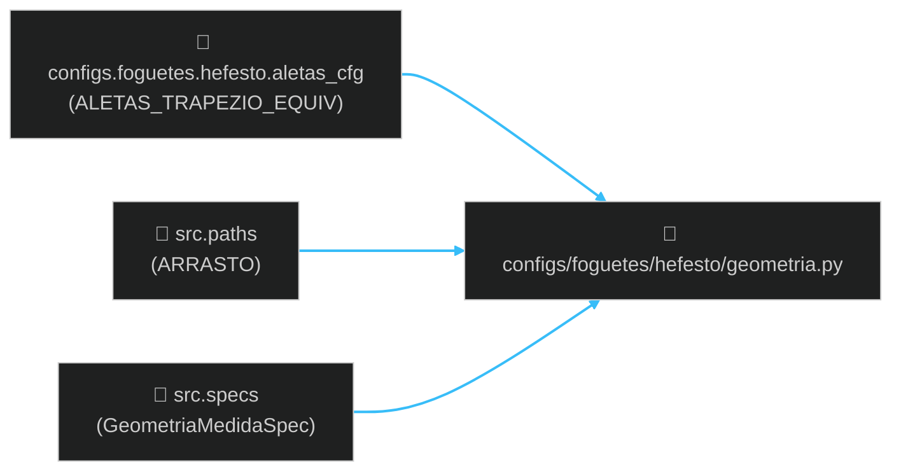

# ⚡ C4 Nível 4 (Código) — `configs/foguetes/hefesto/geometria.py`

> [!NOTE]
> **Gerado automaticamente a partir da AST do código-fonte e motor a2m.**
> Pela regra do modelo C4, o Nível 4 nunca é desenhado manualmente — ele reflete
> em tempo real as classes, funções, impacto e chamadas presentes em [`geometria.py`](../../../configs/foguetes/hefesto/geometria.py).

**Navegação na Hierarquia C4:**
[🌐 Nível 1: Contexto](../c1-contexto.md) · [📦 Nível 2: Containers](../c2-containers.md) · [🧩 C3: Pipeline de Execução & Voo](../c3-execucao-voo.md) · **⚡ Nível 4: `geometria.py`** · [📖 Guia de Visualização](../../../centralControle/GUIA_VISUALIZACAO.md)

---

## 1. Propósito do Módulo

Geometria medida / nominal do Hefesto (`modo='medido'`) e acessórios de acoplamento.

---

## 2. Fronteiras e Dependências do Arquivo

#### 🧭 Dependências Internas Navegáveis

| Dependência | Símbolos Importados | Documento C4 |
| :--- | :--- | :--- |
| `🧩 configs.foguetes.hefesto.aletas_cfg` | `ALETAS_TRAPEZIO_EQUIV` | [⚡ `configs__foguetes__hefesto__aletas_cfg.c4.md`](configs__foguetes__hefesto__aletas_cfg.c4.md) |
| `🧩 src.paths` | `ARRASTO` | [⚡ `src__paths.c4.md`](src__paths.c4.md) |
| `🧩 src.specs` | `GeometriaMedidaSpec` | [⚡ `src__specs.c4.md`](src__specs.c4.md) |

---

## 3. Catálogo de Símbolos (Links Diretos para o Código)
