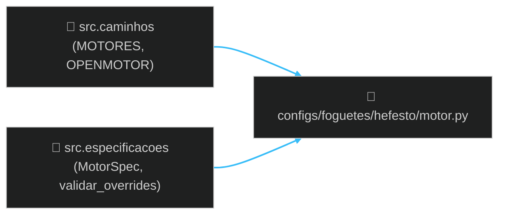
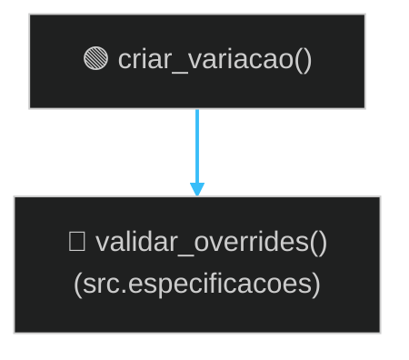

# ⚡ C4 Nível 4 (Código) — `configs/foguetes/hefesto/motor.py`

> [!NOTE]
> **Gerado automaticamente a partir da AST do código-fonte e motor a2m.**
> Pela regra do modelo C4, o Nível 4 nunca é desenhado manualmente — ele reflete
> em tempo real as classes, funções, impacto e chamadas presentes em [`motor.py`](../../../configs/foguetes/hefesto/motor.py).

**Navegação na Hierarquia C4:**
[🌐 Nível 1: Contexto](../c1-contexto.md) · [📦 Nível 2: Containers](../c2-containers.md) · [🧩 C3: Subsistema de Motor & Segurança](../c3-subsistema-motor.md) · **⚡ Nível 4: `motor.py`** · [📖 Guia de Visualização](../../../centralControle/GUIA_VISUALIZACAO.md)

---

## 1. Propósito do Módulo

Configuração declarativa e variações exploratórias do motor Medusa (IREC).

Zero I/O no import: o arquivo `.ric` e a curva `.eng` são apenas referenciados
aqui e lidos sob demanda dentro de `derivar_motor()`.

---

## 2. Fronteiras e Dependências do Arquivo

#### 🧭 Dependências Internas Navegáveis

| Dependência | Símbolos Importados | Documento C4 |
| :--- | :--- | :--- |
| `🧩 src.caminhos` | `MOTORES`, `OPENMOTOR` | [⚡ `src__caminhos.c4.md`](src__caminhos.c4.md) |
| `🧩 src.especificacoes` | `MotorSpec`, `validar_overrides` | [⚡ `src__especificacoes.c4.md`](src__especificacoes.c4.md) |

---

## 3. Fluxo Lógico de Funções Locais (`flowchart TD`)

#### 🧭 Chamadas Externas Identificadas

| Chamada Local | Módulo de Origem | Documento C4 |
| :--- | :--- | :--- |
| `🔗 validar_overrides()` | `src.especificacoes` | [⚡ `src__especificacoes.c4.md`](src__especificacoes.c4.md) |

---

## 4. Catálogo de Símbolos (Links Diretos para o Código)

### Funções do Módulo

| Função | Linhas | Retorno | Resumo |
| :--- | :--- | :--- | :--- |
| [`criar_variacao`](../../../configs/foguetes/hefesto/motor.py#L55-L67) | `L55–L67` | `MotorSpec` | Cria um `MotorSpec` do Hefesto com `overrides` validados contra `PARAMS_LIVRES`. |
