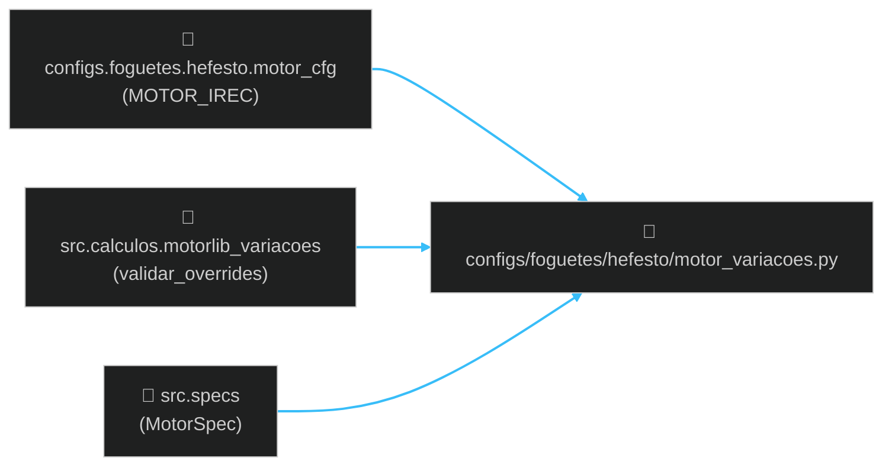
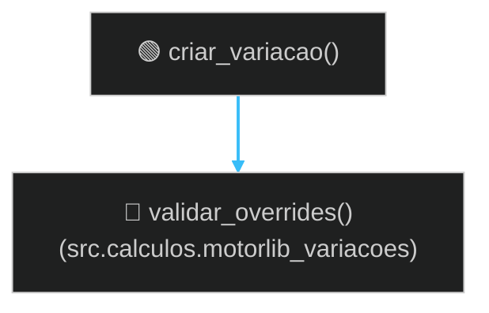

# ⚡ C4 Nível 4 (Código) — `configs/foguetes/hefesto/motor_variacoes.py`

> [!NOTE]
> **Gerado automaticamente a partir da AST do código-fonte e motor a2m.**
> Pela regra do modelo C4, o Nível 4 nunca é desenhado manualmente — ele reflete
> em tempo real as classes, funções, impacto e chamadas presentes em [`motor_variacoes.py`](../../../configs/foguetes/hefesto/motor_variacoes.py).

**Navegação na Hierarquia C4:**
[🌐 Nível 1: Contexto](../c1-contexto.md) · [📦 Nível 2: Containers](../c2-containers.md) · [🧩 C3: Subsistema de Motor & Segurança](../c3-subsistema-motor.md) · **⚡ Nível 4: `motor_variacoes.py`** · [📖 Guia de Visualização](../../../centralControle/GUIA_VISUALIZACAO.md)

---

## 1. Propósito do Módulo

Variações exploratórias do motor Medusa do Hefesto.

Separação:
  - `configs/foguetes/hefesto/motor.py` → motor OFICIAL (`MOTOR_IREC`)
  - este arquivo                        → presets e fábrica de variações (`VARIACOES`)

---

## 2. Fronteiras e Dependências do Arquivo

#### 🧭 Dependências Internas Navegáveis

| Dependência | Símbolos Importados | Documento C4 |
| :--- | :--- | :--- |
| `🧩 configs.foguetes.hefesto.motor_cfg` | `MOTOR_IREC` | [⚡ `configs__foguetes__hefesto__motor_cfg.c4.md`](configs__foguetes__hefesto__motor_cfg.c4.md) |
| `🧩 src.calculos.motorlib_variacoes` | `validar_overrides` | [⚡ `src__calculos__motorlib_variacoes.c4.md`](src__calculos__motorlib_variacoes.c4.md) |
| `🧩 src.specs` | `MotorSpec` | [⚡ `src__specs.c4.md`](src__specs.c4.md) |

---

## 3. Fluxo Lógico de Funções Locais (`flowchart TD`)

#### 🧭 Chamadas Externas Identificadas

| Chamada Local | Módulo de Origem | Documento C4 |
| :--- | :--- | :--- |
| `🔗 validar_overrides()` | `src.calculos.motorlib_variacoes` | [⚡ `src__calculos__motorlib_variacoes.c4.md`](src__calculos__motorlib_variacoes.c4.md) |

---

## 4. Catálogo de Símbolos (Links Diretos para o Código)

### Funções do Módulo

| Função | Linhas | Retorno | Resumo |
| :--- | :--- | :--- | :--- |
| [`criar_variacao`](../../../configs/foguetes/hefesto/motor_variacoes.py#L35-L47) | `L35–L47` | `MotorSpec` | Cria um `MotorSpec` do Hefesto com `overrides` validados contra `PARAMS_LIVRES`. |
