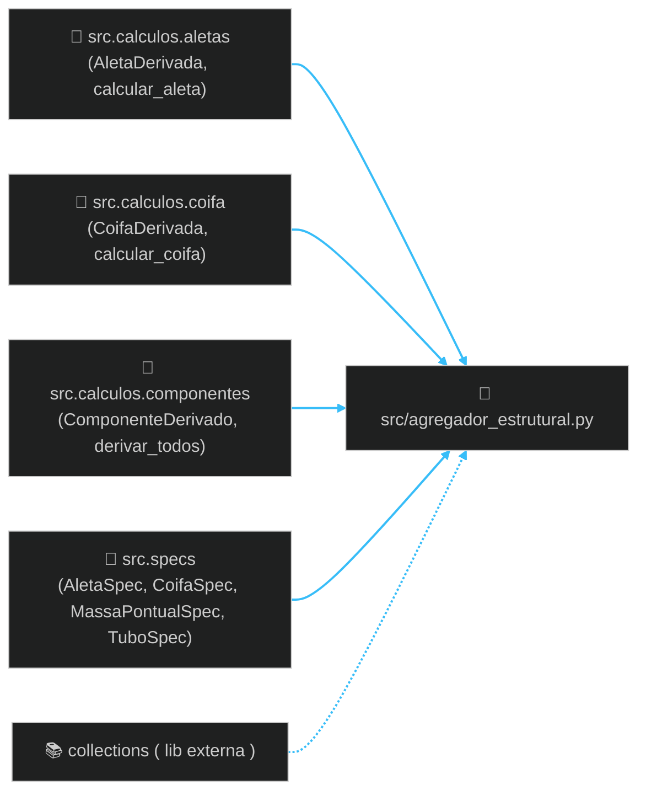
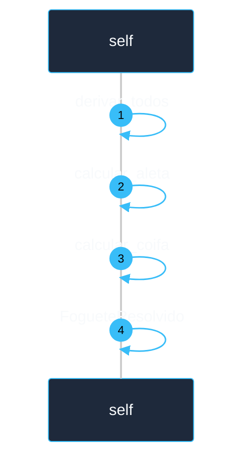
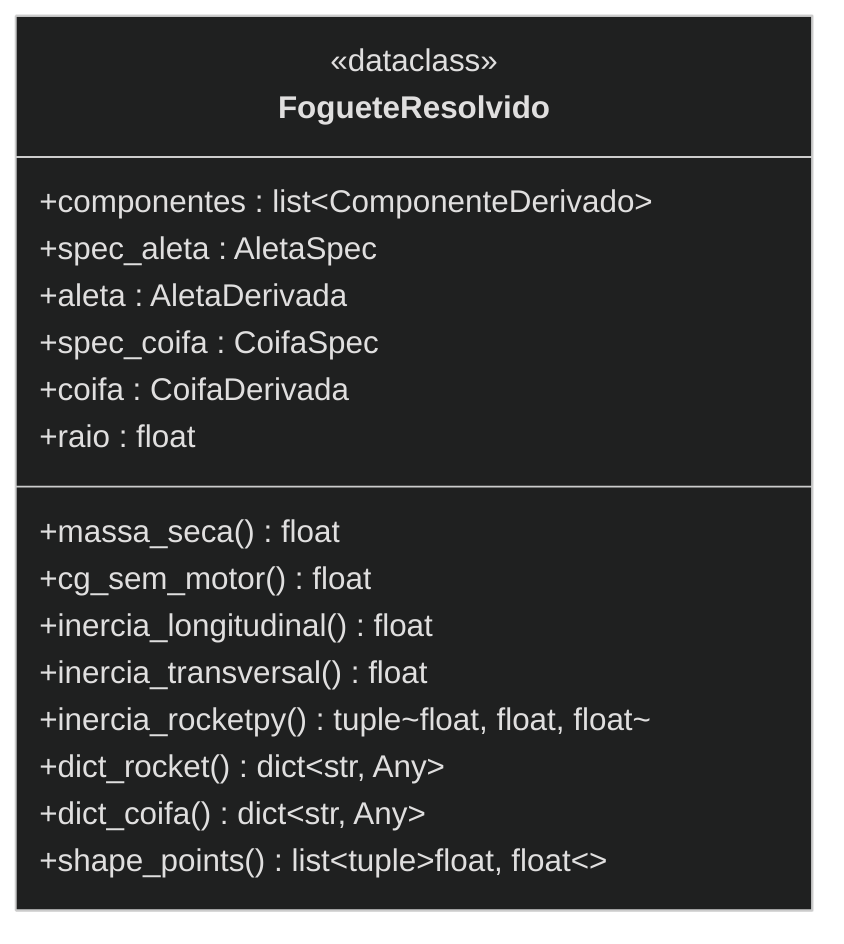
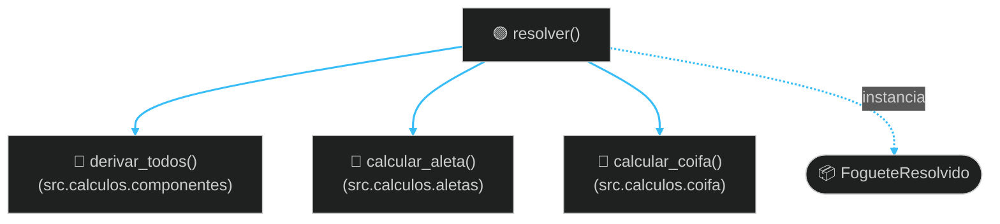

# ⚡ C4 Nível 4 (Código) — `src/agregador_estrutural.py`

> [!NOTE]
> **Gerado automaticamente a partir da AST do código-fonte e motor a2m.**
> Pela regra do modelo C4, o Nível 4 nunca é desenhado manualmente — ele reflete
> em tempo real as classes, funções, impacto e chamadas presentes em [`agregador_estrutural.py`](../../../src/agregador_estrutural.py).

**Navegação na Hierarquia C4:**
[🌐 Nível 1: Contexto](../c1-contexto.md) · [📦 Nível 2: Containers](../c2-containers.md) · [🧩 C3: Pipeline de Execução & Voo](../c3-execucao-voo.md) · **⚡ Nível 4: `agregador_estrutural.py`** · [📖 Guia de Visualização](../../../centralControle/GUIA_VISUALIZACAO.md)

---

## 1. Propósito do Módulo

Combina specs e derivados num `FogueteResolvido` (Modo Calculado).

Agrega massa seca, CG sem motor e momentos de inércia pelo Teorema de Steiner,
entregando a tupla de inércia na convenção exata do RocketPy:
`(I_11, I_22, I_33) = (I_transversal, I_transversal, I_longitudinal)`.

---

## 2. Fronteiras e Dependências do Arquivo

#### 🧭 Dependências Internas Navegáveis

| Dependência | Símbolos Importados | Documento C4 |
| :--- | :--- | :--- |
| `🧩 src.calculos.aletas` | `AletaDerivada`, `calcular_aleta` | [⚡ `src__calculos__aletas.c4.md`](src__calculos__aletas.c4.md) |
| `🧩 src.calculos.coifa` | `CoifaDerivada`, `calcular_coifa` | [⚡ `src__calculos__coifa.c4.md`](src__calculos__coifa.c4.md) |
| `🧩 src.calculos.componentes` | `ComponenteDerivado`, `derivar_todos` | [⚡ `src__calculos__componentes.c4.md`](src__calculos__componentes.c4.md) |
| `🧩 src.specs` | `AletaSpec`, `CoifaSpec`, `MassaPontualSpec`, `TuboSpec` | [⚡ `src__specs.c4.md`](src__specs.c4.md) |

---

## 3. Impacto Sistêmico e Fluxo de Execução

### Análise de Impacto Sistêmico (`a2m impact`)

> [!IMPORTANT]
> **Mapeamento de Efeito Cascata ao Modificar `resolver()`:**
> - **Risco de Quebra Ascendente (Vermelho):** Funções e módulos externos que chamam esta lógica.
> - **Impacto Descendente (Azul):** Rotinas internas e dependências consumidas.

```mermaid
%%{init: {'theme': 'dark', 'themeVariables': { 'lineColor': '#38bdf8' }}}%%
graph TD
    classDef target fill:#ffe6cc,stroke:#d79b00,stroke-width:3px,color:#000
    classDef upward fill:#f8cecc,stroke:#b85450,stroke-width:2px,color:#000
    classDef downward fill:#dae8fc,stroke:#6c8ebf,stroke-width:1px,color:#000

    ALVO(("⭐ resolver (ALVO)")):::target

    subgraph Ascendente["🚨 Risco de Quebra Ascendente (Quem consome esta função)"]
        code_construtor_foguete_py__function__build_rocket_H1ea3317b["⚠️ build_rocket"]:::upward
        code_inspecao_py__function__relatorio_estrutura_He96a1b3e["⚠️ relatorio_estrutura"]:::upward
    end
    code_construtor_foguete_py__function__build_rocket_H1ea3317b --> ALVO
    code_inspecao_py__function__relatorio_estrutura_He96a1b3e --> ALVO
    subgraph Descendente["🧩 Impacto Descendente (Dependências consumidas)"]
        code_calculos_coifa_py__function___derivada_perfil_H64171571["_derivada_perfil"]:::downward
        code_calculos_componentes_py__function__derivar_massa_pontual_Hc57edc66["derivar_massa_pontual"]:::downward
        code_calculos_coifa_py__struct__CoifaDerivada_Hbddc22b3["CoifaDerivada"]:::downward
        code_calculos_aletas_py__function___poligono_propriedades_H0e935ca3["_poligono_propriedades"]:::downward
        code_calculos_aletas_py__struct__AletaDerivada_Hb0df37dc["AletaDerivada"]:::downward
        code_calculos_componentes_py__function__derivar_Hc1b956ae["derivar"]:::downward
        code_calculos_componentes_py__function__derivar_todos_He22d6f33["derivar_todos"]:::downward
        code_calculos_coifa_py__function__perfil_H7f2f5d17["perfil"]:::downward
        code_calculos_coifa_py__function__calcular_coifa_H38e753ce["calcular_coifa"]:::downward
        code_agregador_estrutural_py__struct__FogueteResolvido_H86ab63ba["FogueteResolvido"]:::downward
        code_calculos_componentes_py__function__derivar_tubo_Ha328cfd9["derivar_tubo"]:::downward
        code_calculos_aletas_py__function__calcular_aleta_H300af0c8["calcular_aleta"]:::downward
        extern_math__sqrt_H86ccf542["sqrt"]:::downward
    end
    ALVO --> code_agregador_estrutural_py__struct__FogueteResolvido_H86ab63ba
    ALVO --> code_calculos_aletas_py__function__calcular_aleta_H300af0c8
    ALVO --> code_calculos_coifa_py__function__calcular_coifa_H38e753ce
    ALVO --> code_calculos_componentes_py__function__derivar_todos_He22d6f33
    code_calculos_aletas_py__function__calcular_aleta_H300af0c8 --> code_calculos_aletas_py__function___poligono_propriedades_H0e935ca3
    code_calculos_aletas_py__function__calcular_aleta_H300af0c8 --> code_calculos_aletas_py__struct__AletaDerivada_Hb0df37dc
    code_calculos_coifa_py__function___derivada_perfil_H64171571 --> code_calculos_coifa_py__function__perfil_H7f2f5d17
    code_calculos_coifa_py__function__calcular_coifa_H38e753ce --> code_calculos_coifa_py__function___derivada_perfil_H64171571
    code_calculos_coifa_py__function__calcular_coifa_H38e753ce --> code_calculos_coifa_py__function__perfil_H7f2f5d17
    code_calculos_coifa_py__function__calcular_coifa_H38e753ce --> code_calculos_coifa_py__struct__CoifaDerivada_Hbddc22b3
    code_calculos_coifa_py__function__calcular_coifa_H38e753ce --> extern_math__sqrt_H86ccf542
    code_calculos_componentes_py__function__derivar_Hc1b956ae --> code_calculos_componentes_py__function__derivar_massa_pontual_Hc57edc66
    code_calculos_componentes_py__function__derivar_Hc1b956ae --> code_calculos_componentes_py__function__derivar_tubo_Ha328cfd9
    code_calculos_componentes_py__function__derivar_todos_He22d6f33 --> code_calculos_componentes_py__function__derivar_Hc1b956ae
    click code_calculos_aletas_py__function___poligono_propriedades_H0e935ca3 href "src__calculos__aletas.c4.md" "Abrir C4 (_poligono_propriedades)"
    click code_calculos_aletas_py__function__calcular_aleta_H300af0c8 href "src__calculos__aletas.c4.md" "Abrir C4 (calcular_aleta)"
    click code_calculos_aletas_py__struct__AletaDerivada_Hb0df37dc href "src__calculos__aletas.c4.md" "Abrir C4 (AletaDerivada)"
    click code_calculos_coifa_py__function___derivada_perfil_H64171571 href "src__calculos__coifa.c4.md" "Abrir C4 (_derivada_perfil)"
    click code_calculos_coifa_py__function__calcular_coifa_H38e753ce href "src__calculos__coifa.c4.md" "Abrir C4 (calcular_coifa)"
    click code_calculos_coifa_py__function__perfil_H7f2f5d17 href "src__calculos__coifa.c4.md" "Abrir C4 (perfil)"
    click code_calculos_coifa_py__struct__CoifaDerivada_Hbddc22b3 href "src__calculos__coifa.c4.md" "Abrir C4 (CoifaDerivada)"
    click code_calculos_componentes_py__function__derivar_Hc1b956ae href "src__calculos__componentes.c4.md" "Abrir C4 (derivar)"
    click code_calculos_componentes_py__function__derivar_massa_pontual_Hc57edc66 href "src__calculos__componentes.c4.md" "Abrir C4 (derivar_massa_pontual)"
    click code_calculos_componentes_py__function__derivar_todos_He22d6f33 href "src__calculos__componentes.c4.md" "Abrir C4 (derivar_todos)"
    click code_calculos_componentes_py__function__derivar_tubo_Ha328cfd9 href "src__calculos__componentes.c4.md" "Abrir C4 (derivar_tubo)"
    click code_construtor_foguete_py__function__build_rocket_H1ea3317b href "src__construtor_foguete.c4.md" "Abrir C4 (build_rocket)"
    click code_inspecao_py__function__relatorio_estrutura_He96a1b3e href "src__inspecao.c4.md" "Abrir C4 (relatorio_estrutura)"
    linkStyle default stroke:#38bdf8,stroke-width:2px;
```

#### 🧭 Atalhos Rápidos de Navegação (Impacto Sistêmico)

| Relação | Símbolo / Função | Arquivo C4 Destino |
| :--- | :--- | :--- |
| 🧩 Impacto Descendente (Callee) | `_poligono_propriedades` | [⚡ `src__calculos__aletas.c4.md`](src__calculos__aletas.c4.md) |
| 🧩 Impacto Descendente (Callee) | `calcular_aleta` | [⚡ `src__calculos__aletas.c4.md`](src__calculos__aletas.c4.md) |
| 🧩 Impacto Descendente (Callee) | `AletaDerivada` | [⚡ `src__calculos__aletas.c4.md`](src__calculos__aletas.c4.md) |
| 🧩 Impacto Descendente (Callee) | `_derivada_perfil` | [⚡ `src__calculos__coifa.c4.md`](src__calculos__coifa.c4.md) |
| 🧩 Impacto Descendente (Callee) | `calcular_coifa` | [⚡ `src__calculos__coifa.c4.md`](src__calculos__coifa.c4.md) |
| 🧩 Impacto Descendente (Callee) | `perfil` | [⚡ `src__calculos__coifa.c4.md`](src__calculos__coifa.c4.md) |
| 🧩 Impacto Descendente (Callee) | `CoifaDerivada` | [⚡ `src__calculos__coifa.c4.md`](src__calculos__coifa.c4.md) |
| 🧩 Impacto Descendente (Callee) | `derivar` | [⚡ `src__calculos__componentes.c4.md`](src__calculos__componentes.c4.md) |
| 🧩 Impacto Descendente (Callee) | `derivar_massa_pontual` | [⚡ `src__calculos__componentes.c4.md`](src__calculos__componentes.c4.md) |
| 🧩 Impacto Descendente (Callee) | `derivar_todos` | [⚡ `src__calculos__componentes.c4.md`](src__calculos__componentes.c4.md) |
| 🧩 Impacto Descendente (Callee) | `derivar_tubo` | [⚡ `src__calculos__componentes.c4.md`](src__calculos__componentes.c4.md) |
| 🚨 Risco Ascendente (Caller) | `build_rocket` | [⚡ `src__construtor_foguete.c4.md`](src__construtor_foguete.c4.md) |
| 🚨 Risco Ascendente (Caller) | `relatorio_estrutura` | [⚡ `src__inspecao.c4.md`](src__inspecao.c4.md) |

### Diagrama de Sequência de Execução — `resolver()` (`sequenceDiagram`)

> [!NOTE]
> Mostra o fluxo sequencial real de controle de execução da função,
> incluindo condicionais (`alt ... else`) e laços (`loop`).

---

## 4. Estrutura de Classes e Contratos (`classDiagram`)

---

## 5. Fluxo Lógico de Funções Locais (`flowchart TD`)

#### 🧭 Chamadas Externas Identificadas

| Chamada Local | Módulo de Origem | Documento C4 |
| :--- | :--- | :--- |
| `🔗 derivar_todos()` | `src.calculos.componentes` | [⚡ `src__calculos__componentes.c4.md`](src__calculos__componentes.c4.md) |
| `🔗 calcular_aleta()` | `src.calculos.aletas` | [⚡ `src__calculos__aletas.c4.md`](src__calculos__aletas.c4.md) |
| `🔗 calcular_coifa()` | `src.calculos.coifa` | [⚡ `src__calculos__coifa.c4.md`](src__calculos__coifa.c4.md) |

---

## 6. Catálogo de Símbolos (Links Diretos para o Código)

### Classes / Contratos

| Classe | Linhas | Tipo | Resumo |
| :--- | :--- | :--- | :--- |
| [`FogueteResolvido`](../../../src/agregador_estrutural.py#L21-L102) | `L21–L102` | `@dataclass` | Parâmetros estruturais resolvidos analiticamente (`modo='calculado'`). |

### Funções do Módulo

| Função | Linhas | Retorno | Resumo |
| :--- | :--- | :--- | :--- |
| [`resolver`](../../../src/agregador_estrutural.py#L105-L122) | `L105–L122` | `FogueteResolvido` | Combina componentes + coifa + aleta num `FogueteResolvido`. |
