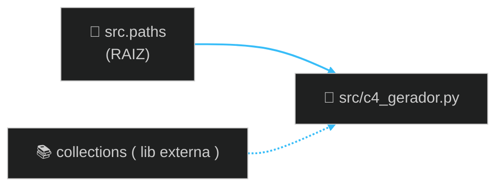
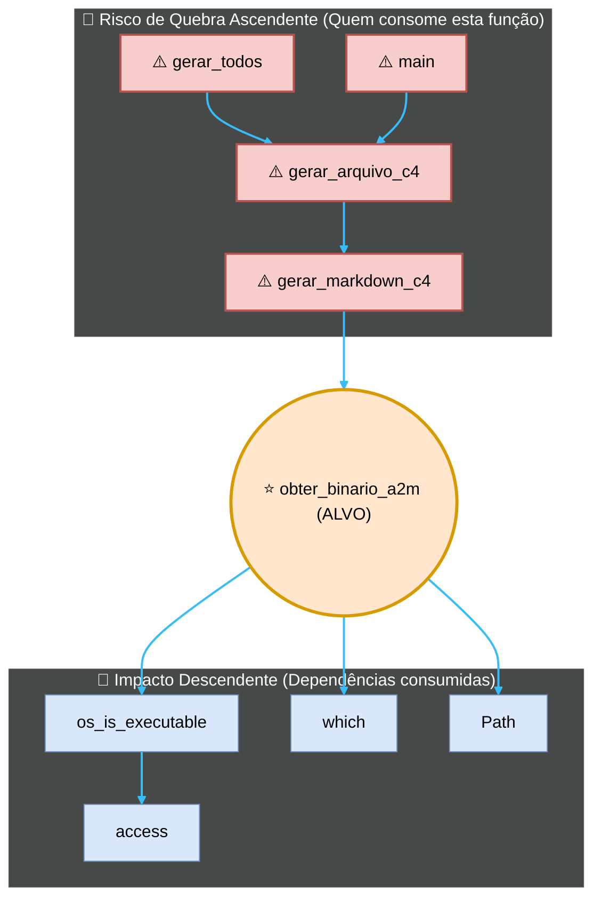
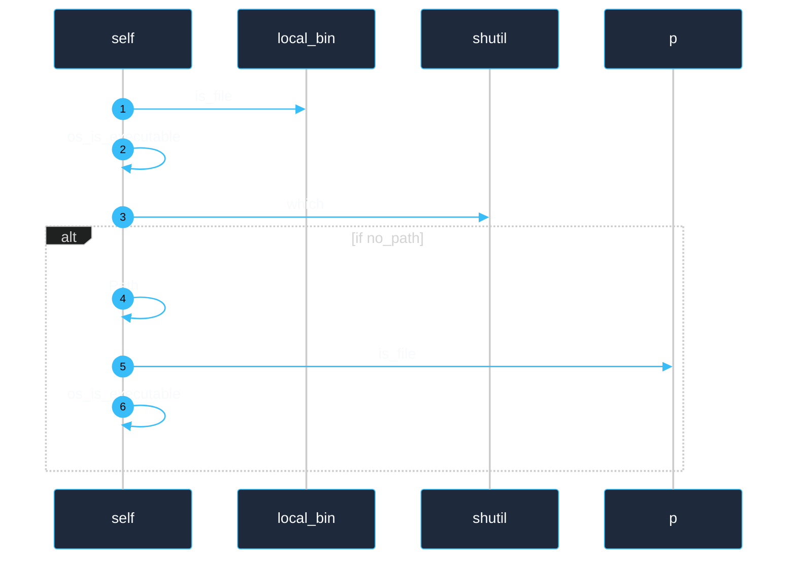
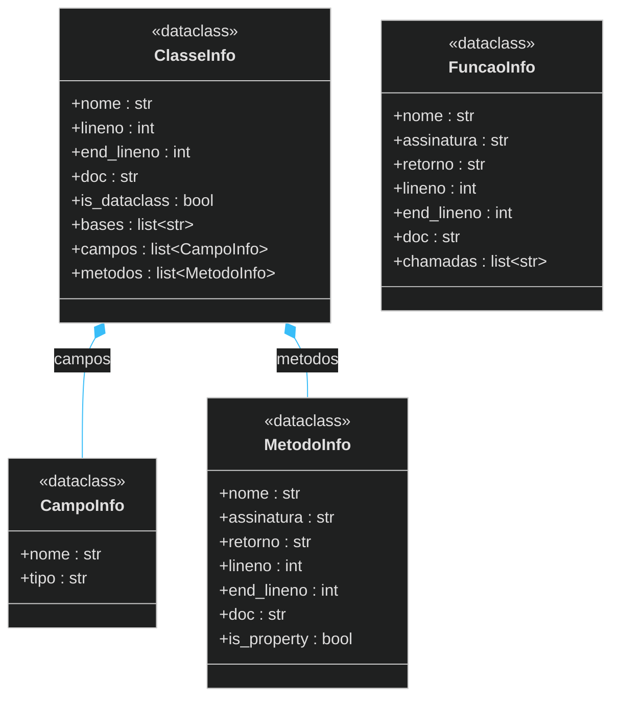
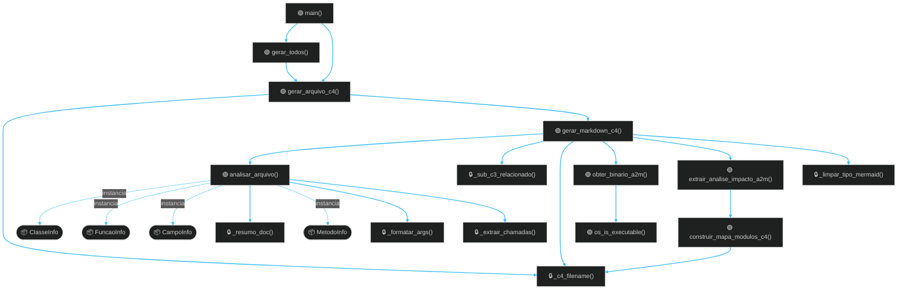

# ⚡ C4 Nível 4 (Código) — `src/c4_gerador.py`

> [!NOTE]
> **Gerado automaticamente a partir da AST do código-fonte e motor a2m.**
> Pela regra do modelo C4, o Nível 4 nunca é desenhado manualmente — ele reflete
> em tempo real as classes, funções, impacto e chamadas presentes em [`c4_gerador.py`](../../../src/c4_gerador.py).

**Navegação na Hierarquia C4:**
[🌐 Nível 1: Contexto](../c1-contexto.md) · [📦 Nível 2: Containers](../c2-containers.md) · [🧩 C3: Pipeline de Execução & Voo](../c3-execucao-voo.md) · **⚡ Nível 4: `c4_gerador.py`** · [📖 Guia de Visualização](../../../centralControle/GUIA_VISUALIZACAO.md)

---

## 1. Propósito do Módulo

Gerador automático de diagramas C4 Nível 4 (Código) via AST e motor a2m.

Regra fundamental do modelo C4 aplicada ao Hefesto:
- Níveis 1 (Contexto), 2 (Containers) e 3 (Componentes) são curados em
  `docs/arquitetura/`.
- O Nível 4 (Código) NUNCA é desenhado à mão: este módulo inspeciona a árvore
  sintática abstrata (AST) de qualquer arquivo `.py` sob demanda e enriquece
  com o motor `a2m` (quando disponível) para gerar um documento Markdown + Mermaid com:
    1. Fronteiras e dependências do arquivo (`flowchart LR`)
    2. Análise de Impacto Sistêmico (Quem consome vs. O que consome)
    3. Diagrama de Sequência de Execução (`sequenceDiagram` com loops/ifs)
    4. Diagrama de classes e contratos `@dataclass` (`classDiagram`)
    5. Grafo de chamadas entre funções do módulo (`flowchart TD`)
    6. Catálogo de símbolos com links diretos para as linhas do código-fonte

Uso via CLI:
    python -m src.c4_gerador src/calculos/motor.py
    python -m src.c4_gerador --todos

---

## 2. Fronteiras e Dependências do Arquivo

#### 🧭 Dependências Internas Navegáveis

| Dependência | Símbolos Importados | Documento C4 |
| :--- | :--- | :--- |
| `🧩 src.paths` | `RAIZ` | [⚡ `src__paths.c4.md`](src__paths.c4.md) |

---

## 3. Impacto Sistêmico e Fluxo de Execução

### Análise de Impacto Sistêmico (`a2m impact`)

> [!IMPORTANT]
> **Mapeamento de Efeito Cascata ao Modificar `obter_binario_a2m()`:**
> - **Risco de Quebra Ascendente (Vermelho):** Funções e módulos externos que chamam esta lógica.
> - **Impacto Descendente (Azul):** Rotinas internas e dependências consumidas.

### Diagrama de Sequência de Execução — `obter_binario_a2m()` (`sequenceDiagram`)

> [!NOTE]
> Mostra o fluxo sequencial real de controle de execução da função,
> incluindo condicionais (`alt ... else`) e laços (`loop`).

---

## 4. Estrutura de Classes e Contratos (`classDiagram`)

---

## 5. Fluxo Lógico de Funções Locais (`flowchart TD`)

---

## 6. Catálogo de Símbolos (Links Diretos para o Código)

### Classes / Contratos

| Classe | Linhas | Tipo | Resumo |
| :--- | :--- | :--- | :--- |
| [`CampoInfo`](../../../src/c4_gerador.py#L65-L67) | `L65–L67` | `@dataclass` | — |
| [`MetodoInfo`](../../../src/c4_gerador.py#L71-L78) | `L71–L78` | `@dataclass` | — |
| [`ClasseInfo`](../../../src/c4_gerador.py#L82-L90) | `L82–L90` | `@dataclass` | — |
| [`FuncaoInfo`](../../../src/c4_gerador.py#L94-L101) | `L94–L101` | `@dataclass` | — |

### Funções do Módulo

| Função | Linhas | Retorno | Resumo |
| :--- | :--- | :--- | :--- |
| [`obter_binario_a2m`](../../../src/c4_gerador.py#L104-L114) | `L104–L114` | `Path | None` | Localiza o binário `a2m` em `centralControle/bin/a2m` ou no PATH do sistema. |
| [`os_is_executable`](../../../src/c4_gerador.py#L117-L119) | `L117–L119` | `bool` | — |
| [`_limpar_tipo_mermaid`](../../../src/c4_gerador.py#L122-L129) | `L122–L129` | `str` | Converte anotações de tipo Python para sintaxe segura no `classDiagram` do Mermaid. |
| [`_resumo_doc`](../../../src/c4_gerador.py#L132-L135) | `L132–L135` | `str` | — |
| [`_formatar_args`](../../../src/c4_gerador.py#L138-L157) | `L138–L157` | `str` | — |
| [`_extrair_chamadas`](../../../src/c4_gerador.py#L160-L174) | `L160–L174` | `list[str]` | Extrai nomes de funções/métodos chamados diretamente no corpo de uma função. |
| [`_c4_filename`](../../../src/c4_gerador.py#L177-L187) | `L177–L187` | `str` | Calcula o nome do arquivo .c4.md correspondente a um caminho relativo. |
| [`construir_mapa_modulos_c4`](../../../src/c4_gerador.py#L190-L218) | `L190–L218` | `dict[str, str]` | Mapeia prefixos do a2m (ex.: 'inspecao_py', 'calculos_motor_py') para seus arquivos C4. |
| [`analisar_arquivo`](../../../src/c4_gerador.py#L221-L322) | `L221–L322` | `tuple[str, dict[str, list[str]], list[str], list[ClasseInfo], list[FuncaoInfo]]` | Analisa a AST de `caminho` e retorna (docstring, imports_internos, imports_externos, classes, funcoes). |
| [`_sub_c3_relacionado`](../../../src/c4_gerador.py#L325-L329) | `L325–L329` | `tuple[str, str]` | Retorna (titulo, caminho_relativo_em_docs_arquitetura) do C3 mais próximo. |
| [`extrair_analise_impacto_a2m`](../../../src/c4_gerador.py#L332-L518) | `L332–L518` | `tuple[list[str], list[str]]` | Gera o diagrama de impacto estruturado (Ascendente/Descendente) e a sequência via a2m. |
| [`gerar_markdown_c4`](../../../src/c4_gerador.py#L521-L772) | `L521–L772` | `str` | Gera o conteúdo Markdown completo de C4 Nível 4 (Código) para `caminho_py`. |
| [`gerar_arquivo_c4`](../../../src/c4_gerador.py#L775-L788) | `L775–L788` | `Path` | Gera e salva o arquivo `.md` de Nível 4 em `docs/arquitetura/_gerados_c4/`. |
| [`gerar_todos`](../../../src/c4_gerador.py#L791-L811) | `L791–L811` | `list[Path]` | Gera a documentação C4 Nível 4 para todos os módulos `.py` de `src/`, `centralControle/` e `configs/`. |
| [`main`](../../../src/c4_gerador.py#L814-L827) | `L814–L827` | `None` | — |
