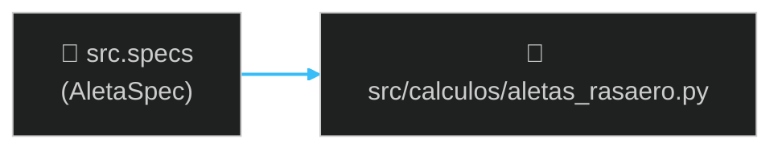
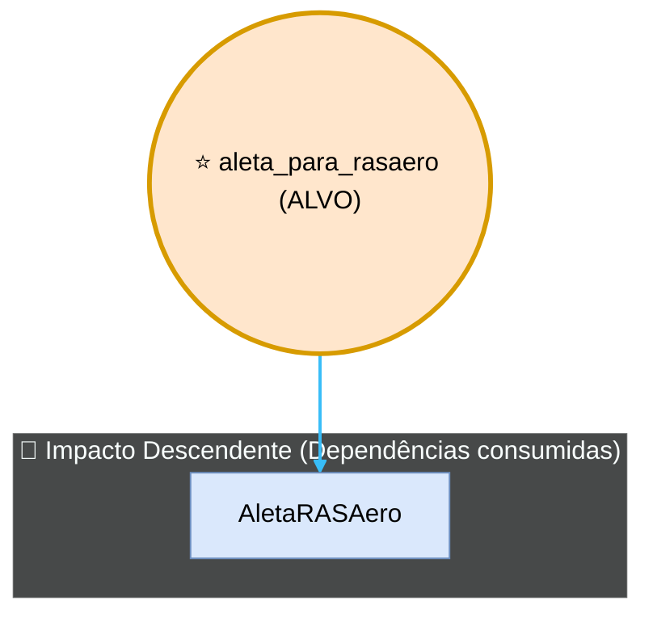
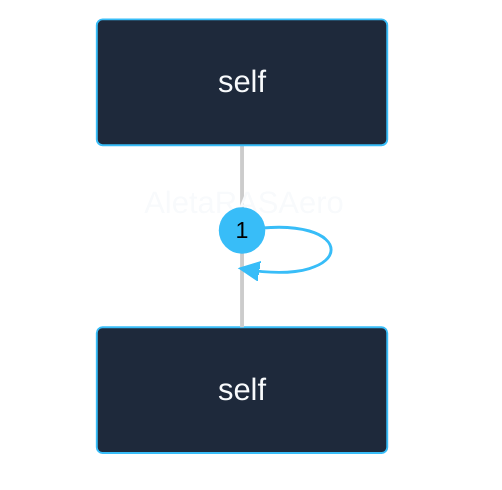
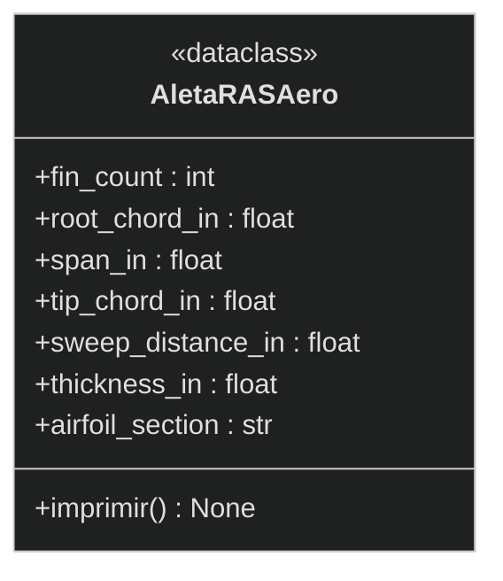
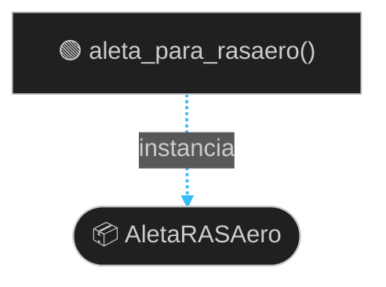

# ⚡ C4 Nível 4 (Código) — `src/calculos/aletas_rasaero.py`

> [!NOTE]
> **Gerado automaticamente a partir da AST do código-fonte e motor a2m.**
> Pela regra do modelo C4, o Nível 4 nunca é desenhado manualmente — ele reflete
> em tempo real as classes, funções, impacto e chamadas presentes em [`aletas_rasaero.py`](../../../src/calculos/aletas_rasaero.py).

**Navegação na Hierarquia C4:**
[🌐 Nível 1: Contexto](../c1-contexto.md) · [📦 Nível 2: Containers](../c2-containers.md) · [🧩 C3: Pipeline de Execução & Voo](../c3-execucao-voo.md) · **⚡ Nível 4: `aletas_rasaero.py`** · [📖 Guia de Visualização](../../../centralControle/GUIA_VISUALIZACAO.md)

---

## 1. Propósito do Módulo

Converte `AletaSpec` (SI) para o formato do RASAero II (polegadas).

---

## 2. Fronteiras e Dependências do Arquivo

#### 🧭 Dependências Internas Navegáveis

| Dependência | Símbolos Importados | Documento C4 |
| :--- | :--- | :--- |
| `🧩 src.specs` | `AletaSpec` | [⚡ `src__specs.c4.md`](src__specs.c4.md) |

---

## 3. Impacto Sistêmico e Fluxo de Execução

### Análise de Impacto Sistêmico (`a2m impact`)

> [!IMPORTANT]
> **Mapeamento de Efeito Cascata ao Modificar `aleta_para_rasaero()`:**
> - **Risco de Quebra Ascendente (Vermelho):** Funções e módulos externos que chamam esta lógica.
> - **Impacto Descendente (Azul):** Rotinas internas e dependências consumidas.

### Diagrama de Sequência de Execução — `aleta_para_rasaero()` (`sequenceDiagram`)

> [!NOTE]
> Mostra o fluxo sequencial real de controle de execução da função,
> incluindo condicionais (`alt ... else`) e laços (`loop`).

---

## 4. Estrutura de Classes e Contratos (`classDiagram`)

---

## 5. Fluxo Lógico de Funções Locais (`flowchart TD`)

---

## 6. Catálogo de Símbolos (Links Diretos para o Código)

### Classes / Contratos

| Classe | Linhas | Tipo | Resumo |
| :--- | :--- | :--- | :--- |
| [`AletaRASAero`](../../../src/calculos/aletas_rasaero.py#L13-L30) | `L13–L30` | `@dataclass` | Campos de aleta prontos para inserção no RASAero II GUI. |

### Funções do Módulo

| Função | Linhas | Retorno | Resumo |
| :--- | :--- | :--- | :--- |
| [`aleta_para_rasaero`](../../../src/calculos/aletas_rasaero.py#L33-L55) | `L33–L55` | `AletaRASAero` | Converte `AletaSpec` (SI) para formato RASAero (polegadas). |
