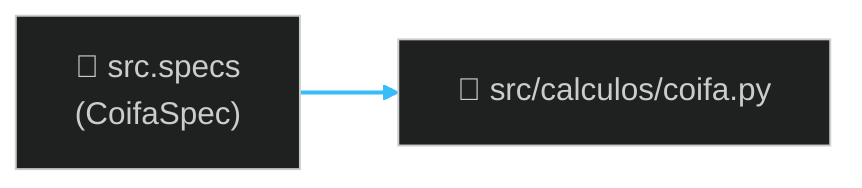
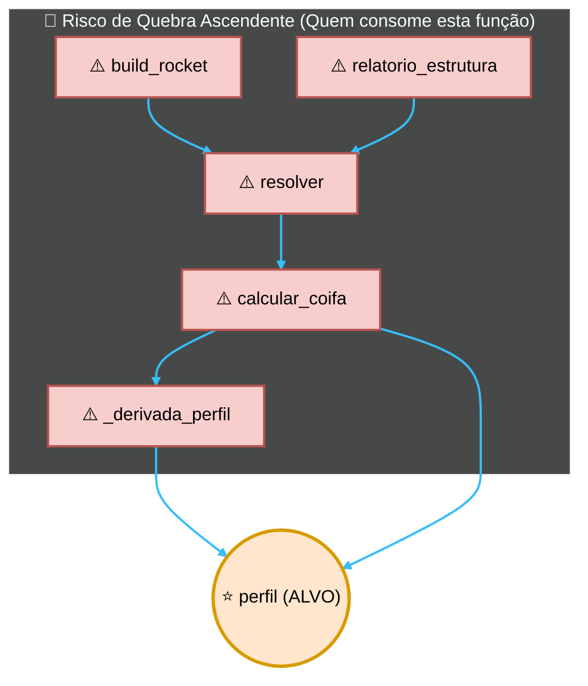
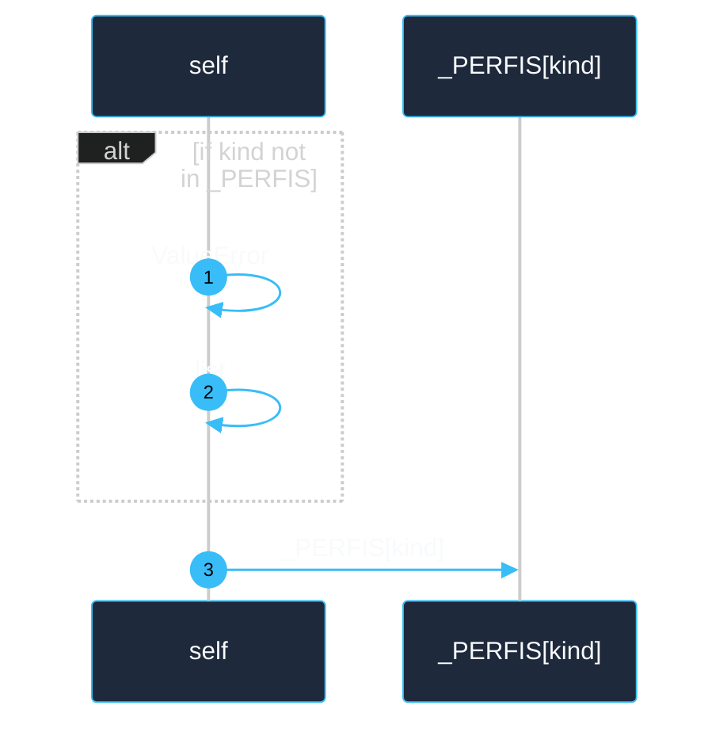
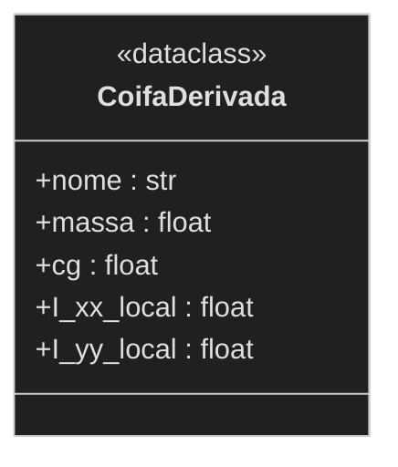
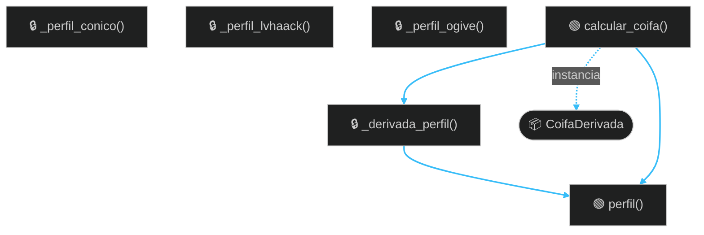

# ⚡ C4 Nível 4 (Código) — `src/calculos/coifa.py`

> [!NOTE]
> **Gerado automaticamente a partir da AST do código-fonte e motor a2m.**
> Pela regra do modelo C4, o Nível 4 nunca é desenhado manualmente — ele reflete
> em tempo real as classes, funções, impacto e chamadas presentes em [`coifa.py`](../../../src/calculos/coifa.py).

**Navegação na Hierarquia C4:**
[🌐 Nível 1: Contexto](../c1-contexto.md) · [📦 Nível 2: Containers](../c2-containers.md) · [🧩 C3: Pipeline de Execução & Voo](../c3-execucao-voo.md) · **⚡ Nível 4: `coifa.py`** · [📖 Guia de Visualização](../../../centralControle/GUIA_VISUALIZACAO.md)

---

## 1. Propósito do Módulo

Deriva massa, CG e inércia de uma `CoifaSpec` por integração numérica.

A coifa é tratada como uma casca fina (t << L) de espessura constante sobre
o perfil `r(x)` do formato escolhido (`x=0` no bico, `x=L` na base).

---

## 2. Fronteiras e Dependências do Arquivo

#### 🧭 Dependências Internas Navegáveis

| Dependência | Símbolos Importados | Documento C4 |
| :--- | :--- | :--- |
| `🧩 src.specs` | `CoifaSpec` | [⚡ `src__specs.c4.md`](src__specs.c4.md) |

---

## 3. Impacto Sistêmico e Fluxo de Execução

### Análise de Impacto Sistêmico (`a2m impact`)

> [!IMPORTANT]
> **Mapeamento de Efeito Cascata ao Modificar `perfil()`:**
> - **Risco de Quebra Ascendente (Vermelho):** Funções e módulos externos que chamam esta lógica.
> - **Impacto Descendente (Azul):** Rotinas internas e dependências consumidas.

#### 🧭 Atalhos Rápidos de Navegação (Impacto Sistêmico)

| Relação | Símbolo / Função | Arquivo C4 Destino |
| :--- | :--- | :--- |
| 🚨 Risco Ascendente (Caller) | `resolver` | [⚡ `src__agregador_estrutural.c4.md`](src__agregador_estrutural.c4.md) |
| 🚨 Risco Ascendente (Caller) | `build_rocket` | [⚡ `src__construtor_foguete.c4.md`](src__construtor_foguete.c4.md) |
| 🚨 Risco Ascendente (Caller) | `relatorio_estrutura` | [⚡ `src__inspecao.c4.md`](src__inspecao.c4.md) |

### Diagrama de Sequência de Execução — `perfil()` (`sequenceDiagram`)

> [!NOTE]
> Mostra o fluxo sequencial real de controle de execução da função,
> incluindo condicionais (`alt ... else`) e laços (`loop`).

---

## 4. Estrutura de Classes e Contratos (`classDiagram`)

---

## 5. Fluxo Lógico de Funções Locais (`flowchart TD`)

---

## 6. Catálogo de Símbolos (Links Diretos para o Código)

### Classes / Contratos

| Classe | Linhas | Tipo | Resumo |
| :--- | :--- | :--- | :--- |
| [`CoifaDerivada`](../../../src/calculos/coifa.py#L55-L60) | `L55–L60` | `@dataclass` | — |

### Funções do Módulo

| Função | Linhas | Retorno | Resumo |
| :--- | :--- | :--- | :--- |
| [`_perfil_conico`](../../../src/calculos/coifa.py#L15-L16) | `L15–L16` | `float` | — |
| [`_perfil_lvhaack`](../../../src/calculos/coifa.py#L19-L25) | `L19–L25` | `float` | LV-Haack (von Kármán quando C=0). |
| [`_perfil_ogive`](../../../src/calculos/coifa.py#L28-L32) | `L28–L32` | `float` | Ogiva tangente: ρ = (R² + L²) / (2R). |
| [`perfil`](../../../src/calculos/coifa.py#L42-L45) | `L42–L45` | `float` | — |
| [`_derivada_perfil`](../../../src/calculos/coifa.py#L48-L51) | `L48–L51` | `float` | — |
| [`calcular_coifa`](../../../src/calculos/coifa.py#L63-L116) | `L63–L116` | `CoifaDerivada` | Integra massa e inércia da casca ao longo do perfil axial. |
