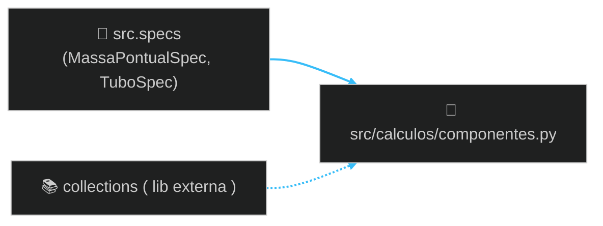
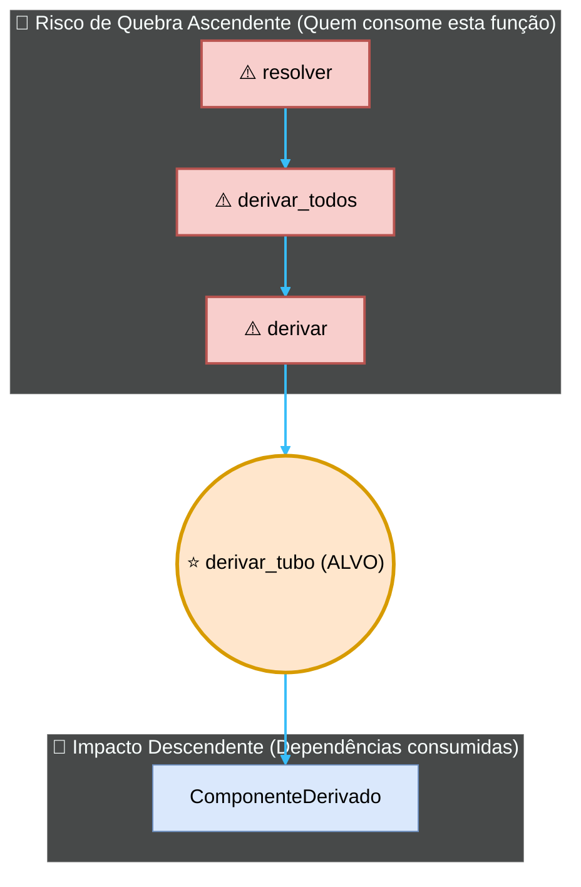
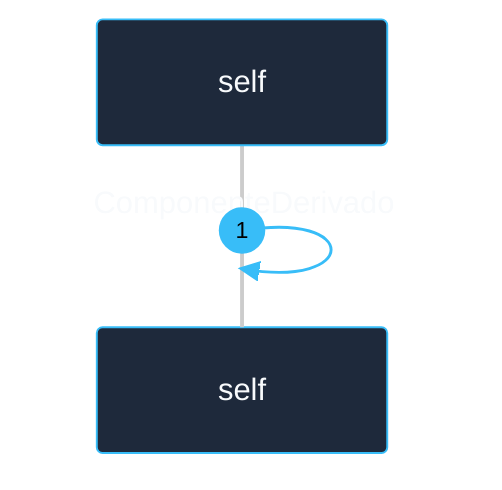
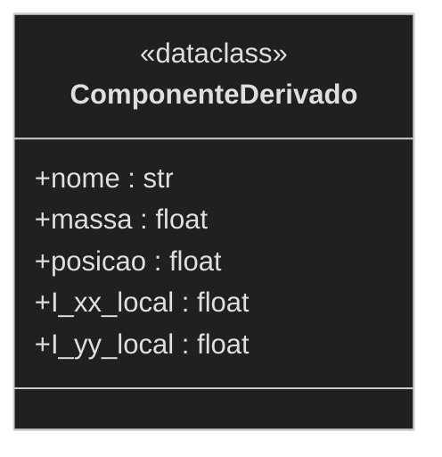
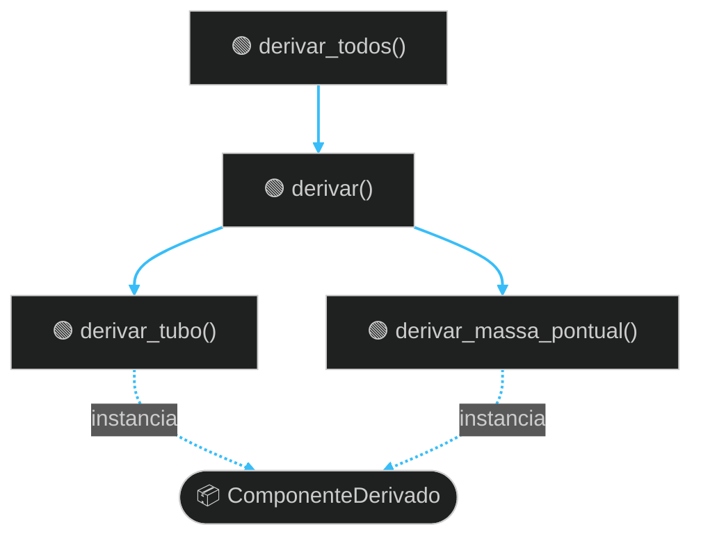

# ⚡ C4 Nível 4 (Código) — `src/calculos/componentes.py`

> [!NOTE]
> **Gerado automaticamente a partir da AST do código-fonte e motor a2m.**
> Pela regra do modelo C4, o Nível 4 nunca é desenhado manualmente — ele reflete
> em tempo real as classes, funções, impacto e chamadas presentes em [`componentes.py`](../../../src/calculos/componentes.py).

**Navegação na Hierarquia C4:**
[🌐 Nível 1: Contexto](../c1-contexto.md) · [📦 Nível 2: Containers](../c2-containers.md) · [🧩 C3: Pipeline de Execução & Voo](../c3-execucao-voo.md) · **⚡ Nível 4: `componentes.py`** · [📖 Guia de Visualização](../../../centralControle/GUIA_VISUALIZACAO.md)

---

## 1. Propósito do Módulo

Deriva massa e inércia dos componentes estruturais a partir de suas Specs.

Cada `TuboSpec` ou `MassaPontualSpec` é traduzida num `ComponenteDerivado`
com massa, posição axial e inércias locais (longitudinal/roll e transversal).

---

## 2. Fronteiras e Dependências do Arquivo

#### 🧭 Dependências Internas Navegáveis

| Dependência | Símbolos Importados | Documento C4 |
| :--- | :--- | :--- |
| `🧩 src.specs` | `MassaPontualSpec`, `TuboSpec` | [⚡ `src__specs.c4.md`](src__specs.c4.md) |

---

## 3. Impacto Sistêmico e Fluxo de Execução

### Análise de Impacto Sistêmico (`a2m impact`)

> [!IMPORTANT]
> **Mapeamento de Efeito Cascata ao Modificar `derivar_tubo()`:**
> - **Risco de Quebra Ascendente (Vermelho):** Funções e módulos externos que chamam esta lógica.
> - **Impacto Descendente (Azul):** Rotinas internas e dependências consumidas.

#### 🧭 Atalhos Rápidos de Navegação (Impacto Sistêmico)

| Relação | Símbolo / Função | Arquivo C4 Destino |
| :--- | :--- | :--- |
| 🚨 Risco Ascendente (Caller) | `resolver` | [⚡ `src__agregador_estrutural.c4.md`](src__agregador_estrutural.c4.md) |

### Diagrama de Sequência de Execução — `derivar_tubo()` (`sequenceDiagram`)

> [!NOTE]
> Mostra o fluxo sequencial real de controle de execução da função,
> incluindo condicionais (`alt ... else`) e laços (`loop`).

---

## 4. Estrutura de Classes e Contratos (`classDiagram`)

---

## 5. Fluxo Lógico de Funções Locais (`flowchart TD`)

---

## 6. Catálogo de Símbolos (Links Diretos para o Código)

### Classes / Contratos

| Classe | Linhas | Tipo | Resumo |
| :--- | :--- | :--- | :--- |
| [`ComponenteDerivado`](../../../src/calculos/componentes.py#L17-L22) | `L17–L22` | `@dataclass` | — |

### Funções do Módulo

| Função | Linhas | Retorno | Resumo |
| :--- | :--- | :--- | :--- |
| [`derivar_tubo`](../../../src/calculos/componentes.py#L25-L41) | `L25–L41` | `ComponenteDerivado` | Cilindro oco. Fórmulas padrão para casca cilíndrica. |
| [`derivar_massa_pontual`](../../../src/calculos/componentes.py#L44-L59) | `L44–L59` | `ComponenteDerivado` | Massa fixa com geometria cilíndrica equivalente para inércia local. |
| [`derivar`](../../../src/calculos/componentes.py#L62-L67) | `L62–L67` | `ComponenteDerivado` | — |
| [`derivar_todos`](../../../src/calculos/componentes.py#L70-L73) | `L70–L73` | `list[ComponenteDerivado]` | — |
