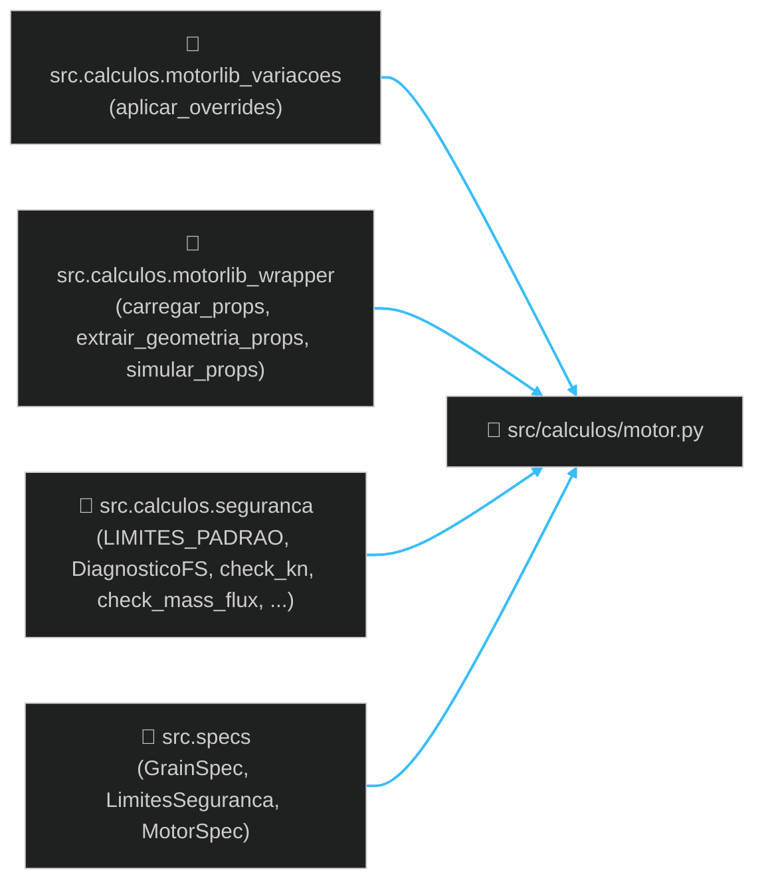
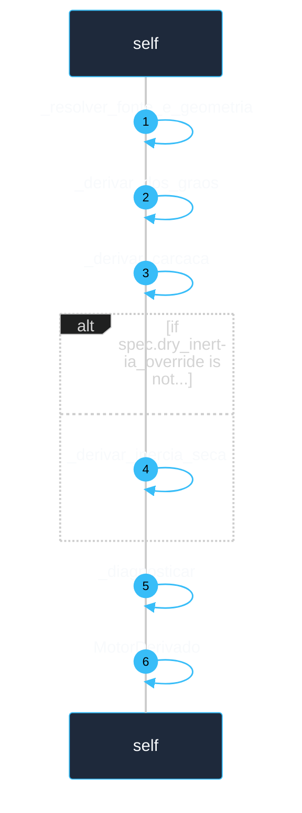
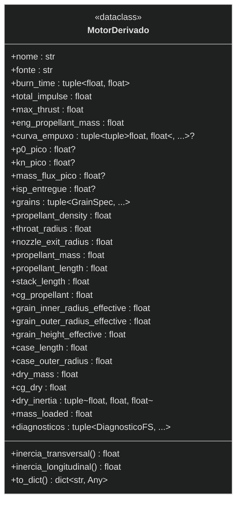

# ⚡ C4 Nível 4 (Código) — `src/calculos/motor.py`

> [!NOTE]
> **Gerado automaticamente a partir da AST do código-fonte e motor a2m.**
> Pela regra do modelo C4, o Nível 4 nunca é desenhado manualmente — ele reflete
> em tempo real as classes, funções, impacto e chamadas presentes em [`motor.py`](../../../src/calculos/motor.py).

**Navegação na Hierarquia C4:**
[🌐 Nível 1: Contexto](../c1-contexto.md) · [📦 Nível 2: Containers](../c2-containers.md) · [🧩 C3: Subsistema de Motor & Segurança](../c3-subsistema-motor.md) · **⚡ Nível 4: `motor.py`** · [📖 Guia de Visualização](../../../centralControle/GUIA_VISUALIZACAO.md)

---

## 1. Propósito do Módulo

Deriva propriedades completas do motor a partir de um `MotorSpec` (.ric > .eng).

🧩 Arquitetura C4 (Nível 3): docs/arquitetura/c3-subsistema-motor.md
⚡ Arquitetura C4 (Nível 4): clique no botão de Grafo no topo direito ao lado de 'More Actions'

Este é um módulo profundo:
  1. Se `spec.ric_path` está definido, carrega o `.ric`, aplica `spec.overrides`
     em memória UMA única vez e extrai do mesmo dicionário `props` tanto a
     geometria real dos grãos/tubeira/propelente quanto a simulação balística
     interna do OpenMotor.
  2. Se apenas `spec.thrust_curve_path` (.eng) está definido, integra a curva
     RASP e usa os grãos declarados em `spec.grains`.
  3. Calcula massa, CG, raio interno efetivo e inércia seca na convenção do
     RocketPy: `(I_11, I_22, I_33) = (I_transversal, I_transversal, I_longitudinal)`.
  4. Avalia todos os diagnósticos de segurança frente a `LimitesSeguranca`.

---

## 2. Fronteiras e Dependências do Arquivo

#### 🧭 Dependências Internas Navegáveis

| Dependência | Símbolos Importados | Documento C4 |
| :--- | :--- | :--- |
| `🧩 src.calculos.motorlib_variacoes` | `aplicar_overrides` | [⚡ `src__calculos__motorlib_variacoes.c4.md`](src__calculos__motorlib_variacoes.c4.md) |
| `🧩 src.calculos.motorlib_wrapper` | `carregar_props`, `extrair_geometria_props`, `simular_props` | [⚡ `src__calculos__motorlib_wrapper.c4.md`](src__calculos__motorlib_wrapper.c4.md) |
| `🧩 src.calculos.seguranca` | `LIMITES_PADRAO`, `DiagnosticoFS`, `check_kn`, `check_mass_flux`, `check_p0`, ... | [⚡ `src__calculos__seguranca.c4.md`](src__calculos__seguranca.c4.md) |
| `🧩 src.specs` | `GrainSpec`, `LimitesSeguranca`, `MotorSpec` | [⚡ `src__specs.c4.md`](src__specs.c4.md) |

---

## 3. Impacto Sistêmico e Fluxo de Execução

### Análise de Impacto Sistêmico (`a2m impact`)

> [!IMPORTANT]
> **Mapeamento de Efeito Cascata ao Modificar `derivar_motor()`:**
> - **Risco de Quebra Ascendente (Vermelho):** Funções e módulos externos que chamam esta lógica.
> - **Impacto Descendente (Azul):** Rotinas internas e dependências consumidas.

```mermaid
%%{init: {'theme': 'dark', 'themeVariables': { 'lineColor': '#38bdf8' }}}%%
graph TD
    classDef target fill:#ffe6cc,stroke:#d79b00,stroke-width:3px,color:#000
    classDef upward fill:#f8cecc,stroke:#b85450,stroke-width:2px,color:#000
    classDef downward fill:#dae8fc,stroke:#6c8ebf,stroke-width:1px,color:#000

    ALVO(("⭐ derivar_motor (ALVO)")):::target

    subgraph Ascendente["🚨 Risco de Quebra Ascendente (Quem consome esta função)"]
        code_construtor_foguete_py__function__build_rocket_H1ea3317b["⚠️ build_rocket"]:::upward
        code_construtor_foguete_py__function__build_motor_Hffc693a0["⚠️ build_motor"]:::upward
        code_inspecao_py__function__relatorio_motor_H38c86267["⚠️ relatorio_motor"]:::upward
        code_inspecao_py__function__relatorio_motor_variacoes_Hd08348f2["⚠️ relatorio_motor_variacoes"]:::upward
        code_inspecao_py__function__relatorio_seguranca_Hb17b73cd["⚠️ relatorio_seguranca"]:::upward
    end
    code_construtor_foguete_py__function__build_motor_Hffc693a0 --> ALVO
    code_construtor_foguete_py__function__build_rocket_H1ea3317b --> code_construtor_foguete_py__function__build_motor_Hffc693a0
    code_inspecao_py__function__relatorio_motor_H38c86267 --> ALVO
    code_inspecao_py__function__relatorio_motor_variacoes_Hd08348f2 --> ALVO
    code_inspecao_py__function__relatorio_seguranca_Hb17b73cd --> ALVO
    subgraph Descendente["🧩 Impacto Descendente (Dependências consumidas)"]
        extern_specs__GrainSpec_H4a81554f["GrainSpec"]:::downward
        code_calculos_seguranca_py__function__check_kn_He000bcfb["check_kn"]:::downward
        code_calculos_motorlib_variacoes_py__function___set_path_H3f6f5bd9["_set_path"]:::downward
        code_calculos_seguranca_py__function__fs_carcaca_H13b5bc35["fs_carcaca"]:::downward
        code_calculos_motor_py__function___ler_eng_H458942d7["_ler_eng"]:::downward
        extern_motor__Motor_Hcc0c9bee["Motor"]:::downward
        code_calculos_motorlib_wrapper_py__function___as_2d_H2444e75d["_as_2d"]:::downward
        code_calculos_motorlib_wrapper_py__function___integrar_trapezio_Hec49c62b["_integrar_trapezio"]:::downward
        code_calculos_motorlib_wrapper_py__function__extrair_geometria_props_Hbcbfe32c["extrair_geometria_props"]:::downward
        extern_fileIO__loadFile_Hfe8ed6d4["loadFile"]:::downward
        code_calculos_seguranca_py__function__check_p0_Hd65d174d["check_p0"]:::downward
        code_calculos_motor_py__function___derivar_carcaca_H48dc928e["_derivar_carcaca"]:::downward
        code_calculos_motorlib_wrapper_py__struct__MotorResultado_H657c0a11["MotorResultado"]:::downward
        code_calculos_motorlib_wrapper_py__function__carregar_props_Hb7e62dfb["carregar_props"]:::downward
        code_calculos_motorlib_variacoes_py__function___tem_indice_especifico_H37f03b07["_tem_indice_especifico"]:::downward
        code_calculos_motor_py__struct__MotorDerivado_Hf96b1b33["MotorDerivado"]:::downward
        extern_copy__deepcopy_H618b073e["deepcopy"]:::downward
        code_calculos_motorlib_wrapper_py__function___as_1d_Hd80e5dd0["_as_1d"]:::downward
        code_calculos_motorlib_variacoes_py__function__aplicar_overrides_H8051349c["aplicar_overrides"]:::downward
        code_calculos_seguranca_py__struct__DiagnosticoFS_Hf7789bea["DiagnosticoFS"]:::downward
        extern_math__isfinite_H0279690a["isfinite"]:::downward
        code_calculos_motor_py__function___integrar_trapezio_H515d0959["_integrar_trapezio"]:::downward
        code_calculos_motor_py__function___derivar_inercia_seca_H6f2bab99["_derivar_inercia_seca"]:::downward
        extern_pathlib__Path_Hd2621e53["Path"]:::downward
        extern_math__sqrt_H86ccf542["sqrt"]:::downward
        code_calculos_motor_py__function___resolver_fonte_e_geometria_H1a15d041["_resolver_fonte_e_geometria"]:::downward
        code_calculos_seguranca_py__function__check_mass_flux_H1757a559["check_mass_flux"]:::downward
        code_calculos_motorlib_wrapper_py__function___pico_2d_Hbac078e9["_pico_2d"]:::downward
        code_calculos_motor_py__function___diagnosticar_H34040dd9["_diagnosticar"]:::downward
        code_calculos_motor_py__function___derivar_dos_graos_H98100ac7["_derivar_dos_graos"]:::downward
        code_calculos_motorlib_wrapper_py__function__simular_props_Hb21e1ad9["simular_props"]:::downward
    end
    code_calculos_motor_py__function___derivar_dos_graos_H98100ac7 --> extern_math__sqrt_H86ccf542
    code_calculos_motor_py__function___diagnosticar_H34040dd9 --> code_calculos_seguranca_py__function__check_kn_He000bcfb
    code_calculos_motor_py__function___diagnosticar_H34040dd9 --> code_calculos_seguranca_py__function__check_mass_flux_H1757a559
    code_calculos_motor_py__function___diagnosticar_H34040dd9 --> code_calculos_seguranca_py__function__check_p0_Hd65d174d
    code_calculos_motor_py__function___diagnosticar_H34040dd9 --> code_calculos_seguranca_py__function__fs_carcaca_H13b5bc35
    code_calculos_motor_py__function___ler_eng_H458942d7 --> extern_pathlib__Path_Hd2621e53
    code_calculos_motor_py__function___resolver_fonte_e_geometria_H1a15d041 --> code_calculos_motor_py__function___integrar_trapezio_H515d0959
    code_calculos_motor_py__function___resolver_fonte_e_geometria_H1a15d041 --> code_calculos_motor_py__function___ler_eng_H458942d7
    code_calculos_motor_py__function___resolver_fonte_e_geometria_H1a15d041 --> code_calculos_motorlib_variacoes_py__function__aplicar_overrides_H8051349c
    code_calculos_motor_py__function___resolver_fonte_e_geometria_H1a15d041 --> code_calculos_motorlib_wrapper_py__function__carregar_props_Hb7e62dfb
    code_calculos_motor_py__function___resolver_fonte_e_geometria_H1a15d041 --> code_calculos_motorlib_wrapper_py__function__extrair_geometria_props_Hbcbfe32c
    code_calculos_motor_py__function___resolver_fonte_e_geometria_H1a15d041 --> code_calculos_motorlib_wrapper_py__function__simular_props_Hb21e1ad9
    ALVO --> code_calculos_motor_py__function___derivar_carcaca_H48dc928e
    ALVO --> code_calculos_motor_py__function___derivar_dos_graos_H98100ac7
    ALVO --> code_calculos_motor_py__function___derivar_inercia_seca_H6f2bab99
    ALVO --> code_calculos_motor_py__function___diagnosticar_H34040dd9
    ALVO --> code_calculos_motor_py__function___resolver_fonte_e_geometria_H1a15d041
    ALVO --> code_calculos_motor_py__struct__MotorDerivado_Hf96b1b33
    code_calculos_motorlib_variacoes_py__function__aplicar_overrides_H8051349c --> code_calculos_motorlib_variacoes_py__function___set_path_H3f6f5bd9
    code_calculos_motorlib_variacoes_py__function__aplicar_overrides_H8051349c --> code_calculos_motorlib_variacoes_py__function___tem_indice_especifico_H37f03b07
    code_calculos_motorlib_variacoes_py__function__aplicar_overrides_H8051349c --> extern_copy__deepcopy_H618b073e
    code_calculos_motorlib_wrapper_py__function__carregar_props_Hb7e62dfb --> extern_fileIO__loadFile_Hfe8ed6d4
    code_calculos_motorlib_wrapper_py__function__carregar_props_Hb7e62dfb --> extern_pathlib__Path_Hd2621e53
    code_calculos_motorlib_wrapper_py__function__extrair_geometria_props_Hbcbfe32c --> extern_specs__GrainSpec_H4a81554f
    code_calculos_motorlib_wrapper_py__function__simular_props_Hb21e1ad9 --> code_calculos_motorlib_wrapper_py__function___as_1d_Hd80e5dd0
    code_calculos_motorlib_wrapper_py__function__simular_props_Hb21e1ad9 --> code_calculos_motorlib_wrapper_py__function___as_2d_H2444e75d
    code_calculos_motorlib_wrapper_py__function__simular_props_Hb21e1ad9 --> code_calculos_motorlib_wrapper_py__function___integrar_trapezio_Hec49c62b
    code_calculos_motorlib_wrapper_py__function__simular_props_Hb21e1ad9 --> code_calculos_motorlib_wrapper_py__function___pico_2d_Hbac078e9
    code_calculos_motorlib_wrapper_py__function__simular_props_Hb21e1ad9 --> code_calculos_motorlib_wrapper_py__struct__MotorResultado_H657c0a11
    code_calculos_motorlib_wrapper_py__function__simular_props_Hb21e1ad9 --> extern_copy__deepcopy_H618b073e
    code_calculos_motorlib_wrapper_py__function__simular_props_Hb21e1ad9 --> extern_motor__Motor_Hcc0c9bee
    code_calculos_seguranca_py__function__check_kn_He000bcfb --> code_calculos_seguranca_py__struct__DiagnosticoFS_Hf7789bea
    code_calculos_seguranca_py__function__check_kn_He000bcfb --> extern_math__isfinite_H0279690a
    code_calculos_seguranca_py__function__check_mass_flux_H1757a559 --> code_calculos_seguranca_py__struct__DiagnosticoFS_Hf7789bea
    code_calculos_seguranca_py__function__check_mass_flux_H1757a559 --> extern_math__isfinite_H0279690a
    code_calculos_seguranca_py__function__check_p0_Hd65d174d --> code_calculos_seguranca_py__struct__DiagnosticoFS_Hf7789bea
    code_calculos_seguranca_py__function__check_p0_Hd65d174d --> extern_math__isfinite_H0279690a
    code_calculos_seguranca_py__function__fs_carcaca_H13b5bc35 --> code_calculos_seguranca_py__struct__DiagnosticoFS_Hf7789bea
    code_calculos_seguranca_py__function__fs_carcaca_H13b5bc35 --> extern_math__isfinite_H0279690a
    click code_calculos_motorlib_variacoes_py__function___set_path_H3f6f5bd9 href "src__calculos__motorlib_variacoes.c4.md" "Abrir C4 (_set_path)"
    click code_calculos_motorlib_variacoes_py__function___tem_indice_especifico_H37f03b07 href "src__calculos__motorlib_variacoes.c4.md" "Abrir C4 (_tem_indice_especifico)"
    click code_calculos_motorlib_variacoes_py__function__aplicar_overrides_H8051349c href "src__calculos__motorlib_variacoes.c4.md" "Abrir C4 (aplicar_overrides)"
    click code_calculos_motorlib_wrapper_py__function___as_1d_Hd80e5dd0 href "src__calculos__motorlib_wrapper.c4.md" "Abrir C4 (_as_1d)"
    click code_calculos_motorlib_wrapper_py__function___as_2d_H2444e75d href "src__calculos__motorlib_wrapper.c4.md" "Abrir C4 (_as_2d)"
    click code_calculos_motorlib_wrapper_py__function___integrar_trapezio_Hec49c62b href "src__calculos__motorlib_wrapper.c4.md" "Abrir C4 (_integrar_trapezio)"
    click code_calculos_motorlib_wrapper_py__function___pico_2d_Hbac078e9 href "src__calculos__motorlib_wrapper.c4.md" "Abrir C4 (_pico_2d)"
    click code_calculos_motorlib_wrapper_py__function__carregar_props_Hb7e62dfb href "src__calculos__motorlib_wrapper.c4.md" "Abrir C4 (carregar_props)"
    click code_calculos_motorlib_wrapper_py__function__extrair_geometria_props_Hbcbfe32c href "src__calculos__motorlib_wrapper.c4.md" "Abrir C4 (extrair_geometria_props)"
    click code_calculos_motorlib_wrapper_py__function__simular_props_Hb21e1ad9 href "src__calculos__motorlib_wrapper.c4.md" "Abrir C4 (simular_props)"
    click code_calculos_motorlib_wrapper_py__struct__MotorResultado_H657c0a11 href "src__calculos__motorlib_wrapper.c4.md" "Abrir C4 (MotorResultado)"
    click code_calculos_seguranca_py__function__check_kn_He000bcfb href "src__calculos__seguranca.c4.md" "Abrir C4 (check_kn)"
    click code_calculos_seguranca_py__function__check_mass_flux_H1757a559 href "src__calculos__seguranca.c4.md" "Abrir C4 (check_mass_flux)"
    click code_calculos_seguranca_py__function__check_p0_Hd65d174d href "src__calculos__seguranca.c4.md" "Abrir C4 (check_p0)"
    click code_calculos_seguranca_py__function__fs_carcaca_H13b5bc35 href "src__calculos__seguranca.c4.md" "Abrir C4 (fs_carcaca)"
    click code_calculos_seguranca_py__struct__DiagnosticoFS_Hf7789bea href "src__calculos__seguranca.c4.md" "Abrir C4 (DiagnosticoFS)"
    click code_construtor_foguete_py__function__build_motor_Hffc693a0 href "src__construtor_foguete.c4.md" "Abrir C4 (build_motor)"
    click code_construtor_foguete_py__function__build_rocket_H1ea3317b href "src__construtor_foguete.c4.md" "Abrir C4 (build_rocket)"
    click code_inspecao_py__function__relatorio_motor_H38c86267 href "src__inspecao.c4.md" "Abrir C4 (relatorio_motor)"
    click code_inspecao_py__function__relatorio_motor_variacoes_Hd08348f2 href "src__inspecao.c4.md" "Abrir C4 (relatorio_motor_variacoes)"
    click code_inspecao_py__function__relatorio_seguranca_Hb17b73cd href "src__inspecao.c4.md" "Abrir C4 (relatorio_seguranca)"
    linkStyle default stroke:#38bdf8,stroke-width:2px;
```

#### 🧭 Atalhos Rápidos de Navegação (Impacto Sistêmico)

| Relação | Símbolo / Função | Arquivo C4 Destino |
| :--- | :--- | :--- |
| 🧩 Impacto Descendente (Callee) | `_set_path` | [⚡ `src__calculos__motorlib_variacoes.c4.md`](src__calculos__motorlib_variacoes.c4.md) |
| 🧩 Impacto Descendente (Callee) | `_tem_indice_especifico` | [⚡ `src__calculos__motorlib_variacoes.c4.md`](src__calculos__motorlib_variacoes.c4.md) |
| 🧩 Impacto Descendente (Callee) | `aplicar_overrides` | [⚡ `src__calculos__motorlib_variacoes.c4.md`](src__calculos__motorlib_variacoes.c4.md) |
| 🧩 Impacto Descendente (Callee) | `_as_1d` | [⚡ `src__calculos__motorlib_wrapper.c4.md`](src__calculos__motorlib_wrapper.c4.md) |
| 🧩 Impacto Descendente (Callee) | `_as_2d` | [⚡ `src__calculos__motorlib_wrapper.c4.md`](src__calculos__motorlib_wrapper.c4.md) |
| 🧩 Impacto Descendente (Callee) | `_integrar_trapezio` | [⚡ `src__calculos__motorlib_wrapper.c4.md`](src__calculos__motorlib_wrapper.c4.md) |
| 🧩 Impacto Descendente (Callee) | `_pico_2d` | [⚡ `src__calculos__motorlib_wrapper.c4.md`](src__calculos__motorlib_wrapper.c4.md) |
| 🧩 Impacto Descendente (Callee) | `carregar_props` | [⚡ `src__calculos__motorlib_wrapper.c4.md`](src__calculos__motorlib_wrapper.c4.md) |
| 🧩 Impacto Descendente (Callee) | `extrair_geometria_props` | [⚡ `src__calculos__motorlib_wrapper.c4.md`](src__calculos__motorlib_wrapper.c4.md) |
| 🧩 Impacto Descendente (Callee) | `simular_props` | [⚡ `src__calculos__motorlib_wrapper.c4.md`](src__calculos__motorlib_wrapper.c4.md) |
| 🧩 Impacto Descendente (Callee) | `MotorResultado` | [⚡ `src__calculos__motorlib_wrapper.c4.md`](src__calculos__motorlib_wrapper.c4.md) |
| 🧩 Impacto Descendente (Callee) | `check_kn` | [⚡ `src__calculos__seguranca.c4.md`](src__calculos__seguranca.c4.md) |
| 🧩 Impacto Descendente (Callee) | `check_mass_flux` | [⚡ `src__calculos__seguranca.c4.md`](src__calculos__seguranca.c4.md) |
| 🧩 Impacto Descendente (Callee) | `check_p0` | [⚡ `src__calculos__seguranca.c4.md`](src__calculos__seguranca.c4.md) |
| 🧩 Impacto Descendente (Callee) | `fs_carcaca` | [⚡ `src__calculos__seguranca.c4.md`](src__calculos__seguranca.c4.md) |
| 🧩 Impacto Descendente (Callee) | `DiagnosticoFS` | [⚡ `src__calculos__seguranca.c4.md`](src__calculos__seguranca.c4.md) |
| 🚨 Risco Ascendente (Caller) | `build_motor` | [⚡ `src__construtor_foguete.c4.md`](src__construtor_foguete.c4.md) |
| 🚨 Risco Ascendente (Caller) | `build_rocket` | [⚡ `src__construtor_foguete.c4.md`](src__construtor_foguete.c4.md) |
| 🚨 Risco Ascendente (Caller) | `relatorio_motor` | [⚡ `src__inspecao.c4.md`](src__inspecao.c4.md) |
| 🚨 Risco Ascendente (Caller) | `relatorio_motor_variacoes` | [⚡ `src__inspecao.c4.md`](src__inspecao.c4.md) |
| 🚨 Risco Ascendente (Caller) | `relatorio_seguranca` | [⚡ `src__inspecao.c4.md`](src__inspecao.c4.md) |

### Diagrama de Sequência de Execução — `derivar_motor()` (`sequenceDiagram`)

> [!NOTE]
> Mostra o fluxo sequencial real de controle de execução da função,
> incluindo condicionais (`alt ... else`) e laços (`loop`).

---

## 4. Estrutura de Classes e Contratos (`classDiagram`)

---

## 5. Fluxo Lógico de Funções Locais (`flowchart TD`)

```mermaid
%%{init: {'theme': 'dark', 'themeVariables': { 'lineColor': '#38bdf8' }}}%%
flowchart TD
    F_0["🔒 _ler_eng()"]
    F_1["🔒 _integrar_trapezio()"]
    F_2["🔒 _resolver_fonte_e_geometria()"]
    F_3["🔒 _derivar_dos_graos()"]
    F_4["🔒 _derivar_carcaca()"]
    F_5["🔒 _derivar_inercia_seca()"]
    F_6["🔒 _diagnosticar()"]
    F_7["🟢 derivar_motor()"]
    EXTCALL_0["🔗 carregar_props()\n(src.calculos.motorlib_wrapper)"]
    click EXTCALL_0 href "src__calculos__motorlib_wrapper.c4.md" "Abrir C4 de src.calculos.motorlib_wrapper"
    F_2 --> EXTCALL_0
    EXTCALL_1["🔗 extrair_geometria_props()\n(src.calculos.motorlib_wrapper)"]
    click EXTCALL_1 href "src__calculos__motorlib_wrapper.c4.md" "Abrir C4 de src.calculos.motorlib_wrapper"
    F_2 --> EXTCALL_1
    EXTCALL_2["🔗 simular_props()\n(src.calculos.motorlib_wrapper)"]
    click EXTCALL_2 href "src__calculos__motorlib_wrapper.c4.md" "Abrir C4 de src.calculos.motorlib_wrapper"
    F_2 --> EXTCALL_2
    F_2 --> F_0
    F_2 --> F_1
    EXTCALL_3["🔗 aplicar_overrides()\n(src.calculos.motorlib_variacoes)"]
    click EXTCALL_3 href "src__calculos__motorlib_variacoes.c4.md" "Abrir C4 de src.calculos.motorlib_variacoes"
    F_2 --> EXTCALL_3
    EXTCALL_4["🔗 fs_carcaca()\n(src.calculos.seguranca)"]
    click EXTCALL_4 href "src__calculos__seguranca.c4.md" "Abrir C4 de src.calculos.seguranca"
    F_6 --> EXTCALL_4
    EXTCALL_5["🔗 check_p0()\n(src.calculos.seguranca)"]
    click EXTCALL_5 href "src__calculos__seguranca.c4.md" "Abrir C4 de src.calculos.seguranca"
    F_6 --> EXTCALL_5
    EXTCALL_6["🔗 check_kn()\n(src.calculos.seguranca)"]
    click EXTCALL_6 href "src__calculos__seguranca.c4.md" "Abrir C4 de src.calculos.seguranca"
    F_6 --> EXTCALL_6
    EXTCALL_7["🔗 check_mass_flux()\n(src.calculos.seguranca)"]
    click EXTCALL_7 href "src__calculos__seguranca.c4.md" "Abrir C4 de src.calculos.seguranca"
    F_6 --> EXTCALL_7
    F_7 --> F_2
    F_7 --> F_3
    F_7 --> F_4
    F_7 --> F_6
    CLS_MotorDerivado(["📦 MotorDerivado"])
    F_7 -. instancia .-> CLS_MotorDerivado
    F_7 --> F_5
    linkStyle default stroke:#38bdf8,stroke-width:2px;
```

#### 🧭 Chamadas Externas Identificadas

| Chamada Local | Módulo de Origem | Documento C4 |
| :--- | :--- | :--- |
| `🔗 carregar_props()` | `src.calculos.motorlib_wrapper` | [⚡ `src__calculos__motorlib_wrapper.c4.md`](src__calculos__motorlib_wrapper.c4.md) |
| `🔗 extrair_geometria_props()` | `src.calculos.motorlib_wrapper` | [⚡ `src__calculos__motorlib_wrapper.c4.md`](src__calculos__motorlib_wrapper.c4.md) |
| `🔗 simular_props()` | `src.calculos.motorlib_wrapper` | [⚡ `src__calculos__motorlib_wrapper.c4.md`](src__calculos__motorlib_wrapper.c4.md) |
| `🔗 aplicar_overrides()` | `src.calculos.motorlib_variacoes` | [⚡ `src__calculos__motorlib_variacoes.c4.md`](src__calculos__motorlib_variacoes.c4.md) |
| `🔗 fs_carcaca()` | `src.calculos.seguranca` | [⚡ `src__calculos__seguranca.c4.md`](src__calculos__seguranca.c4.md) |
| `🔗 check_p0()` | `src.calculos.seguranca` | [⚡ `src__calculos__seguranca.c4.md`](src__calculos__seguranca.c4.md) |
| `🔗 check_kn()` | `src.calculos.seguranca` | [⚡ `src__calculos__seguranca.c4.md`](src__calculos__seguranca.c4.md) |
| `🔗 check_mass_flux()` | `src.calculos.seguranca` | [⚡ `src__calculos__seguranca.c4.md`](src__calculos__seguranca.c4.md) |

---

## 6. Catálogo de Símbolos (Links Diretos para o Código)

### Classes / Contratos

| Classe | Linhas | Tipo | Resumo |
| :--- | :--- | :--- | :--- |
| [`MotorDerivado`](../../../src/calculos/motor.py#L103-L202) | `L103–L202` | `@dataclass` | — |

### Funções do Módulo

| Função | Linhas | Retorno | Resumo |
| :--- | :--- | :--- | :--- |
| [`_ler_eng`](../../../src/calculos/motor.py#L45-L88) | `L45–L88` | `tuple[list[float], list[float], dict[str, Any]]` | Lê um arquivo RASP `.eng` e devolve `(tempos, empuxos, header)`. |
| [`_integrar_trapezio`](../../../src/calculos/motor.py#L91-L96) | `L91–L96` | `float` | — |
| [`_resolver_fonte_e_geometria`](../../../src/calculos/motor.py#L208-L266) | `L208–L266` | `dict[str, Any]` | Resolve tanto a balística quanto a geometria efetiva (.ric > .eng). |
| [`_derivar_dos_graos`](../../../src/calculos/motor.py#L269-L313) | `L269–L313` | `tuple[float, float, float, float, float, float, float]` | Retorna `(massa_total, comprimento_prop, stack_length, cg_local, inner_eff, |
| [`_derivar_carcaca`](../../../src/calculos/motor.py#L316-L334) | `L316–L334` | `tuple[float, float, float]` | Retorna `(case_length, case_outer_radius, dry_mass)`. |
| [`_derivar_inercia_seca`](../../../src/calculos/motor.py#L337-L350) | `L337–L350` | `tuple[float, float]` | Inércia de casca cilíndrica oca. |
| [`_diagnosticar`](../../../src/calculos/motor.py#L353-L371) | `L353–L371` | `tuple[DiagnosticoFS, ...]` | — |
| [`derivar_motor`](../../../src/calculos/motor.py#L377-L447) | `L377–L447` | `MotorDerivado` | Deriva cinemática, balística interna, massas, inércias e diagnósticos do motor. |
