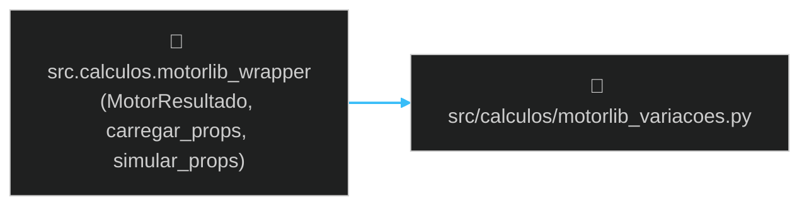
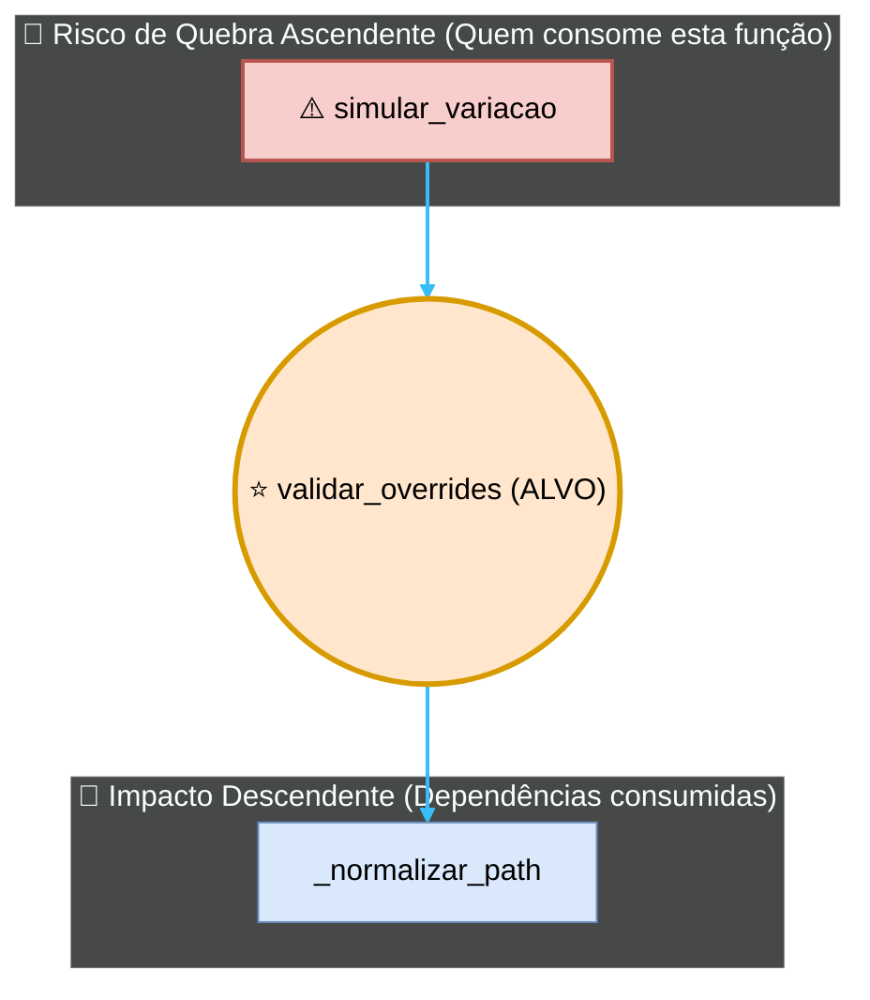
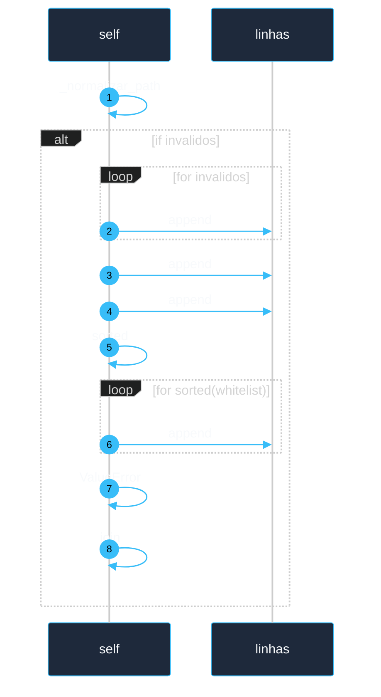
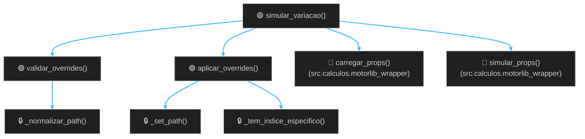

# ⚡ C4 Nível 4 (Código) — `src/calculos/motorlib_variacoes.py`

> [!NOTE]
> **Gerado automaticamente a partir da AST do código-fonte e motor a2m.**
> Pela regra do modelo C4, o Nível 4 nunca é desenhado manualmente — ele reflete
> em tempo real as classes, funções, impacto e chamadas presentes em [`motorlib_variacoes.py`](../../../src/calculos/motorlib_variacoes.py).

**Navegação na Hierarquia C4:**
[🌐 Nível 1: Contexto](../c1-contexto.md) · [📦 Nível 2: Containers](../c2-containers.md) · [🧩 C3: Subsistema de Motor & Segurança](../c3-subsistema-motor.md) · **⚡ Nível 4: `motorlib_variacoes.py`** · [📖 Guia de Visualização](../../../centralControle/GUIA_VISUALIZACAO.md)

---

## 1. Propósito do Módulo

Variações programáticas do motor em memória (dot-path + wildcard).

Aplica overrides dot-path sobre o dicionário `props` do `.ric`, com suporte a
wildcard `*` (todos os grãos) e índice numérico específico.

Ordem de aplicação (quando ambos presentes):
  1. Wildcards primeiro ("grains.*.properties.coreDiameter")
  2. Índices específicos depois ("grains.4.properties.coreDiameter")

---

## 2. Fronteiras e Dependências do Arquivo

#### 🧭 Dependências Internas Navegáveis

| Dependência | Símbolos Importados | Documento C4 |
| :--- | :--- | :--- |
| `🧩 src.calculos.motorlib_wrapper` | `MotorResultado`, `carregar_props`, `simular_props` | [⚡ `src__calculos__motorlib_wrapper.c4.md`](src__calculos__motorlib_wrapper.c4.md) |

---

## 3. Impacto Sistêmico e Fluxo de Execução

### Análise de Impacto Sistêmico (`a2m impact`)

> [!IMPORTANT]
> **Mapeamento de Efeito Cascata ao Modificar `validar_overrides()`:**
> - **Risco de Quebra Ascendente (Vermelho):** Funções e módulos externos que chamam esta lógica.
> - **Impacto Descendente (Azul):** Rotinas internas e dependências consumidas.

### Diagrama de Sequência de Execução — `validar_overrides()` (`sequenceDiagram`)

> [!NOTE]
> Mostra o fluxo sequencial real de controle de execução da função,
> incluindo condicionais (`alt ... else`) e laços (`loop`).

---

## 4. Fluxo Lógico de Funções Locais (`flowchart TD`)

#### 🧭 Chamadas Externas Identificadas

| Chamada Local | Módulo de Origem | Documento C4 |
| :--- | :--- | :--- |
| `🔗 carregar_props()` | `src.calculos.motorlib_wrapper` | [⚡ `src__calculos__motorlib_wrapper.c4.md`](src__calculos__motorlib_wrapper.c4.md) |
| `🔗 simular_props()` | `src.calculos.motorlib_wrapper` | [⚡ `src__calculos__motorlib_wrapper.c4.md`](src__calculos__motorlib_wrapper.c4.md) |

---

## 5. Catálogo de Símbolos (Links Diretos para o Código)

### Funções do Módulo

| Função | Linhas | Retorno | Resumo |
| :--- | :--- | :--- | :--- |
| [`_normalizar_path`](../../../src/calculos/motorlib_variacoes.py#L24-L27) | `L24–L27` | `str` | Substitui índices numéricos por '*' para comparação com a whitelist. |
| [`validar_overrides`](../../../src/calculos/motorlib_variacoes.py#L30-L49) | `L30–L49` | `None` | Verifica se todos os paths de `overrides` pertencem à `whitelist`. |
| [`_set_path`](../../../src/calculos/motorlib_variacoes.py#L52-L100) | `L52–L100` | `None` | Aplica `valor` em `obj` seguindo `partes` (dot-path separado). |
| [`_tem_indice_especifico`](../../../src/calculos/motorlib_variacoes.py#L103-L104) | `L103–L104` | `bool` | — |
| [`aplicar_overrides`](../../../src/calculos/motorlib_variacoes.py#L107-L119) | `L107–L119` | `dict` | Retorna uma cópia profunda de `props` com `overrides` aplicados. |
| [`simular_variacao`](../../../src/calculos/motorlib_variacoes.py#L122-L133) | `L122–L133` | `MotorResultado` | Carrega o `.ric`, valida e aplica `overrides` em memória e simula. |
