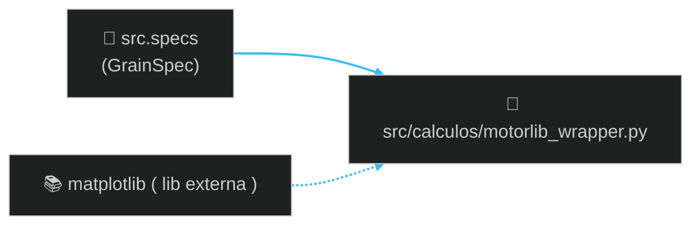
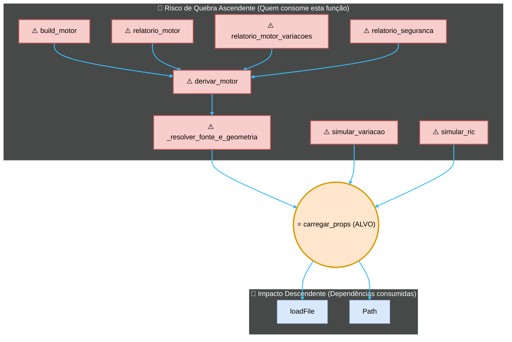
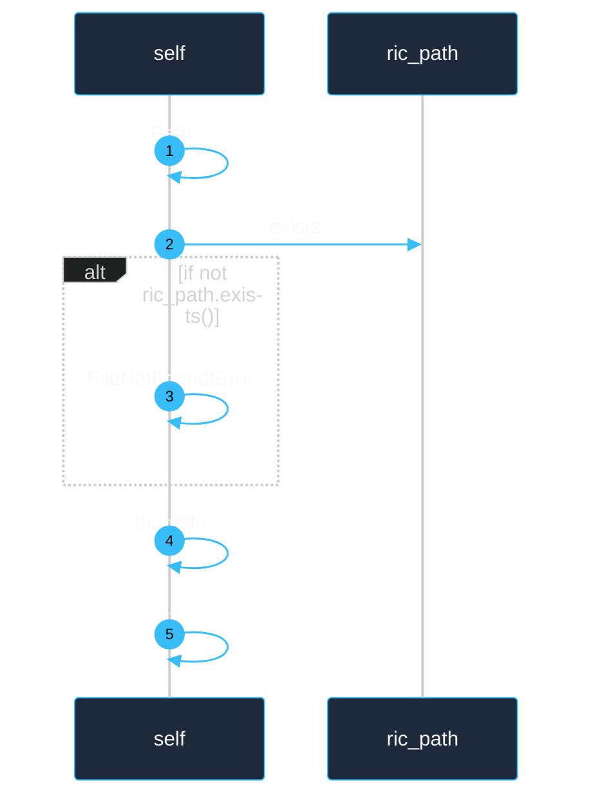
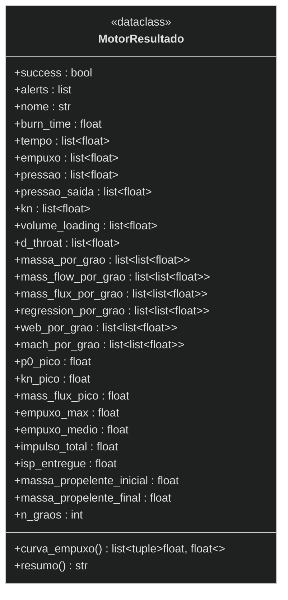
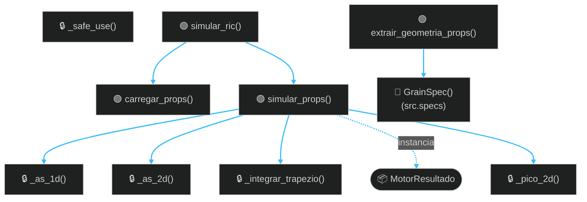

# ⚡ C4 Nível 4 (Código) — `src/calculos/motorlib_wrapper.py`

> [!NOTE]
> **Gerado automaticamente a partir da AST do código-fonte e motor a2m.**
> Pela regra do modelo C4, o Nível 4 nunca é desenhado manualmente — ele reflete
> em tempo real as classes, funções, impacto e chamadas presentes em [`motorlib_wrapper.py`](../../../src/calculos/motorlib_wrapper.py).

**Navegação na Hierarquia C4:**
[🌐 Nível 1: Contexto](../c1-contexto.md) · [📦 Nível 2: Containers](../c2-containers.md) · [🧩 C3: Subsistema de Motor & Segurança](../c3-subsistema-motor.md) · **⚡ Nível 4: `motorlib_wrapper.py`** · [📖 Guia de Visualização](../../../centralControle/GUIA_VISUALIZACAO.md)

---

## 1. Propósito do Módulo

Adaptador do motorlib/uilib (OpenMotor) — leitura de .ric, extração geométrica e simulação.

Isola todas as peculiaridades do OpenMotor (proteção do backend do matplotlib,
restauração do `sys.excepthook` e silenciamento do logger do `uilib`) em uma
única costura (seam).

---

## 2. Fronteiras e Dependências do Arquivo

#### 🧭 Dependências Internas Navegáveis

| Dependência | Símbolos Importados | Documento C4 |
| :--- | :--- | :--- |
| `🧩 src.specs` | `GrainSpec` | [⚡ `src__specs.c4.md`](src__specs.c4.md) |

---

## 3. Impacto Sistêmico e Fluxo de Execução

### Análise de Impacto Sistêmico (`a2m impact`)

> [!IMPORTANT]
> **Mapeamento de Efeito Cascata ao Modificar `carregar_props()`:**
> - **Risco de Quebra Ascendente (Vermelho):** Funções e módulos externos que chamam esta lógica.
> - **Impacto Descendente (Azul):** Rotinas internas e dependências consumidas.

#### 🧭 Atalhos Rápidos de Navegação (Impacto Sistêmico)

| Relação | Símbolo / Função | Arquivo C4 Destino |
| :--- | :--- | :--- |
| 🚨 Risco Ascendente (Caller) | `_resolver_fonte_e_geometria` | [⚡ `src__calculos__motor.c4.md`](src__calculos__motor.c4.md) |
| 🚨 Risco Ascendente (Caller) | `derivar_motor` | [⚡ `src__calculos__motor.c4.md`](src__calculos__motor.c4.md) |
| 🚨 Risco Ascendente (Caller) | `simular_variacao` | [⚡ `src__calculos__motorlib_variacoes.c4.md`](src__calculos__motorlib_variacoes.c4.md) |
| 🚨 Risco Ascendente (Caller) | `build_motor` | [⚡ `src__construtor_foguete.c4.md`](src__construtor_foguete.c4.md) |
| 🚨 Risco Ascendente (Caller) | `relatorio_motor` | [⚡ `src__inspecao.c4.md`](src__inspecao.c4.md) |
| 🚨 Risco Ascendente (Caller) | `relatorio_motor_variacoes` | [⚡ `src__inspecao.c4.md`](src__inspecao.c4.md) |
| 🚨 Risco Ascendente (Caller) | `relatorio_seguranca` | [⚡ `src__inspecao.c4.md`](src__inspecao.c4.md) |

### Diagrama de Sequência de Execução — `carregar_props()` (`sequenceDiagram`)

> [!NOTE]
> Mostra o fluxo sequencial real de controle de execução da função,
> incluindo condicionais (`alt ... else`) e laços (`loop`).

---

## 4. Estrutura de Classes e Contratos (`classDiagram`)

---

## 5. Fluxo Lógico de Funções Locais (`flowchart TD`)

#### 🧭 Chamadas Externas Identificadas

| Chamada Local | Módulo de Origem | Documento C4 |
| :--- | :--- | :--- |
| `🔗 GrainSpec()` | `src.specs` | [⚡ `src__specs.c4.md`](src__specs.c4.md) |

---

## 6. Catálogo de Símbolos (Links Diretos para o Código)

### Classes / Contratos

| Classe | Linhas | Tipo | Resumo |
| :--- | :--- | :--- | :--- |
| [`MotorResultado`](../../../src/calculos/motorlib_wrapper.py#L79-L136) | `L79–L136` | `@dataclass` | Resultado da simulação balística interna do OpenMotor. |

### Funções do Módulo

| Função | Linhas | Retorno | Resumo |
| :--- | :--- | :--- | :--- |
| [`_safe_use`](../../../src/calculos/motorlib_wrapper.py#L28-L31) | `L28–L31` | `None` | — |
| [`_as_1d`](../../../src/calculos/motorlib_wrapper.py#L54-L55) | `L54–L55` | `list[float]` | — |
| [`_as_2d`](../../../src/calculos/motorlib_wrapper.py#L58-L61) | `L58–L61` | `list[list[float]]` | — |
| [`_pico_2d`](../../../src/calculos/motorlib_wrapper.py#L64-L65) | `L64–L65` | `float` | — |
| [`_integrar_trapezio`](../../../src/calculos/motorlib_wrapper.py#L68-L72) | `L68–L72` | `float` | — |
| [`carregar_props`](../../../src/calculos/motorlib_wrapper.py#L142-L147) | `L142–L147` | `dict` | Carrega o dicionário de propriedades de um arquivo .ric (já migrado pelo uilib). |
| [`extrair_geometria_props`](../../../src/calculos/motorlib_wrapper.py#L150-L195) | `L150–L195` | `tuple[tuple[GrainSpec, ...], float, float, float]` | Extrai (grains, propellant_density, throat_radius, nozzle_exit_radius) de `props`. |
| [`simular_props`](../../../src/calculos/motorlib_wrapper.py#L198-L277) | `L198–L277` | `MotorResultado` | Roda o solver do OpenMotor sobre um dicionário `props` em memória. |
| [`simular_ric`](../../../src/calculos/motorlib_wrapper.py#L280-L283) | `L280–L283` | `MotorResultado` | Carrega um arquivo .ric e executa a simulação no OpenMotor. |
