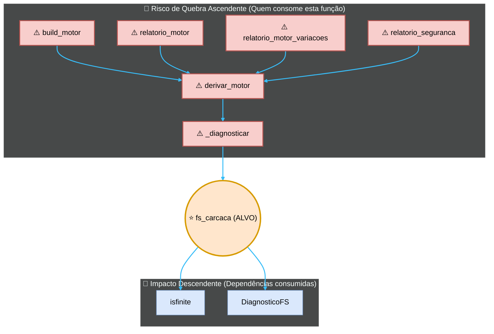
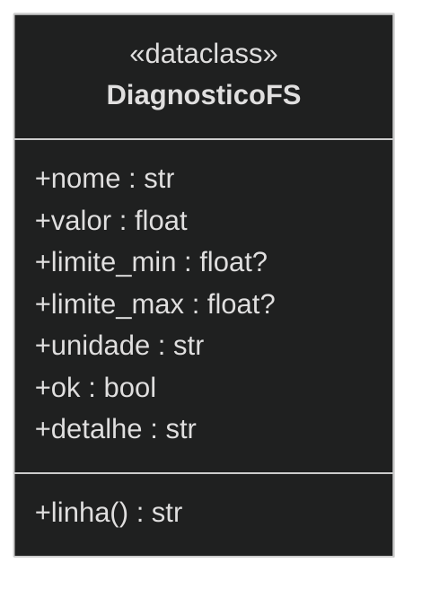
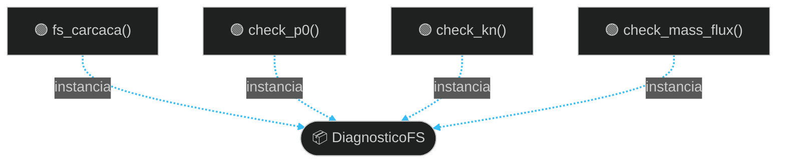

# ⚡ C4 Nível 4 (Código) — `src/calculos/seguranca.py`

> [!NOTE]
> **Gerado automaticamente a partir da AST do código-fonte e motor a2m.**
> Pela regra do modelo C4, o Nível 4 nunca é desenhado manualmente — ele reflete
> em tempo real as classes, funções, impacto e chamadas presentes em [`seguranca.py`](../../../src/calculos/seguranca.py).

**Navegação na Hierarquia C4:**
[🌐 Nível 1: Contexto](../c1-contexto.md) · [📦 Nível 2: Containers](../c2-containers.md) · [🧩 C3: Subsistema de Motor & Segurança](../c3-subsistema-motor.md) · **⚡ Nível 4: `seguranca.py`** · [📖 Guia de Visualização](../../../centralControle/GUIA_VISUALIZACAO.md)

---

## 1. Propósito do Módulo

Fatores de segurança e verificação de limites operacionais.

Cada função devolve um `DiagnosticoFS` imutável com valor calculado, limite,
status OK/alerta e detalhamento legível. Não importa nada de `configs/`.

---

## 2. Fronteiras e Dependências do Arquivo


#### 🧭 Dependências Internas Navegáveis

| Dependência | Símbolos Importados | Documento C4 |
| :--- | :--- | :--- |
| `🧩 src.specs` | `LimitesSeguranca` | [⚡ `src__specs.c4.md`](src__specs.c4.md) |

---

## 3. Impacto Sistêmico e Fluxo de Execução

### Análise de Impacto Sistêmico (`a2m impact`)

> [!IMPORTANT]
> **Mapeamento de Efeito Cascata ao Modificar `fs_carcaca()`:**
> - **Risco de Quebra Ascendente (Vermelho):** Funções e módulos externos que chamam esta lógica.
> - **Impacto Descendente (Azul):** Rotinas internas e dependências consumidas.



#### 🧭 Atalhos Rápidos de Navegação (Impacto Sistêmico)

| Relação | Símbolo / Função | Arquivo C4 Destino |
| :--- | :--- | :--- |
| 🚨 Risco Ascendente (Caller) | `_diagnosticar` | [⚡ `src__calculos__motor.c4.md`](src__calculos__motor.c4.md) |
| 🚨 Risco Ascendente (Caller) | `derivar_motor` | [⚡ `src__calculos__motor.c4.md`](src__calculos__motor.c4.md) |
| 🚨 Risco Ascendente (Caller) | `build_motor` | [⚡ `src__construtor_foguete.c4.md`](src__construtor_foguete.c4.md) |
| 🚨 Risco Ascendente (Caller) | `relatorio_motor` | [⚡ `src__inspecao.c4.md`](src__inspecao.c4.md) |
| 🚨 Risco Ascendente (Caller) | `relatorio_motor_variacoes` | [⚡ `src__inspecao.c4.md`](src__inspecao.c4.md) |
| 🚨 Risco Ascendente (Caller) | `relatorio_seguranca` | [⚡ `src__inspecao.c4.md`](src__inspecao.c4.md) |

### Diagrama de Sequência de Execução — `fs_carcaca()` (`sequenceDiagram`)

> [!NOTE]
> Mostra o fluxo sequencial real de controle de execução da função,
> incluindo condicionais (`alt ... else`) e laços (`loop`).

```mermaid
%%{init: {'theme': 'dark', 'themeVariables': { 'signalColor': '#38bdf8', 'signalTextColor': '#f8fafc', 'actorBkg': '#1e293b', 'actorBorder': '#38bdf8', 'actorTextColor': '#f8fafc' }}}%%
sequenceDiagram
    autonumber
    %% def fs_carcaca(
    participant self as self
    self->>self: isfinite
    self->>self: isfinite
    self->>self: isfinite
    self->>self: isfinite
    alt if p0_pico &lt;= 0 or case_inner_radiu...
        self->>self: DiagnosticoFS
        self->>self: float
    end
    self->>self: float
    self->>self: DiagnosticoFS
```

---

## 4. Estrutura de Classes e Contratos (`classDiagram`)



---

## 5. Fluxo Lógico de Funções Locais (`flowchart TD`)



---

## 6. Catálogo de Símbolos (Links Diretos para o Código)

### Classes / Contratos

| Classe | Linhas | Tipo | Resumo |
| :--- | :--- | :--- | :--- |
| [`DiagnosticoFS`](../../../src/calculos/seguranca.py#L18-L38) | `L18–L38` | `@dataclass` | — |

### Funções do Módulo

| Função | Linhas | Retorno | Resumo |
| :--- | :--- | :--- | :--- |
| [`fs_carcaca`](../../../src/calculos/seguranca.py#L41-L83) | `L41–L83` | `DiagnosticoFS` | FS da carcaça cilíndrica de paredes finas (Beer & Johnston). |
| [`check_p0`](../../../src/calculos/seguranca.py#L86-L111) | `L86–L111` | `DiagnosticoFS` | — |
| [`check_kn`](../../../src/calculos/seguranca.py#L114-L139) | `L114–L139` | `DiagnosticoFS` | — |
| [`check_mass_flux`](../../../src/calculos/seguranca.py#L142-L167) | `L142–L167` | `DiagnosticoFS` | — |
