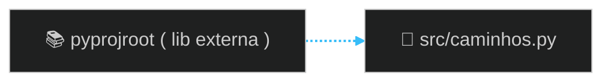

# ⚡ C4 Nível 4 (Código) — `src/caminhos.py`

> [!NOTE]
> **Gerado automaticamente a partir da AST do código-fonte e motor a2m.**
> Pela regra do modelo C4, o Nível 4 nunca é desenhado manualmente — ele reflete
> em tempo real as classes, funções, impacto e chamadas presentes em [`caminhos.py`](../../../src/caminhos.py).

**Navegação na Hierarquia C4:**
[🌐 Nível 1: Contexto](../c1-contexto.md) · [📦 Nível 2: Containers](../c2-containers.md) · [🧩 C3: Pipeline de Execução & Voo](../c3-execucao-voo.md) · **⚡ Nível 4: `caminhos.py`** · [📖 Guia de Visualização](../../../centralControle/GUIA_VISUALIZACAO.md)

---

## 1. Propósito do Módulo

Caminhos canônicos de dados e artefatos do projeto.

---

## 2. Fronteiras e Dependências do Arquivo

---

## 3. Catálogo de Símbolos (Links Diretos para o Código)
