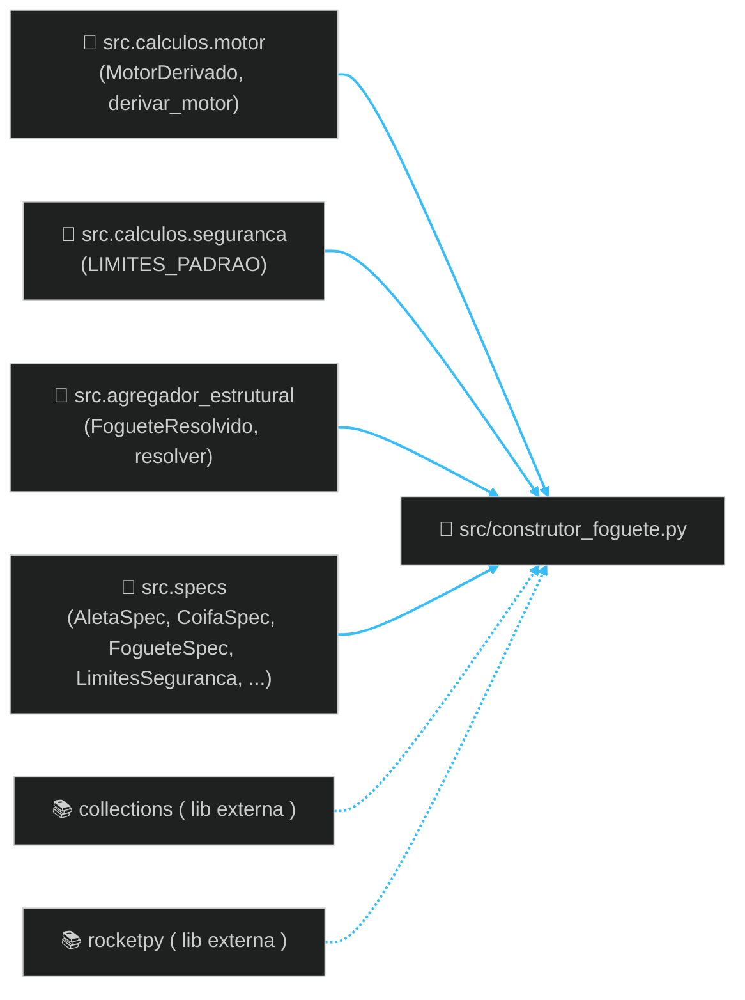
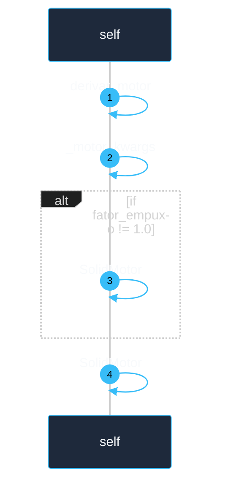
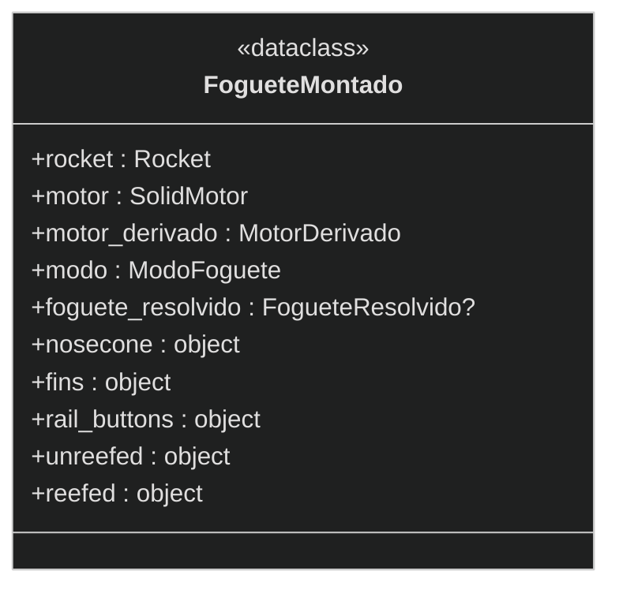
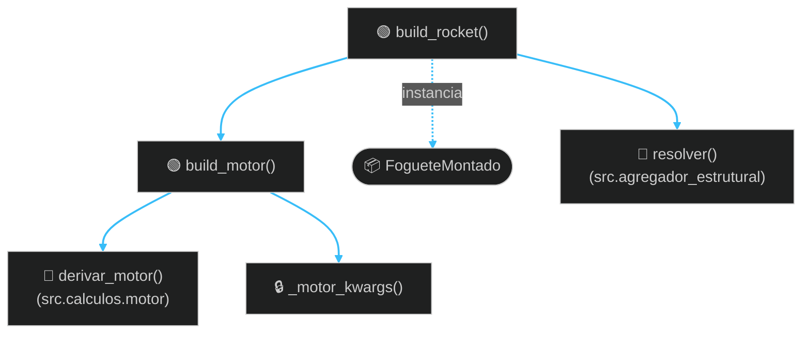

# ⚡ C4 Nível 4 (Código) — `src/construtor_foguete.py`

> [!NOTE]
> **Gerado automaticamente a partir da AST do código-fonte e motor a2m.**
> Pela regra do modelo C4, o Nível 4 nunca é desenhado manualmente — ele reflete
> em tempo real as classes, funções, impacto e chamadas presentes em [`construtor_foguete.py`](../../../src/construtor_foguete.py).

**Navegação na Hierarquia C4:**
[🌐 Nível 1: Contexto](../c1-contexto.md) · [📦 Nível 2: Containers](../c2-containers.md) · [🧩 C3: Pipeline de Execução & Voo](../c3-execucao-voo.md) · **⚡ Nível 4: `construtor_foguete.py`** · [📖 Guia de Visualização](../../../centralControle/GUIA_VISUALIZACAO.md)

---

## 1. Propósito do Módulo

Monta o `SolidMotor` e o `Rocket` prontos para simulação no RocketPy.

Separa explicitamente os dois modos de representação estrutural do foguete:
  - `modo="calculado"`: massa, CG e inércia vêm de `resolver(componentes, aleta, coifa, raio)`.
  - `modo="medido"`: massa, CG e inércia vêm de `GeometriaMedidaSpec` (bancada/OpenRocket).

Não importa nada de `configs/`; todas as especificações chegam por argumento.

---

## 2. Fronteiras e Dependências do Arquivo

#### 🧭 Dependências Internas Navegáveis

| Dependência | Símbolos Importados | Documento C4 |
| :--- | :--- | :--- |
| `🧩 src.agregador_estrutural` | `FogueteResolvido`, `resolver` | [⚡ `src__agregador_estrutural.c4.md`](src__agregador_estrutural.c4.md) |
| `🧩 src.calculos.motor` | `MotorDerivado`, `derivar_motor` | [⚡ `src__calculos__motor.c4.md`](src__calculos__motor.c4.md) |
| `🧩 src.calculos.seguranca` | `LIMITES_PADRAO` | [⚡ `src__calculos__seguranca.c4.md`](src__calculos__seguranca.c4.md) |
| `🧩 src.specs` | `AletaSpec`, `CoifaSpec`, `FogueteSpec`, `LimitesSeguranca`, `MassaPontualSpec`, ... | [⚡ `src__specs.c4.md`](src__specs.c4.md) |

---

## 3. Impacto Sistêmico e Fluxo de Execução

### Análise de Impacto Sistêmico (`a2m impact`)

> [!IMPORTANT]
> **Mapeamento de Efeito Cascata ao Modificar `build_motor()`:**
> - **Risco de Quebra Ascendente (Vermelho):** Funções e módulos externos que chamam esta lógica.
> - **Impacto Descendente (Azul):** Rotinas internas e dependências consumidas.

```mermaid
%%{init: {'theme': 'dark', 'themeVariables': { 'lineColor': '#38bdf8' }}}%%
graph TD
    classDef target fill:#ffe6cc,stroke:#d79b00,stroke-width:3px,color:#000
    classDef upward fill:#f8cecc,stroke:#b85450,stroke-width:2px,color:#000
    classDef downward fill:#dae8fc,stroke:#6c8ebf,stroke-width:1px,color:#000

    ALVO(("⭐ build_motor (ALVO)")):::target

    subgraph Ascendente["🚨 Risco de Quebra Ascendente (Quem consome esta função)"]
        code_construtor_foguete_py__function__build_rocket_H1ea3317b["⚠️ build_rocket"]:::upward
    end
    code_construtor_foguete_py__function__build_rocket_H1ea3317b --> ALVO
    subgraph Descendente["🧩 Impacto Descendente (Dependências consumidas)"]
        code_calculos_seguranca_py__function__check_kn_He000bcfb["check_kn"]:::downward
        code_calculos_seguranca_py__function__fs_carcaca_H13b5bc35["fs_carcaca"]:::downward
        code_calculos_motor_py__function___ler_eng_H458942d7["_ler_eng"]:::downward
        code_calculos_motor_py__function__derivar_motor_H72c18b31["derivar_motor"]:::downward
        code_calculos_motorlib_wrapper_py__function__extrair_geometria_props_Hbcbfe32c["extrair_geometria_props"]:::downward
        code_calculos_seguranca_py__function__check_p0_Hd65d174d["check_p0"]:::downward
        code_calculos_motor_py__function___derivar_carcaca_H48dc928e["_derivar_carcaca"]:::downward
        code_calculos_motorlib_wrapper_py__function__carregar_props_Hb7e62dfb["carregar_props"]:::downward
        code_calculos_motor_py__struct__MotorDerivado_Hf96b1b33["MotorDerivado"]:::downward
        code_calculos_motorlib_variacoes_py__function__aplicar_overrides_H8051349c["aplicar_overrides"]:::downward
        code_calculos_motor_py__function___integrar_trapezio_H515d0959["_integrar_trapezio"]:::downward
        code_construtor_foguete_py__function___motor_kwargs_Hc7e2af3e["_motor_kwargs"]:::downward
        code_calculos_motor_py__function___derivar_inercia_seca_H6f2bab99["_derivar_inercia_seca"]:::downward
        extern_rocketpy__SolidMotor_Hfc7e259f["SolidMotor"]:::downward
        extern_math__sqrt_H86ccf542["sqrt"]:::downward
        code_calculos_motor_py__function___resolver_fonte_e_geometria_H1a15d041["_resolver_fonte_e_geometria"]:::downward
        code_calculos_seguranca_py__function__check_mass_flux_H1757a559["check_mass_flux"]:::downward
        code_calculos_motor_py__function___diagnosticar_H34040dd9["_diagnosticar"]:::downward
        code_calculos_motor_py__function___derivar_dos_graos_H98100ac7["_derivar_dos_graos"]:::downward
        code_calculos_motorlib_wrapper_py__function__simular_props_Hb21e1ad9["simular_props"]:::downward
    end
    code_calculos_motor_py__function___derivar_dos_graos_H98100ac7 --> extern_math__sqrt_H86ccf542
    code_calculos_motor_py__function___diagnosticar_H34040dd9 --> code_calculos_seguranca_py__function__check_kn_He000bcfb
    code_calculos_motor_py__function___diagnosticar_H34040dd9 --> code_calculos_seguranca_py__function__check_mass_flux_H1757a559
    code_calculos_motor_py__function___diagnosticar_H34040dd9 --> code_calculos_seguranca_py__function__check_p0_Hd65d174d
    code_calculos_motor_py__function___diagnosticar_H34040dd9 --> code_calculos_seguranca_py__function__fs_carcaca_H13b5bc35
    code_calculos_motor_py__function___resolver_fonte_e_geometria_H1a15d041 --> code_calculos_motor_py__function___integrar_trapezio_H515d0959
    code_calculos_motor_py__function___resolver_fonte_e_geometria_H1a15d041 --> code_calculos_motor_py__function___ler_eng_H458942d7
    code_calculos_motor_py__function___resolver_fonte_e_geometria_H1a15d041 --> code_calculos_motorlib_variacoes_py__function__aplicar_overrides_H8051349c
    code_calculos_motor_py__function___resolver_fonte_e_geometria_H1a15d041 --> code_calculos_motorlib_wrapper_py__function__carregar_props_Hb7e62dfb
    code_calculos_motor_py__function___resolver_fonte_e_geometria_H1a15d041 --> code_calculos_motorlib_wrapper_py__function__extrair_geometria_props_Hbcbfe32c
    code_calculos_motor_py__function___resolver_fonte_e_geometria_H1a15d041 --> code_calculos_motorlib_wrapper_py__function__simular_props_Hb21e1ad9
    code_calculos_motor_py__function__derivar_motor_H72c18b31 --> code_calculos_motor_py__function___derivar_carcaca_H48dc928e
    code_calculos_motor_py__function__derivar_motor_H72c18b31 --> code_calculos_motor_py__function___derivar_dos_graos_H98100ac7
    code_calculos_motor_py__function__derivar_motor_H72c18b31 --> code_calculos_motor_py__function___derivar_inercia_seca_H6f2bab99
    code_calculos_motor_py__function__derivar_motor_H72c18b31 --> code_calculos_motor_py__function___diagnosticar_H34040dd9
    code_calculos_motor_py__function__derivar_motor_H72c18b31 --> code_calculos_motor_py__function___resolver_fonte_e_geometria_H1a15d041
    code_calculos_motor_py__function__derivar_motor_H72c18b31 --> code_calculos_motor_py__struct__MotorDerivado_Hf96b1b33
    ALVO --> code_calculos_motor_py__function__derivar_motor_H72c18b31
    ALVO --> code_construtor_foguete_py__function___motor_kwargs_Hc7e2af3e
    ALVO --> extern_rocketpy__SolidMotor_Hfc7e259f
    click code_calculos_motor_py__function___derivar_carcaca_H48dc928e href "src__calculos__motor.c4.md" "Abrir C4 (_derivar_carcaca)"
    click code_calculos_motor_py__function___derivar_dos_graos_H98100ac7 href "src__calculos__motor.c4.md" "Abrir C4 (_derivar_dos_graos)"
    click code_calculos_motor_py__function___derivar_inercia_seca_H6f2bab99 href "src__calculos__motor.c4.md" "Abrir C4 (_derivar_inercia_seca)"
    click code_calculos_motor_py__function___diagnosticar_H34040dd9 href "src__calculos__motor.c4.md" "Abrir C4 (_diagnosticar)"
    click code_calculos_motor_py__function___integrar_trapezio_H515d0959 href "src__calculos__motor.c4.md" "Abrir C4 (_integrar_trapezio)"
    click code_calculos_motor_py__function___ler_eng_H458942d7 href "src__calculos__motor.c4.md" "Abrir C4 (_ler_eng)"
    click code_calculos_motor_py__function___resolver_fonte_e_geometria_H1a15d041 href "src__calculos__motor.c4.md" "Abrir C4 (_resolver_fonte_e_geometria)"
    click code_calculos_motor_py__function__derivar_motor_H72c18b31 href "src__calculos__motor.c4.md" "Abrir C4 (derivar_motor)"
    click code_calculos_motor_py__struct__MotorDerivado_Hf96b1b33 href "src__calculos__motor.c4.md" "Abrir C4 (MotorDerivado)"
    click code_calculos_motorlib_variacoes_py__function__aplicar_overrides_H8051349c href "src__calculos__motorlib_variacoes.c4.md" "Abrir C4 (aplicar_overrides)"
    click code_calculos_motorlib_wrapper_py__function__carregar_props_Hb7e62dfb href "src__calculos__motorlib_wrapper.c4.md" "Abrir C4 (carregar_props)"
    click code_calculos_motorlib_wrapper_py__function__extrair_geometria_props_Hbcbfe32c href "src__calculos__motorlib_wrapper.c4.md" "Abrir C4 (extrair_geometria_props)"
    click code_calculos_motorlib_wrapper_py__function__simular_props_Hb21e1ad9 href "src__calculos__motorlib_wrapper.c4.md" "Abrir C4 (simular_props)"
    click code_calculos_seguranca_py__function__check_kn_He000bcfb href "src__calculos__seguranca.c4.md" "Abrir C4 (check_kn)"
    click code_calculos_seguranca_py__function__check_mass_flux_H1757a559 href "src__calculos__seguranca.c4.md" "Abrir C4 (check_mass_flux)"
    click code_calculos_seguranca_py__function__check_p0_Hd65d174d href "src__calculos__seguranca.c4.md" "Abrir C4 (check_p0)"
    click code_calculos_seguranca_py__function__fs_carcaca_H13b5bc35 href "src__calculos__seguranca.c4.md" "Abrir C4 (fs_carcaca)"
    linkStyle default stroke:#38bdf8,stroke-width:2px;
```

#### 🧭 Atalhos Rápidos de Navegação (Impacto Sistêmico)

| Relação | Símbolo / Função | Arquivo C4 Destino |
| :--- | :--- | :--- |
| 🧩 Impacto Descendente (Callee) | `_derivar_carcaca` | [⚡ `src__calculos__motor.c4.md`](src__calculos__motor.c4.md) |
| 🧩 Impacto Descendente (Callee) | `_derivar_dos_graos` | [⚡ `src__calculos__motor.c4.md`](src__calculos__motor.c4.md) |
| 🧩 Impacto Descendente (Callee) | `_derivar_inercia_seca` | [⚡ `src__calculos__motor.c4.md`](src__calculos__motor.c4.md) |
| 🧩 Impacto Descendente (Callee) | `_diagnosticar` | [⚡ `src__calculos__motor.c4.md`](src__calculos__motor.c4.md) |
| 🧩 Impacto Descendente (Callee) | `_integrar_trapezio` | [⚡ `src__calculos__motor.c4.md`](src__calculos__motor.c4.md) |
| 🧩 Impacto Descendente (Callee) | `_ler_eng` | [⚡ `src__calculos__motor.c4.md`](src__calculos__motor.c4.md) |
| 🧩 Impacto Descendente (Callee) | `_resolver_fonte_e_geometria` | [⚡ `src__calculos__motor.c4.md`](src__calculos__motor.c4.md) |
| 🧩 Impacto Descendente (Callee) | `derivar_motor` | [⚡ `src__calculos__motor.c4.md`](src__calculos__motor.c4.md) |
| 🧩 Impacto Descendente (Callee) | `MotorDerivado` | [⚡ `src__calculos__motor.c4.md`](src__calculos__motor.c4.md) |
| 🧩 Impacto Descendente (Callee) | `aplicar_overrides` | [⚡ `src__calculos__motorlib_variacoes.c4.md`](src__calculos__motorlib_variacoes.c4.md) |
| 🧩 Impacto Descendente (Callee) | `carregar_props` | [⚡ `src__calculos__motorlib_wrapper.c4.md`](src__calculos__motorlib_wrapper.c4.md) |
| 🧩 Impacto Descendente (Callee) | `extrair_geometria_props` | [⚡ `src__calculos__motorlib_wrapper.c4.md`](src__calculos__motorlib_wrapper.c4.md) |
| 🧩 Impacto Descendente (Callee) | `simular_props` | [⚡ `src__calculos__motorlib_wrapper.c4.md`](src__calculos__motorlib_wrapper.c4.md) |
| 🧩 Impacto Descendente (Callee) | `check_kn` | [⚡ `src__calculos__seguranca.c4.md`](src__calculos__seguranca.c4.md) |
| 🧩 Impacto Descendente (Callee) | `check_mass_flux` | [⚡ `src__calculos__seguranca.c4.md`](src__calculos__seguranca.c4.md) |
| 🧩 Impacto Descendente (Callee) | `check_p0` | [⚡ `src__calculos__seguranca.c4.md`](src__calculos__seguranca.c4.md) |
| 🧩 Impacto Descendente (Callee) | `fs_carcaca` | [⚡ `src__calculos__seguranca.c4.md`](src__calculos__seguranca.c4.md) |

### Diagrama de Sequência de Execução — `build_motor()` (`sequenceDiagram`)

> [!NOTE]
> Mostra o fluxo sequencial real de controle de execução da função,
> incluindo condicionais (`alt ... else`) e laços (`loop`).

---

## 4. Estrutura de Classes e Contratos (`classDiagram`)

---

## 5. Fluxo Lógico de Funções Locais (`flowchart TD`)

#### 🧭 Chamadas Externas Identificadas

| Chamada Local | Módulo de Origem | Documento C4 |
| :--- | :--- | :--- |
| `🔗 derivar_motor()` | `src.calculos.motor` | [⚡ `src__calculos__motor.c4.md`](src__calculos__motor.c4.md) |
| `🔗 resolver()` | `src.agregador_estrutural` | [⚡ `src__agregador_estrutural.c4.md`](src__agregador_estrutural.c4.md) |

---

## 6. Catálogo de Símbolos (Links Diretos para o Código)

### Classes / Contratos

| Classe | Linhas | Tipo | Resumo |
| :--- | :--- | :--- | :--- |
| [`FogueteMontado`](../../../src/construtor_foguete.py#L35-L45) | `L35–L45` | `@dataclass` | — |

### Funções do Módulo

| Função | Linhas | Retorno | Resumo |
| :--- | :--- | :--- | :--- |
| [`_motor_kwargs`](../../../src/construtor_foguete.py#L48-L78) | `L48–L78` | `dict[str, Any]` | Traduz `MotorSpec` + `MotorDerivado` para os argumentos de `SolidMotor`. |
| [`build_motor`](../../../src/construtor_foguete.py#L81-L95) | `L81–L95` | `tuple[SolidMotor, MotorDerivado]` | Constrói o `SolidMotor` e o `MotorDerivado` a partir de um `MotorSpec`. |
| [`build_rocket`](../../../src/construtor_foguete.py#L98-L240) | `L98–L240` | `FogueteMontado` | Constrói o `FogueteMontado` no modo estrutural escolhido (`calculado` ou `medido`). |
