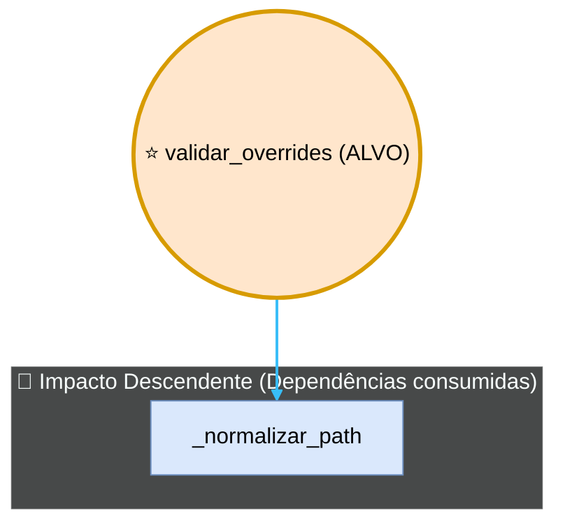
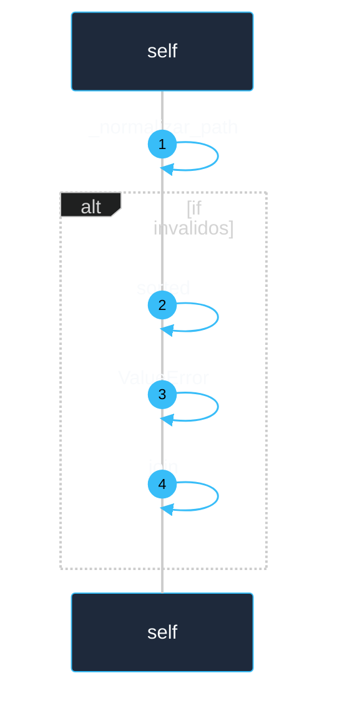
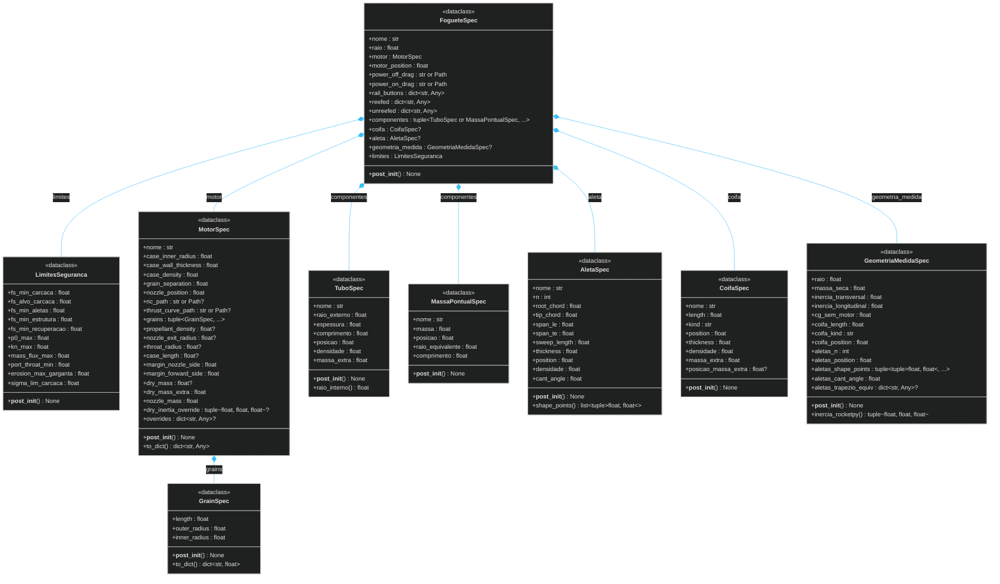
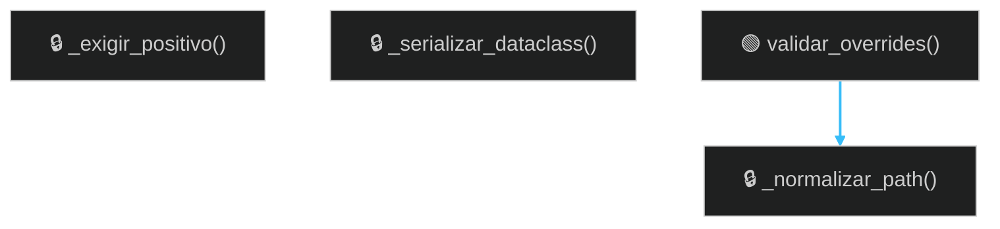

# ⚡ C4 Nível 4 (Código) — `src/especificacoes.py`

> [!NOTE]
> **Gerado automaticamente a partir da AST do código-fonte e motor a2m.**
> Pela regra do modelo C4, o Nível 4 nunca é desenhado manualmente — ele reflete
> em tempo real as classes, funções, impacto e chamadas presentes em [`especificacoes.py`](../../../src/especificacoes.py).

**Navegação na Hierarquia C4:**
[🌐 Nível 1: Contexto](../c1-contexto.md) · [📦 Nível 2: Containers](../c2-containers.md) · [🧩 C3: Pipeline de Execução & Voo](../c3-execucao-voo.md) · **⚡ Nível 4: `especificacoes.py`** · [📖 Guia de Visualização](../../../centralControle/GUIA_VISUALIZACAO.md)

---

## 1. Propósito do Módulo

Especificações de domínio (Specs), validação fail-fast e whitelist de overrides.

Define todos os contratos de entrada do projeto sem importar `configs/` nem
dependências pesadas (OpenMotor/RocketPy), garantindo pureza no `import`.
Todas as unidades estão no Sistema Internacional (SI: m, kg, s, Pa, kg/m³),
salvo indicação explícita (como ângulos em graus).

---

## 2. Fronteiras e Dependências do Arquivo

---

## 3. Impacto Sistêmico e Fluxo de Execução

### Análise de Impacto Sistêmico (`a2m impact`)

> [!IMPORTANT]
> **Mapeamento de Efeito Cascata ao Modificar `validar_overrides()`:**
> - **Risco de Quebra Ascendente (Vermelho):** Funções e módulos externos que chamam esta lógica.
> - **Impacto Descendente (Azul):** Rotinas internas e dependências consumidas.

### Diagrama de Sequência de Execução — `validar_overrides()` (`sequenceDiagram`)

> [!NOTE]
> Mostra o fluxo sequencial real de controle de execução da função,
> incluindo condicionais (`alt ... else`) e laços (`loop`).

---

## 4. Estrutura de Classes e Contratos (`classDiagram`)

---

## 5. Fluxo Lógico de Funções Locais (`flowchart TD`)

---

## 6. Catálogo de Símbolos (Links Diretos para o Código)

### Classes / Contratos

| Classe | Linhas | Tipo | Resumo |
| :--- | :--- | :--- | :--- |
| [`LimitesSeguranca`](../../../src/especificacoes.py#L69-L93) | `L69–L93` | `@dataclass` | Critérios de aceitação estrutural e operacional (ex.: IREC). |
| [`GrainSpec`](../../../src/especificacoes.py#L103-L118) | `L103–L118` | `@dataclass` | Grão propelente cilíndrico oco (BATES). |
| [`MotorSpec`](../../../src/especificacoes.py#L122-L186) | `L122–L186` | `@dataclass` | Especificação declarativa de um motor sólido. |
| [`TuboSpec`](../../../src/especificacoes.py#L193-L218) | `L193–L218` | `@dataclass` | Cilindro oco (ou maciço quando espessura == raio_externo). |
| [`MassaPontualSpec`](../../../src/especificacoes.py#L222-L236) | `L222–L236` | `@dataclass` | Componente interno com massa fixa e geometria equivalente para inércia. |
| [`AletaSpec`](../../../src/especificacoes.py#L240-L277) | `L240–L277` | `@dataclass` | Conjunto de aletas trapezoidais/freeform em SI. |
| [`CoifaSpec`](../../../src/especificacoes.py#L281-L296) | `L281–L296` | `@dataclass` | Coifa modelada como casca fina sobre o perfil `kind`. |
| [`GeometriaMedidaSpec`](../../../src/especificacoes.py#L303-L336) | `L303–L336` | `@dataclass` | Propriedades globais medidas diretamente na bancada/OpenRocket (`modo='medido'`). |
| [`FogueteSpec`](../../../src/especificacoes.py#L343-L370) | `L343–L370` | `@dataclass` | Identidade completa de um foguete (suporta modos 'calculado' e 'medido'). |

### Funções do Módulo

| Função | Linhas | Retorno | Resumo |
| :--- | :--- | :--- | :--- |
| [`_exigir_positivo`](../../../src/especificacoes.py#L22-L26) | `L22–L26` | `None` | Falha imediatamente quando qualquer campo numérico é `<= 0`. |
| [`_serializar_dataclass`](../../../src/especificacoes.py#L29-L40) | `L29–L40` | `dict[str, Any]` | Serializa uma dataclass convertendo `Path` para `str` e tuplas para listas. |
| [`_normalizar_path`](../../../src/especificacoes.py#L46-L48) | `L46–L48` | `str` | Substitui índices numéricos por '*' para comparação com a whitelist. |
| [`validar_overrides`](../../../src/especificacoes.py#L51-L62) | `L51–L62` | `None` | Verifica se todos os paths de `overrides` pertencem à `whitelist`. |
