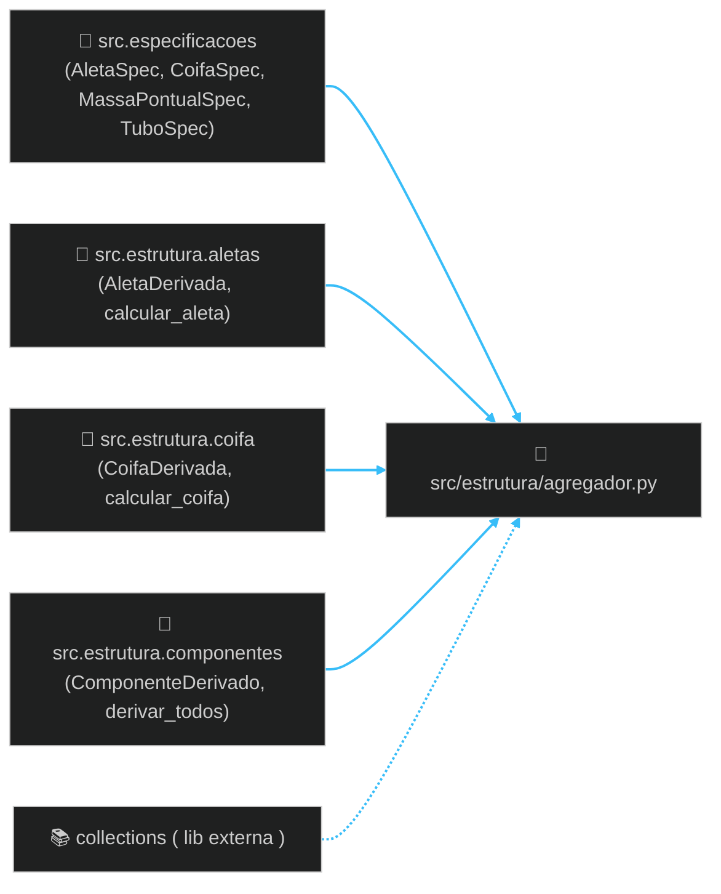
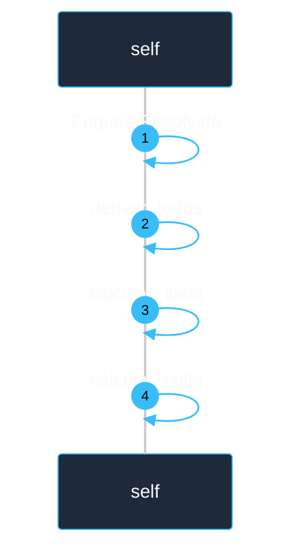
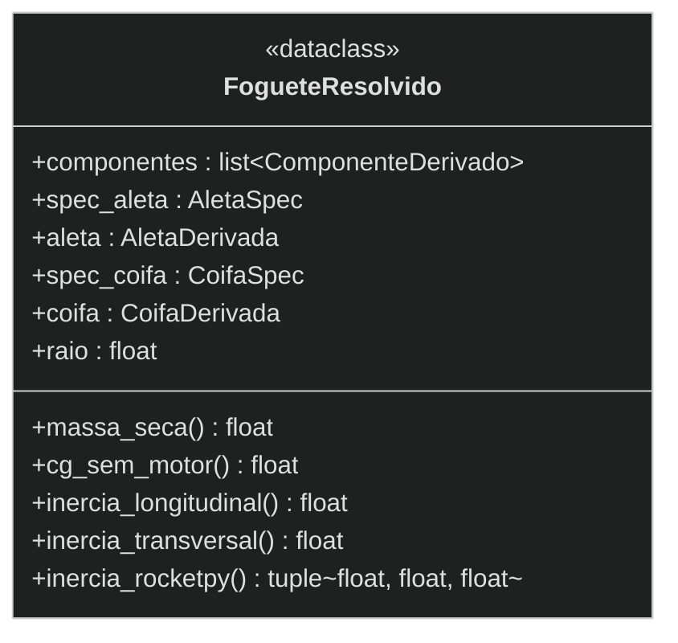
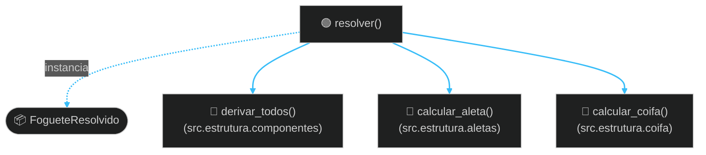

# ⚡ C4 Nível 4 (Código) — `src/estrutura/agregador.py`

> [!NOTE]
> **Gerado automaticamente a partir da AST do código-fonte e motor a2m.**
> Pela regra do modelo C4, o Nível 4 nunca é desenhado manualmente — ele reflete
> em tempo real as classes, funções, impacto e chamadas presentes em [`agregador.py`](../../../src/estrutura/agregador.py).

**Navegação na Hierarquia C4:**
[🌐 Nível 1: Contexto](../c1-contexto.md) · [📦 Nível 2: Containers](../c2-containers.md) · [🧩 C3: Pipeline de Execução & Voo](../c3-execucao-voo.md) · **⚡ Nível 4: `agregador.py`** · [📖 Guia de Visualização](../../../centralControle/GUIA_VISUALIZACAO.md)

---

## 1. Propósito do Módulo

Combina specs e derivados num `FogueteResolvido` (Modo Calculado).

Agrega massa seca, CG sem motor e momentos de inércia pelo Teorema de Steiner,
entregando a tupla de inércia na convenção exata do RocketPy:
`(I_11, I_22, I_33) = (I_transversal, I_transversal, I_longitudinal)`.

---

## 2. Fronteiras e Dependências do Arquivo

#### 🧭 Dependências Internas Navegáveis

| Dependência | Símbolos Importados | Documento C4 |
| :--- | :--- | :--- |
| `🧩 src.especificacoes` | `AletaSpec`, `CoifaSpec`, `MassaPontualSpec`, `TuboSpec` | [⚡ `src__especificacoes.c4.md`](src__especificacoes.c4.md) |
| `🧩 src.estrutura.aletas` | `AletaDerivada`, `calcular_aleta` | [⚡ `src__estrutura__aletas.c4.md`](src__estrutura__aletas.c4.md) |
| `🧩 src.estrutura.coifa` | `CoifaDerivada`, `calcular_coifa` | [⚡ `src__estrutura__coifa.c4.md`](src__estrutura__coifa.c4.md) |
| `🧩 src.estrutura.componentes` | `ComponenteDerivado`, `derivar_todos` | [⚡ `src__estrutura__componentes.c4.md`](src__estrutura__componentes.c4.md) |

---

## 3. Impacto Sistêmico e Fluxo de Execução

### Análise de Impacto Sistêmico (`a2m impact`)

> [!IMPORTANT]
> **Mapeamento de Efeito Cascata ao Modificar `resolver()`:**
> - **Risco de Quebra Ascendente (Vermelho):** Funções e módulos externos que chamam esta lógica.
> - **Impacto Descendente (Azul):** Rotinas internas e dependências consumidas.

```mermaid
%%{init: {'theme': 'dark', 'themeVariables': { 'lineColor': '#38bdf8' }}}%%
graph TD
    classDef target fill:#ffe6cc,stroke:#d79b00,stroke-width:3px,color:#000
    classDef upward fill:#f8cecc,stroke:#b85450,stroke-width:2px,color:#000
    classDef downward fill:#dae8fc,stroke:#6c8ebf,stroke-width:1px,color:#000

    ALVO(("⭐ resolver (ALVO)")):::target

    subgraph Ascendente["🚨 Risco de Quebra Ascendente (Quem consome esta função)"]
        code_simulacao_construtor_foguete_py__function__build_rocket_H78d46662["⚠️ build_rocket"]:::upward
        code_relatorios_py__function__relatorio_estrutura_H094b32d0["⚠️ relatorio_estrutura"]:::upward
    end
    code_relatorios_py__function__relatorio_estrutura_H094b32d0 --> ALVO
    code_simulacao_construtor_foguete_py__function__build_rocket_H78d46662 --> ALVO
    subgraph Descendente["🧩 Impacto Descendente (Dependências consumidas)"]
        code_estrutura_agregador_py__struct__FogueteResolvido_H6a97d6ec["FogueteResolvido"]:::downward
        code_estrutura_aletas_py__struct__AletaDerivada_Hd49930e1["AletaDerivada"]:::downward
        extern_math__sqrt_H86ccf542["sqrt"]:::downward
        code_estrutura_coifa_py__function___derivada_perfil_Hcb9c4bb1["_derivada_perfil"]:::downward
        code_estrutura_coifa_py__function__perfil_H5c9a8154["perfil"]:::downward
        code_estrutura_componentes_py__function__derivar_Ha9380997["derivar"]:::downward
        code_estrutura_componentes_py__function__derivar_massa_pontual_H0d748f9e["derivar_massa_pontual"]:::downward
        code_estrutura_coifa_py__struct__CoifaDerivada_Hb7163119["CoifaDerivada"]:::downward
        code_estrutura_componentes_py__function__derivar_tubo_H331218a5["derivar_tubo"]:::downward
        code_estrutura_coifa_py__function__calcular_coifa_H57dbc0ed["calcular_coifa"]:::downward
        code_estrutura_aletas_py__function___poligono_propriedades_Hbacb03cf["_poligono_propriedades"]:::downward
        code_estrutura_aletas_py__function__calcular_aleta_Hfbf470fc["calcular_aleta"]:::downward
        code_estrutura_componentes_py__function__derivar_todos_H2dd80524["derivar_todos"]:::downward
    end
    ALVO --> code_estrutura_agregador_py__struct__FogueteResolvido_H6a97d6ec
    ALVO --> code_estrutura_aletas_py__function__calcular_aleta_Hfbf470fc
    ALVO --> code_estrutura_coifa_py__function__calcular_coifa_H57dbc0ed
    ALVO --> code_estrutura_componentes_py__function__derivar_todos_H2dd80524
    code_estrutura_aletas_py__function__calcular_aleta_Hfbf470fc --> code_estrutura_aletas_py__function___poligono_propriedades_Hbacb03cf
    code_estrutura_aletas_py__function__calcular_aleta_Hfbf470fc --> code_estrutura_aletas_py__struct__AletaDerivada_Hd49930e1
    code_estrutura_coifa_py__function___derivada_perfil_Hcb9c4bb1 --> code_estrutura_coifa_py__function__perfil_H5c9a8154
    code_estrutura_coifa_py__function__calcular_coifa_H57dbc0ed --> code_estrutura_coifa_py__function___derivada_perfil_Hcb9c4bb1
    code_estrutura_coifa_py__function__calcular_coifa_H57dbc0ed --> code_estrutura_coifa_py__function__perfil_H5c9a8154
    code_estrutura_coifa_py__function__calcular_coifa_H57dbc0ed --> code_estrutura_coifa_py__struct__CoifaDerivada_Hb7163119
    code_estrutura_coifa_py__function__calcular_coifa_H57dbc0ed --> extern_math__sqrt_H86ccf542
    code_estrutura_componentes_py__function__derivar_Ha9380997 --> code_estrutura_componentes_py__function__derivar_massa_pontual_H0d748f9e
    code_estrutura_componentes_py__function__derivar_Ha9380997 --> code_estrutura_componentes_py__function__derivar_tubo_H331218a5
    code_estrutura_componentes_py__function__derivar_todos_H2dd80524 --> code_estrutura_componentes_py__function__derivar_Ha9380997
    click code_estrutura_aletas_py__function___poligono_propriedades_Hbacb03cf href "src__estrutura__aletas.c4.md" "Abrir C4 (_poligono_propriedades)"
    click code_estrutura_aletas_py__function__calcular_aleta_Hfbf470fc href "src__estrutura__aletas.c4.md" "Abrir C4 (calcular_aleta)"
    click code_estrutura_aletas_py__struct__AletaDerivada_Hd49930e1 href "src__estrutura__aletas.c4.md" "Abrir C4 (AletaDerivada)"
    click code_estrutura_coifa_py__function___derivada_perfil_Hcb9c4bb1 href "src__estrutura__coifa.c4.md" "Abrir C4 (_derivada_perfil)"
    click code_estrutura_coifa_py__function__calcular_coifa_H57dbc0ed href "src__estrutura__coifa.c4.md" "Abrir C4 (calcular_coifa)"
    click code_estrutura_coifa_py__function__perfil_H5c9a8154 href "src__estrutura__coifa.c4.md" "Abrir C4 (perfil)"
    click code_estrutura_coifa_py__struct__CoifaDerivada_Hb7163119 href "src__estrutura__coifa.c4.md" "Abrir C4 (CoifaDerivada)"
    click code_estrutura_componentes_py__function__derivar_Ha9380997 href "src__estrutura__componentes.c4.md" "Abrir C4 (derivar)"
    click code_estrutura_componentes_py__function__derivar_massa_pontual_H0d748f9e href "src__estrutura__componentes.c4.md" "Abrir C4 (derivar_massa_pontual)"
    click code_estrutura_componentes_py__function__derivar_todos_H2dd80524 href "src__estrutura__componentes.c4.md" "Abrir C4 (derivar_todos)"
    click code_estrutura_componentes_py__function__derivar_tubo_H331218a5 href "src__estrutura__componentes.c4.md" "Abrir C4 (derivar_tubo)"
    click code_relatorios_py__function__relatorio_estrutura_H094b32d0 href "src__relatorios.c4.md" "Abrir C4 (relatorio_estrutura)"
    click code_simulacao_construtor_foguete_py__function__build_rocket_H78d46662 href "src__simulacao__construtor_foguete.c4.md" "Abrir C4 (build_rocket)"
    linkStyle default stroke:#38bdf8,stroke-width:2px;
```

#### 🧭 Atalhos Rápidos de Navegação (Impacto Sistêmico)

| Relação | Símbolo / Função | Arquivo C4 Destino |
| :--- | :--- | :--- |
| 🧩 Impacto Descendente (Callee) | `_poligono_propriedades` | [⚡ `src__estrutura__aletas.c4.md`](src__estrutura__aletas.c4.md) |
| 🧩 Impacto Descendente (Callee) | `calcular_aleta` | [⚡ `src__estrutura__aletas.c4.md`](src__estrutura__aletas.c4.md) |
| 🧩 Impacto Descendente (Callee) | `AletaDerivada` | [⚡ `src__estrutura__aletas.c4.md`](src__estrutura__aletas.c4.md) |
| 🧩 Impacto Descendente (Callee) | `_derivada_perfil` | [⚡ `src__estrutura__coifa.c4.md`](src__estrutura__coifa.c4.md) |
| 🧩 Impacto Descendente (Callee) | `calcular_coifa` | [⚡ `src__estrutura__coifa.c4.md`](src__estrutura__coifa.c4.md) |
| 🧩 Impacto Descendente (Callee) | `perfil` | [⚡ `src__estrutura__coifa.c4.md`](src__estrutura__coifa.c4.md) |
| 🧩 Impacto Descendente (Callee) | `CoifaDerivada` | [⚡ `src__estrutura__coifa.c4.md`](src__estrutura__coifa.c4.md) |
| 🧩 Impacto Descendente (Callee) | `derivar` | [⚡ `src__estrutura__componentes.c4.md`](src__estrutura__componentes.c4.md) |
| 🧩 Impacto Descendente (Callee) | `derivar_massa_pontual` | [⚡ `src__estrutura__componentes.c4.md`](src__estrutura__componentes.c4.md) |
| 🧩 Impacto Descendente (Callee) | `derivar_todos` | [⚡ `src__estrutura__componentes.c4.md`](src__estrutura__componentes.c4.md) |
| 🧩 Impacto Descendente (Callee) | `derivar_tubo` | [⚡ `src__estrutura__componentes.c4.md`](src__estrutura__componentes.c4.md) |
| 🚨 Risco Ascendente (Caller) | `relatorio_estrutura` | [⚡ `src__relatorios.c4.md`](src__relatorios.c4.md) |
| 🚨 Risco Ascendente (Caller) | `build_rocket` | [⚡ `src__simulacao__construtor_foguete.c4.md`](src__simulacao__construtor_foguete.c4.md) |

### Diagrama de Sequência de Execução — `resolver()` (`sequenceDiagram`)

> [!NOTE]
> Mostra o fluxo sequencial real de controle de execução da função,
> incluindo condicionais (`alt ... else`) e laços (`loop`).

---

## 4. Estrutura de Classes e Contratos (`classDiagram`)

---

## 5. Fluxo Lógico de Funções Locais (`flowchart TD`)

#### 🧭 Chamadas Externas Identificadas

| Chamada Local | Módulo de Origem | Documento C4 |
| :--- | :--- | :--- |
| `🔗 derivar_todos()` | `src.estrutura.componentes` | [⚡ `src__estrutura__componentes.c4.md`](src__estrutura__componentes.c4.md) |
| `🔗 calcular_aleta()` | `src.estrutura.aletas` | [⚡ `src__estrutura__aletas.c4.md`](src__estrutura__aletas.c4.md) |
| `🔗 calcular_coifa()` | `src.estrutura.coifa` | [⚡ `src__estrutura__coifa.c4.md`](src__estrutura__coifa.c4.md) |

---

## 6. Catálogo de Símbolos (Links Diretos para o Código)

### Classes / Contratos

| Classe | Linhas | Tipo | Resumo |
| :--- | :--- | :--- | :--- |
| [`FogueteResolvido`](../../../src/estrutura/agregador.py#L20-L61) | `L20–L61` | `@dataclass` | Parâmetros estruturais resolvidos analiticamente (`modo='calculado'`). |

### Funções do Módulo

| Função | Linhas | Retorno | Resumo |
| :--- | :--- | :--- | :--- |
| [`resolver`](../../../src/estrutura/agregador.py#L64-L78) | `L64–L78` | `FogueteResolvido` | Combina componentes + coifa + aleta num `FogueteResolvido`. |
