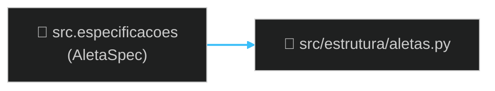
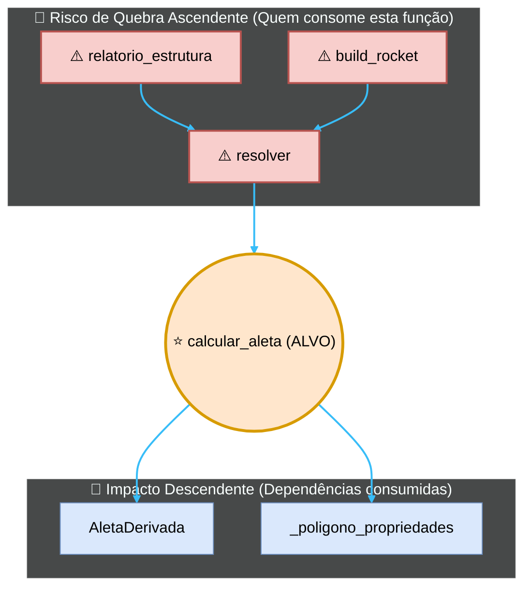
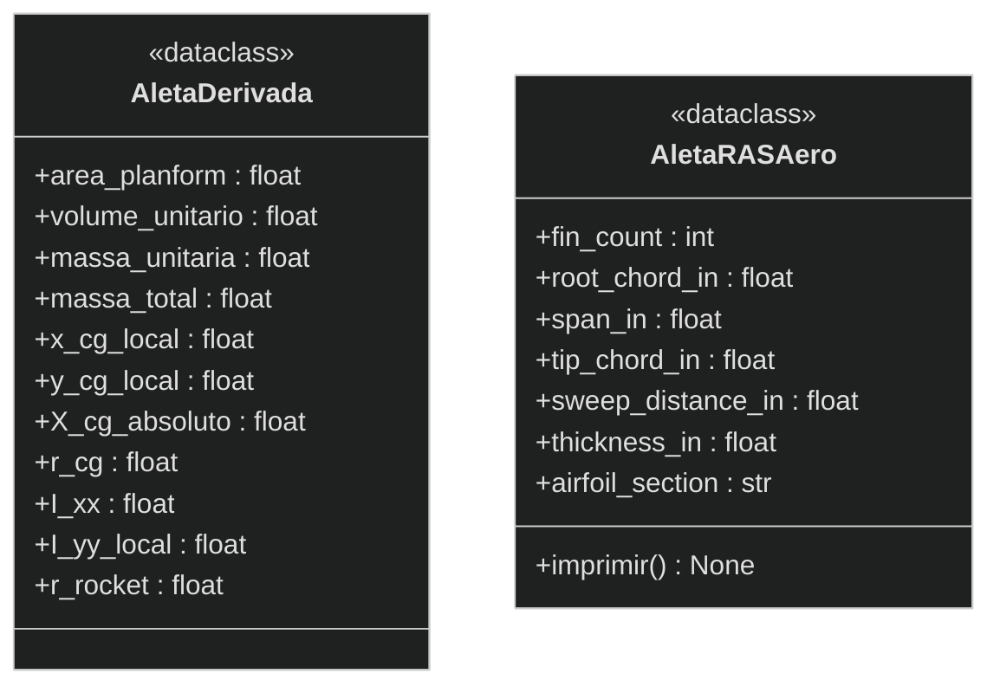
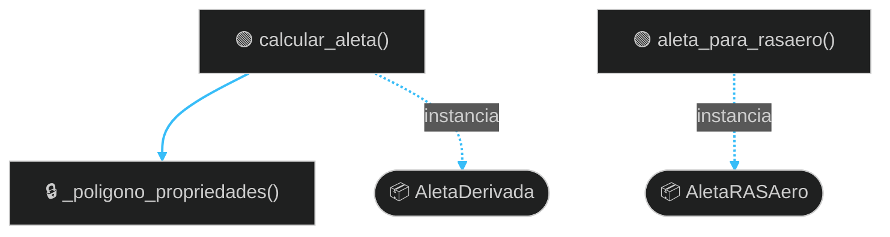

# ⚡ C4 Nível 4 (Código) — `src/estrutura/aletas.py`

> [!NOTE]
> **Gerado automaticamente a partir da AST do código-fonte e motor a2m.**
> Pela regra do modelo C4, o Nível 4 nunca é desenhado manualmente — ele reflete
> em tempo real as classes, funções, impacto e chamadas presentes em [`aletas.py`](../../../src/estrutura/aletas.py).

**Navegação na Hierarquia C4:**
[🌐 Nível 1: Contexto](../c1-contexto.md) · [📦 Nível 2: Containers](../c2-containers.md) · [🧩 C3: Pipeline de Execução & Voo](../c3-execucao-voo.md) · **⚡ Nível 4: `aletas.py`** · [📖 Guia de Visualização](../../../centralControle/GUIA_VISUALIZACAO.md)

---

## 1. Propósito do Módulo

Deriva massa, CG e inércia de uma `AletaSpec` e converte para o formato RASAero II.

---

## 2. Fronteiras e Dependências do Arquivo



#### 🧭 Dependências Internas Navegáveis

| Dependência | Símbolos Importados | Documento C4 |
| :--- | :--- | :--- |
| `🧩 src.especificacoes` | `AletaSpec` | [⚡ `src__especificacoes.c4.md`](src__especificacoes.c4.md) |

---

## 3. Impacto Sistêmico e Fluxo de Execução

### Análise de Impacto Sistêmico (`a2m impact`)

> [!IMPORTANT]
> **Mapeamento de Efeito Cascata ao Modificar `calcular_aleta()`:**
> - **Risco de Quebra Ascendente (Vermelho):** Funções e módulos externos que chamam esta lógica.
> - **Impacto Descendente (Azul):** Rotinas internas e dependências consumidas.



#### 🧭 Atalhos Rápidos de Navegação (Impacto Sistêmico)

| Relação | Símbolo / Função | Arquivo C4 Destino |
| :--- | :--- | :--- |
| 🚨 Risco Ascendente (Caller) | `resolver` | [⚡ `src__estrutura__agregador.c4.md`](src__estrutura__agregador.c4.md) |
| 🚨 Risco Ascendente (Caller) | `relatorio_estrutura` | [⚡ `src__relatorios.c4.md`](src__relatorios.c4.md) |
| 🚨 Risco Ascendente (Caller) | `build_rocket` | [⚡ `src__simulacao__construtor_foguete.c4.md`](src__simulacao__construtor_foguete.c4.md) |

### Diagrama de Sequência de Execução — `calcular_aleta()` (`sequenceDiagram`)

> [!NOTE]
> Mostra o fluxo sequencial real de controle de execução da função,
> incluindo condicionais (`alt ... else`) e laços (`loop`).

```mermaid
%%{init: {'theme': 'dark', 'themeVariables': { 'signalColor': '#38bdf8', 'signalTextColor': '#f8fafc', 'actorBkg': '#1e293b', 'actorBorder': '#38bdf8', 'actorTextColor': '#f8fafc' }}}%%
sequenceDiagram
    autonumber
    %% def calcular_aleta(spec: AletaSpec, r_rocket: float) -> AletaDerivada
    participant self as self
    alt if r_rocket &lt;= 0
        self->>self: ValueError
    end
    self->>self: _poligono_propriedades
    self->>self: AletaDerivada
```

---

## 4. Estrutura de Classes e Contratos (`classDiagram`)



---

## 5. Fluxo Lógico de Funções Locais (`flowchart TD`)



---

## 6. Catálogo de Símbolos (Links Diretos para o Código)

### Classes / Contratos

| Classe | Linhas | Tipo | Resumo |
| :--- | :--- | :--- | :--- |
| [`AletaDerivada`](../../../src/estrutura/aletas.py#L13-L26) | `L13–L26` | `@dataclass` | — |
| [`AletaRASAero`](../../../src/estrutura/aletas.py#L30-L47) | `L30–L47` | `@dataclass` | Campos de aleta prontos para inserção no RASAero II GUI. |

### Funções do Módulo

| Função | Linhas | Retorno | Resumo |
| :--- | :--- | :--- | :--- |
| [`_poligono_propriedades`](../../../src/estrutura/aletas.py#L50-L64) | `L50–L64` | `tuple[float, float, float]` | Área e centroide `(x_c, y_c)` de um polígono simples (fórmula de Shoelace). |
| [`calcular_aleta`](../../../src/estrutura/aletas.py#L67-L90) | `L67–L90` | `AletaDerivada` | Deriva massa, CG e inércia a partir da geometria e material. |
| [`aleta_para_rasaero`](../../../src/estrutura/aletas.py#L93-L114) | `L93–L114` | `AletaRASAero` | Converte `AletaSpec` (SI) para formato RASAero (polegadas). |
