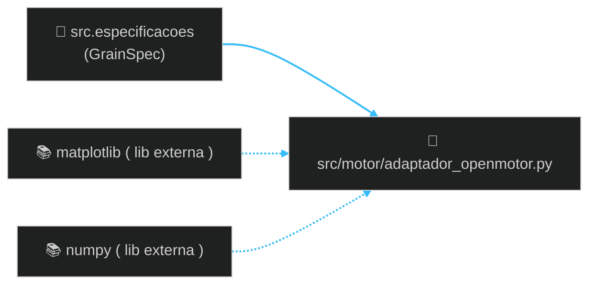
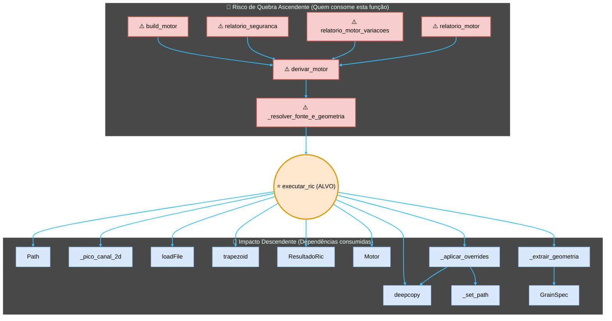
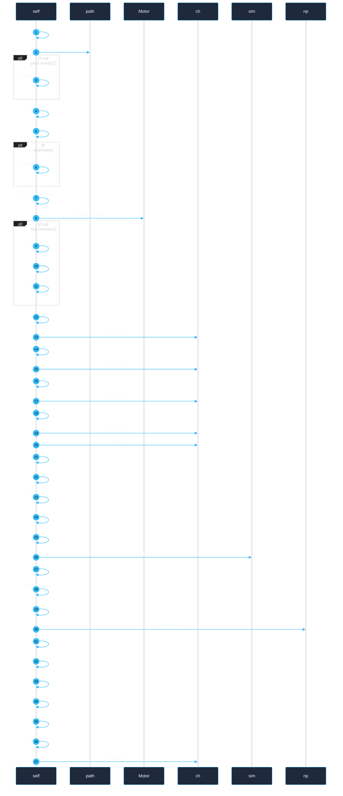
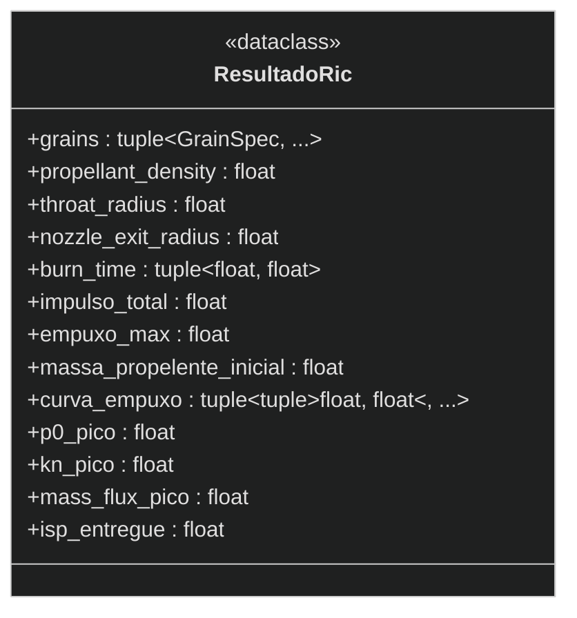
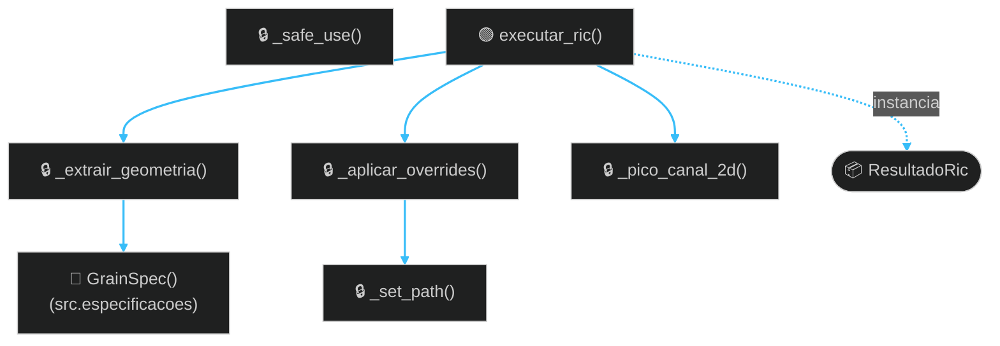

# ⚡ C4 Nível 4 (Código) — `src/motor/adaptador_openmotor.py`

> [!NOTE]
> **Gerado automaticamente a partir da AST do código-fonte e motor a2m.**
> Pela regra do modelo C4, o Nível 4 nunca é desenhado manualmente — ele reflete
> em tempo real as classes, funções, impacto e chamadas presentes em [`adaptador_openmotor.py`](../../../src/motor/adaptador_openmotor.py).

**Navegação na Hierarquia C4:**
[🌐 Nível 1: Contexto](../c1-contexto.md) · [📦 Nível 2: Containers](../c2-containers.md) · [🧩 C3: Subsistema de Motor & Segurança](../c3-subsistema-motor.md) · **⚡ Nível 4: `adaptador_openmotor.py`** · [📖 Guia de Visualização](../../../centralControle/GUIA_VISUALIZACAO.md)

---

## 1. Propósito do Módulo

Adaptador profundo do OpenMotor (motorlib/uilib) com suporte a overrides em memória.

Isola os efeitos colaterais de import do `uilib` (matplotlib backend,
`sys.excepthook` e logger) atrás de uma única interface `executar_ric()`.

---

## 2. Fronteiras e Dependências do Arquivo

#### 🧭 Dependências Internas Navegáveis

| Dependência | Símbolos Importados | Documento C4 |
| :--- | :--- | :--- |
| `🧩 src.especificacoes` | `GrainSpec` | [⚡ `src__especificacoes.c4.md`](src__especificacoes.c4.md) |

---

## 3. Impacto Sistêmico e Fluxo de Execução

### Análise de Impacto Sistêmico (`a2m impact`)

> [!IMPORTANT]
> **Mapeamento de Efeito Cascata ao Modificar `executar_ric()`:**
> - **Risco de Quebra Ascendente (Vermelho):** Funções e módulos externos que chamam esta lógica.
> - **Impacto Descendente (Azul):** Rotinas internas e dependências consumidas.

#### 🧭 Atalhos Rápidos de Navegação (Impacto Sistêmico)

| Relação | Símbolo / Função | Arquivo C4 Destino |
| :--- | :--- | :--- |
| 🚨 Risco Ascendente (Caller) | `_resolver_fonte_e_geometria` | [⚡ `src__motor__derivador.c4.md`](src__motor__derivador.c4.md) |
| 🚨 Risco Ascendente (Caller) | `derivar_motor` | [⚡ `src__motor__derivador.c4.md`](src__motor__derivador.c4.md) |
| 🚨 Risco Ascendente (Caller) | `relatorio_motor` | [⚡ `src__relatorios.c4.md`](src__relatorios.c4.md) |
| 🚨 Risco Ascendente (Caller) | `relatorio_motor_variacoes` | [⚡ `src__relatorios.c4.md`](src__relatorios.c4.md) |
| 🚨 Risco Ascendente (Caller) | `relatorio_seguranca` | [⚡ `src__relatorios.c4.md`](src__relatorios.c4.md) |
| 🚨 Risco Ascendente (Caller) | `build_motor` | [⚡ `src__simulacao__construtor_foguete.c4.md`](src__simulacao__construtor_foguete.c4.md) |

### Diagrama de Sequência de Execução — `executar_ric()` (`sequenceDiagram`)

> [!NOTE]
> Mostra o fluxo sequencial real de controle de execução da função,
> incluindo condicionais (`alt ... else`) e laços (`loop`).

---

## 4. Estrutura de Classes e Contratos (`classDiagram`)

---

## 5. Fluxo Lógico de Funções Locais (`flowchart TD`)

#### 🧭 Chamadas Externas Identificadas

| Chamada Local | Módulo de Origem | Documento C4 |
| :--- | :--- | :--- |
| `🔗 GrainSpec()` | `src.especificacoes` | [⚡ `src__especificacoes.c4.md`](src__especificacoes.c4.md) |

---

## 6. Catálogo de Símbolos (Links Diretos para o Código)

### Classes / Contratos

| Classe | Linhas | Tipo | Resumo |
| :--- | :--- | :--- | :--- |
| [`ResultadoRic`](../../../src/motor/adaptador_openmotor.py#L52-L66) | `L52–L66` | `@dataclass` | Geometria efetiva pós-overrides e métricas balísticas da simulação `.ric`. |

### Funções do Módulo

| Função | Linhas | Retorno | Resumo |
| :--- | :--- | :--- | :--- |
| [`_safe_use`](../../../src/motor/adaptador_openmotor.py#L29-L32) | `L29–L32` | `None` | — |
| [`_set_path`](../../../src/motor/adaptador_openmotor.py#L69-L104) | `L69–L104` | `None` | Aplica `valor` em `obj` seguindo `partes` (dot-path com suporte a `*` e índice). |
| [`_aplicar_overrides`](../../../src/motor/adaptador_openmotor.py#L107-L116) | `L107–L116` | `dict` | Retorna uma cópia de `props` com wildcards aplicados antes de índices específicos. |
| [`_extrair_geometria`](../../../src/motor/adaptador_openmotor.py#L119-L141) | `L119–L141` | `tuple[tuple[GrainSpec, ...], float, float, float]` | Extrai `(grains, propellant_density, throat_radius, nozzle_exit_radius)` de `props`. |
| [`_pico_canal_2d`](../../../src/motor/adaptador_openmotor.py#L144-L149) | `L144–L149` | `float` | — |
| [`executar_ric`](../../../src/motor/adaptador_openmotor.py#L152-L201) | `L152–L201` | `ResultadoRic` | Carrega um `.ric`, aplica `overrides` em memória, extrai geometria e roda o OpenMotor. |
