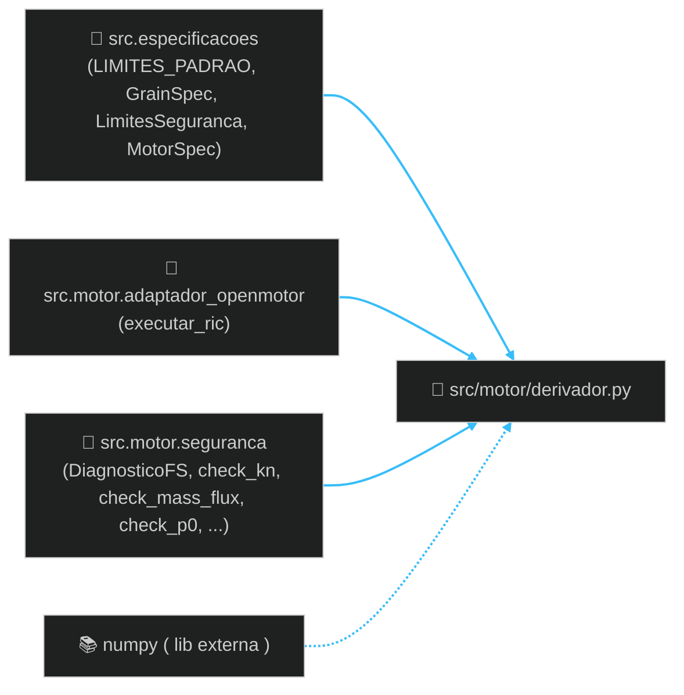
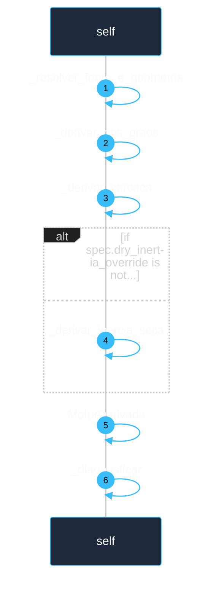
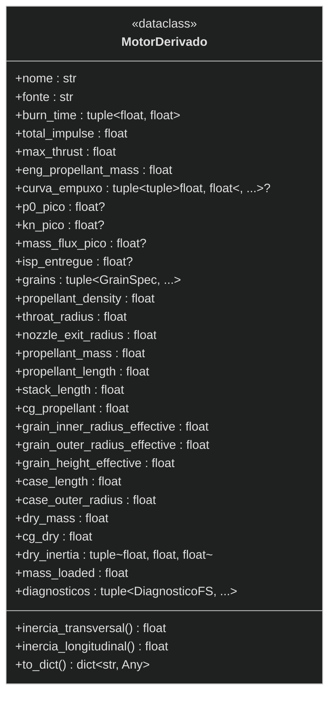
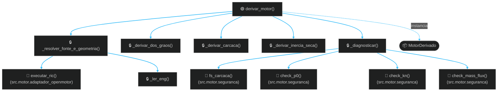

# ⚡ C4 Nível 4 (Código) — `src/motor/derivador.py`

> [!NOTE]
> **Gerado automaticamente a partir da AST do código-fonte e motor a2m.**
> Pela regra do modelo C4, o Nível 4 nunca é desenhado manualmente — ele reflete
> em tempo real as classes, funções, impacto e chamadas presentes em [`derivador.py`](../../../src/motor/derivador.py).

**Navegação na Hierarquia C4:**
[🌐 Nível 1: Contexto](../c1-contexto.md) · [📦 Nível 2: Containers](../c2-containers.md) · [🧩 C3: Subsistema de Motor & Segurança](../c3-subsistema-motor.md) · **⚡ Nível 4: `derivador.py`** · [📖 Guia de Visualização](../../../centralControle/GUIA_VISUALIZACAO.md)

---

## 1. Propósito do Módulo

Deriva propriedades completas do motor a partir de um `MotorSpec` (.ric > .eng).

Este é um módulo profundo:
  1. Se `spec.ric_path` está definido, delega ao `adaptador_openmotor.executar_ric`
     aplicando `spec.overrides` em memória uma única vez e extraindo geometria e
     balística consistentes.
  2. Se apenas `spec.thrust_curve_path` (.eng) está definido, integra a curva RASP
     e usa os grãos declarados em `spec.grains`.
  3. Calcula massa, CG, raio efetivo, inércia seca na convenção RocketPy e
     diagnósticos de segurança frente a `LimitesSeguranca`.

---

## 2. Fronteiras e Dependências do Arquivo

#### 🧭 Dependências Internas Navegáveis

| Dependência | Símbolos Importados | Documento C4 |
| :--- | :--- | :--- |
| `🧩 src.especificacoes` | `LIMITES_PADRAO`, `GrainSpec`, `LimitesSeguranca`, `MotorSpec` | [⚡ `src__especificacoes.c4.md`](src__especificacoes.c4.md) |
| `🧩 src.motor.adaptador_openmotor` | `executar_ric` | [⚡ `src__motor__adaptador_openmotor.c4.md`](src__motor__adaptador_openmotor.c4.md) |
| `🧩 src.motor.seguranca` | `DiagnosticoFS`, `check_kn`, `check_mass_flux`, `check_p0`, `fs_carcaca` | [⚡ `src__motor__seguranca.c4.md`](src__motor__seguranca.c4.md) |

---

## 3. Impacto Sistêmico e Fluxo de Execução

### Análise de Impacto Sistêmico (`a2m impact`)

> [!IMPORTANT]
> **Mapeamento de Efeito Cascata ao Modificar `derivar_motor()`:**
> - **Risco de Quebra Ascendente (Vermelho):** Funções e módulos externos que chamam esta lógica.
> - **Impacto Descendente (Azul):** Rotinas internas e dependências consumidas.

```mermaid
%%{init: {'theme': 'dark', 'themeVariables': { 'lineColor': '#38bdf8' }}}%%
graph TD
    classDef target fill:#ffe6cc,stroke:#d79b00,stroke-width:3px,color:#000
    classDef upward fill:#f8cecc,stroke:#b85450,stroke-width:2px,color:#000
    classDef downward fill:#dae8fc,stroke:#6c8ebf,stroke-width:1px,color:#000

    ALVO(("⭐ derivar_motor (ALVO)")):::target

    subgraph Ascendente["🚨 Risco de Quebra Ascendente (Quem consome esta função)"]
        code_relatorios_py__function__relatorio_seguranca_H11f57f78["⚠️ relatorio_seguranca"]:::upward
        code_relatorios_py__function__relatorio_motor_H6c9acec8["⚠️ relatorio_motor"]:::upward
        code_relatorios_py__function__relatorio_motor_variacoes_H0b79fa33["⚠️ relatorio_motor_variacoes"]:::upward
        code_simulacao_construtor_foguete_py__function__build_rocket_H78d46662["⚠️ build_rocket"]:::upward
        code_simulacao_construtor_foguete_py__function__build_motor_Hbe678e56["⚠️ build_motor"]:::upward
    end
    code_relatorios_py__function__relatorio_motor_H6c9acec8 --> ALVO
    code_relatorios_py__function__relatorio_motor_variacoes_H0b79fa33 --> ALVO
    code_relatorios_py__function__relatorio_seguranca_H11f57f78 --> ALVO
    code_simulacao_construtor_foguete_py__function__build_motor_Hbe678e56 --> ALVO
    code_simulacao_construtor_foguete_py__function__build_rocket_H78d46662 --> code_simulacao_construtor_foguete_py__function__build_motor_Hbe678e56
    subgraph Descendente["🧩 Impacto Descendente (Dependências consumidas)"]
        code_motor_adaptador_openmotor_py__function__executar_ric_H49ca99b7["executar_ric"]:::downward
        code_motor_derivador_py__struct__MotorDerivado_Hd4e5d2d3["MotorDerivado"]:::downward
        extern_motor__Motor_Hcc0c9bee["Motor"]:::downward
        code_motor_adaptador_openmotor_py__function___aplicar_overrides_H53241152["_aplicar_overrides"]:::downward
        code_motor_seguranca_py__struct__DiagnosticoFS_H08a335bb["DiagnosticoFS"]:::downward
        extern_math__sqrt_H86ccf542["sqrt"]:::downward
        extern_numpy__trapezoid_Hbc102c77["trapezoid"]:::downward
        code_motor_seguranca_py__function___verificar_teto_H05031ab8["_verificar_teto"]:::downward
        code_motor_seguranca_py__function__check_p0_H62c1972c["check_p0"]:::downward
        code_motor_derivador_py__function___resolver_fonte_e_geometria_H35eb7443["_resolver_fonte_e_geometria"]:::downward
        code_motor_derivador_py__function___diagnosticar_H516ee10e["_diagnosticar"]:::downward
        code_motor_adaptador_openmotor_py__function___pico_canal_2d_Hb5c40048["_pico_canal_2d"]:::downward
        code_motor_seguranca_py__function__fs_carcaca_H5149385b["fs_carcaca"]:::downward
        code_motor_derivador_py__function___derivar_carcaca_H7f1129db["_derivar_carcaca"]:::downward
        extern_fileIO__loadFile_Hfe8ed6d4["loadFile"]:::downward
        code_motor_adaptador_openmotor_py__struct__ResultadoRic_H7c88ef35["ResultadoRic"]:::downward
        code_motor_adaptador_openmotor_py__function___extrair_geometria_H59c6fe2d["_extrair_geometria"]:::downward
        code_motor_seguranca_py__function__check_mass_flux_H946b27da["check_mass_flux"]:::downward
        code_motor_derivador_py__function___derivar_dos_graos_Hd696d94b["_derivar_dos_graos"]:::downward
        extern_pathlib__Path_Hd2621e53["Path"]:::downward
        extern_copy__deepcopy_H618b073e["deepcopy"]:::downward
        code_motor_seguranca_py__function__check_kn_H83a6a604["check_kn"]:::downward
        extern_math__isfinite_H0279690a["isfinite"]:::downward
        code_motor_derivador_py__function___ler_eng_H858ba6e1["_ler_eng"]:::downward
        code_motor_derivador_py__function___derivar_inercia_seca_H007f35ab["_derivar_inercia_seca"]:::downward
    end
    code_motor_adaptador_openmotor_py__function__executar_ric_H49ca99b7 --> code_motor_adaptador_openmotor_py__function___aplicar_overrides_H53241152
    code_motor_adaptador_openmotor_py__function__executar_ric_H49ca99b7 --> code_motor_adaptador_openmotor_py__function___extrair_geometria_H59c6fe2d
    code_motor_adaptador_openmotor_py__function__executar_ric_H49ca99b7 --> code_motor_adaptador_openmotor_py__function___pico_canal_2d_Hb5c40048
    code_motor_adaptador_openmotor_py__function__executar_ric_H49ca99b7 --> code_motor_adaptador_openmotor_py__struct__ResultadoRic_H7c88ef35
    code_motor_adaptador_openmotor_py__function__executar_ric_H49ca99b7 --> extern_copy__deepcopy_H618b073e
    code_motor_adaptador_openmotor_py__function__executar_ric_H49ca99b7 --> extern_fileIO__loadFile_Hfe8ed6d4
    code_motor_adaptador_openmotor_py__function__executar_ric_H49ca99b7 --> extern_motor__Motor_Hcc0c9bee
    code_motor_adaptador_openmotor_py__function__executar_ric_H49ca99b7 --> extern_numpy__trapezoid_Hbc102c77
    code_motor_adaptador_openmotor_py__function__executar_ric_H49ca99b7 --> extern_pathlib__Path_Hd2621e53
    code_motor_derivador_py__function___derivar_dos_graos_Hd696d94b --> extern_math__sqrt_H86ccf542
    code_motor_derivador_py__function___diagnosticar_H516ee10e --> code_motor_seguranca_py__function__check_kn_H83a6a604
    code_motor_derivador_py__function___diagnosticar_H516ee10e --> code_motor_seguranca_py__function__check_mass_flux_H946b27da
    code_motor_derivador_py__function___diagnosticar_H516ee10e --> code_motor_seguranca_py__function__check_p0_H62c1972c
    code_motor_derivador_py__function___diagnosticar_H516ee10e --> code_motor_seguranca_py__function__fs_carcaca_H5149385b
    code_motor_derivador_py__function___ler_eng_H858ba6e1 --> extern_pathlib__Path_Hd2621e53
    code_motor_derivador_py__function___resolver_fonte_e_geometria_H35eb7443 --> code_motor_adaptador_openmotor_py__function__executar_ric_H49ca99b7
    code_motor_derivador_py__function___resolver_fonte_e_geometria_H35eb7443 --> code_motor_derivador_py__function___ler_eng_H858ba6e1
    code_motor_derivador_py__function___resolver_fonte_e_geometria_H35eb7443 --> extern_numpy__trapezoid_Hbc102c77
    ALVO --> code_motor_derivador_py__function___derivar_carcaca_H7f1129db
    ALVO --> code_motor_derivador_py__function___derivar_dos_graos_Hd696d94b
    ALVO --> code_motor_derivador_py__function___derivar_inercia_seca_H007f35ab
    ALVO --> code_motor_derivador_py__function___diagnosticar_H516ee10e
    ALVO --> code_motor_derivador_py__function___resolver_fonte_e_geometria_H35eb7443
    ALVO --> code_motor_derivador_py__struct__MotorDerivado_Hd4e5d2d3
    code_motor_seguranca_py__function__check_kn_H83a6a604 --> code_motor_seguranca_py__function___verificar_teto_H05031ab8
    code_motor_seguranca_py__function__check_mass_flux_H946b27da --> code_motor_seguranca_py__function___verificar_teto_H05031ab8
    code_motor_seguranca_py__function__check_p0_H62c1972c --> code_motor_seguranca_py__function___verificar_teto_H05031ab8
    code_motor_seguranca_py__function__fs_carcaca_H5149385b --> code_motor_seguranca_py__struct__DiagnosticoFS_H08a335bb
    code_motor_seguranca_py__function__fs_carcaca_H5149385b --> extern_math__isfinite_H0279690a
    click code_motor_adaptador_openmotor_py__function___aplicar_overrides_H53241152 href "src__motor__adaptador_openmotor.c4.md" "Abrir C4 (_aplicar_overrides)"
    click code_motor_adaptador_openmotor_py__function___extrair_geometria_H59c6fe2d href "src__motor__adaptador_openmotor.c4.md" "Abrir C4 (_extrair_geometria)"
    click code_motor_adaptador_openmotor_py__function___pico_canal_2d_Hb5c40048 href "src__motor__adaptador_openmotor.c4.md" "Abrir C4 (_pico_canal_2d)"
    click code_motor_adaptador_openmotor_py__function__executar_ric_H49ca99b7 href "src__motor__adaptador_openmotor.c4.md" "Abrir C4 (executar_ric)"
    click code_motor_adaptador_openmotor_py__struct__ResultadoRic_H7c88ef35 href "src__motor__adaptador_openmotor.c4.md" "Abrir C4 (ResultadoRic)"
    click code_motor_seguranca_py__function___verificar_teto_H05031ab8 href "src__motor__seguranca.c4.md" "Abrir C4 (_verificar_teto)"
    click code_motor_seguranca_py__function__check_kn_H83a6a604 href "src__motor__seguranca.c4.md" "Abrir C4 (check_kn)"
    click code_motor_seguranca_py__function__check_mass_flux_H946b27da href "src__motor__seguranca.c4.md" "Abrir C4 (check_mass_flux)"
    click code_motor_seguranca_py__function__check_p0_H62c1972c href "src__motor__seguranca.c4.md" "Abrir C4 (check_p0)"
    click code_motor_seguranca_py__function__fs_carcaca_H5149385b href "src__motor__seguranca.c4.md" "Abrir C4 (fs_carcaca)"
    click code_motor_seguranca_py__struct__DiagnosticoFS_H08a335bb href "src__motor__seguranca.c4.md" "Abrir C4 (DiagnosticoFS)"
    click code_relatorios_py__function__relatorio_motor_H6c9acec8 href "src__relatorios.c4.md" "Abrir C4 (relatorio_motor)"
    click code_relatorios_py__function__relatorio_motor_variacoes_H0b79fa33 href "src__relatorios.c4.md" "Abrir C4 (relatorio_motor_variacoes)"
    click code_relatorios_py__function__relatorio_seguranca_H11f57f78 href "src__relatorios.c4.md" "Abrir C4 (relatorio_seguranca)"
    click code_simulacao_construtor_foguete_py__function__build_motor_Hbe678e56 href "src__simulacao__construtor_foguete.c4.md" "Abrir C4 (build_motor)"
    click code_simulacao_construtor_foguete_py__function__build_rocket_H78d46662 href "src__simulacao__construtor_foguete.c4.md" "Abrir C4 (build_rocket)"
    linkStyle default stroke:#38bdf8,stroke-width:2px;
```

#### 🧭 Atalhos Rápidos de Navegação (Impacto Sistêmico)

| Relação | Símbolo / Função | Arquivo C4 Destino |
| :--- | :--- | :--- |
| 🧩 Impacto Descendente (Callee) | `_aplicar_overrides` | [⚡ `src__motor__adaptador_openmotor.c4.md`](src__motor__adaptador_openmotor.c4.md) |
| 🧩 Impacto Descendente (Callee) | `_extrair_geometria` | [⚡ `src__motor__adaptador_openmotor.c4.md`](src__motor__adaptador_openmotor.c4.md) |
| 🧩 Impacto Descendente (Callee) | `_pico_canal_2d` | [⚡ `src__motor__adaptador_openmotor.c4.md`](src__motor__adaptador_openmotor.c4.md) |
| 🧩 Impacto Descendente (Callee) | `executar_ric` | [⚡ `src__motor__adaptador_openmotor.c4.md`](src__motor__adaptador_openmotor.c4.md) |
| 🧩 Impacto Descendente (Callee) | `ResultadoRic` | [⚡ `src__motor__adaptador_openmotor.c4.md`](src__motor__adaptador_openmotor.c4.md) |
| 🧩 Impacto Descendente (Callee) | `_verificar_teto` | [⚡ `src__motor__seguranca.c4.md`](src__motor__seguranca.c4.md) |
| 🧩 Impacto Descendente (Callee) | `check_kn` | [⚡ `src__motor__seguranca.c4.md`](src__motor__seguranca.c4.md) |
| 🧩 Impacto Descendente (Callee) | `check_mass_flux` | [⚡ `src__motor__seguranca.c4.md`](src__motor__seguranca.c4.md) |
| 🧩 Impacto Descendente (Callee) | `check_p0` | [⚡ `src__motor__seguranca.c4.md`](src__motor__seguranca.c4.md) |
| 🧩 Impacto Descendente (Callee) | `fs_carcaca` | [⚡ `src__motor__seguranca.c4.md`](src__motor__seguranca.c4.md) |
| 🧩 Impacto Descendente (Callee) | `DiagnosticoFS` | [⚡ `src__motor__seguranca.c4.md`](src__motor__seguranca.c4.md) |
| 🚨 Risco Ascendente (Caller) | `relatorio_motor` | [⚡ `src__relatorios.c4.md`](src__relatorios.c4.md) |
| 🚨 Risco Ascendente (Caller) | `relatorio_motor_variacoes` | [⚡ `src__relatorios.c4.md`](src__relatorios.c4.md) |
| 🚨 Risco Ascendente (Caller) | `relatorio_seguranca` | [⚡ `src__relatorios.c4.md`](src__relatorios.c4.md) |
| 🚨 Risco Ascendente (Caller) | `build_motor` | [⚡ `src__simulacao__construtor_foguete.c4.md`](src__simulacao__construtor_foguete.c4.md) |
| 🚨 Risco Ascendente (Caller) | `build_rocket` | [⚡ `src__simulacao__construtor_foguete.c4.md`](src__simulacao__construtor_foguete.c4.md) |

### Diagrama de Sequência de Execução — `derivar_motor()` (`sequenceDiagram`)

> [!NOTE]
> Mostra o fluxo sequencial real de controle de execução da função,
> incluindo condicionais (`alt ... else`) e laços (`loop`).

---

## 4. Estrutura de Classes e Contratos (`classDiagram`)

---

## 5. Fluxo Lógico de Funções Locais (`flowchart TD`)

#### 🧭 Chamadas Externas Identificadas

| Chamada Local | Módulo de Origem | Documento C4 |
| :--- | :--- | :--- |
| `🔗 executar_ric()` | `src.motor.adaptador_openmotor` | [⚡ `src__motor__adaptador_openmotor.c4.md`](src__motor__adaptador_openmotor.c4.md) |
| `🔗 fs_carcaca()` | `src.motor.seguranca` | [⚡ `src__motor__seguranca.c4.md`](src__motor__seguranca.c4.md) |
| `🔗 check_p0()` | `src.motor.seguranca` | [⚡ `src__motor__seguranca.c4.md`](src__motor__seguranca.c4.md) |
| `🔗 check_kn()` | `src.motor.seguranca` | [⚡ `src__motor__seguranca.c4.md`](src__motor__seguranca.c4.md) |
| `🔗 check_mass_flux()` | `src.motor.seguranca` | [⚡ `src__motor__seguranca.c4.md`](src__motor__seguranca.c4.md) |

---

## 6. Catálogo de Símbolos (Links Diretos para o Código)

### Classes / Contratos

| Classe | Linhas | Tipo | Resumo |
| :--- | :--- | :--- | :--- |
| [`MotorDerivado`](../../../src/motor/derivador.py#L79-L134) | `L79–L134` | `@dataclass` | — |

### Funções do Módulo

| Função | Linhas | Retorno | Resumo |
| :--- | :--- | :--- | :--- |
| [`_ler_eng`](../../../src/motor/derivador.py#L34-L75) | `L34–L75` | `tuple[list[float], list[float], dict[str, Any]]` | Lê um arquivo RASP `.eng` e devolve `(tempos, empuxos, header)`. |
| [`_resolver_fonte_e_geometria`](../../../src/motor/derivador.py#L137-L181) | `L137–L181` | `dict[str, Any]` | Resolve balística e geometria efetiva (`.ric` > `.eng`). |
| [`_derivar_dos_graos`](../../../src/motor/derivador.py#L184-L208) | `L184–L208` | `tuple[float, float, float, float, float, float, float]` | Retorna `(massa_total, comp_prop, stack_len, cg_local, inner_eff, height_eff, outer_eff)`. |
| [`_derivar_carcaca`](../../../src/motor/derivador.py#L211-L224) | `L211–L224` | `tuple[float, float, float]` | Retorna `(case_length, case_outer_radius, dry_mass)`. |
| [`_derivar_inercia_seca`](../../../src/motor/derivador.py#L227-L232) | `L227–L232` | `tuple[float, float]` | Retorna `(I_longitudinal, I_transversal)` para casca cilíndrica oca. |
| [`_diagnosticar`](../../../src/motor/derivador.py#L235-L248) | `L235–L248` | `tuple[DiagnosticoFS, ...]` | — |
| [`derivar_motor`](../../../src/motor/derivador.py#L251-L301) | `L251–L301` | `MotorDerivado` | Deriva cinemática, balística interna, massas, inércias e diagnósticos do motor. |
