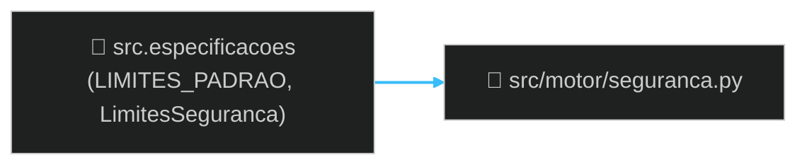
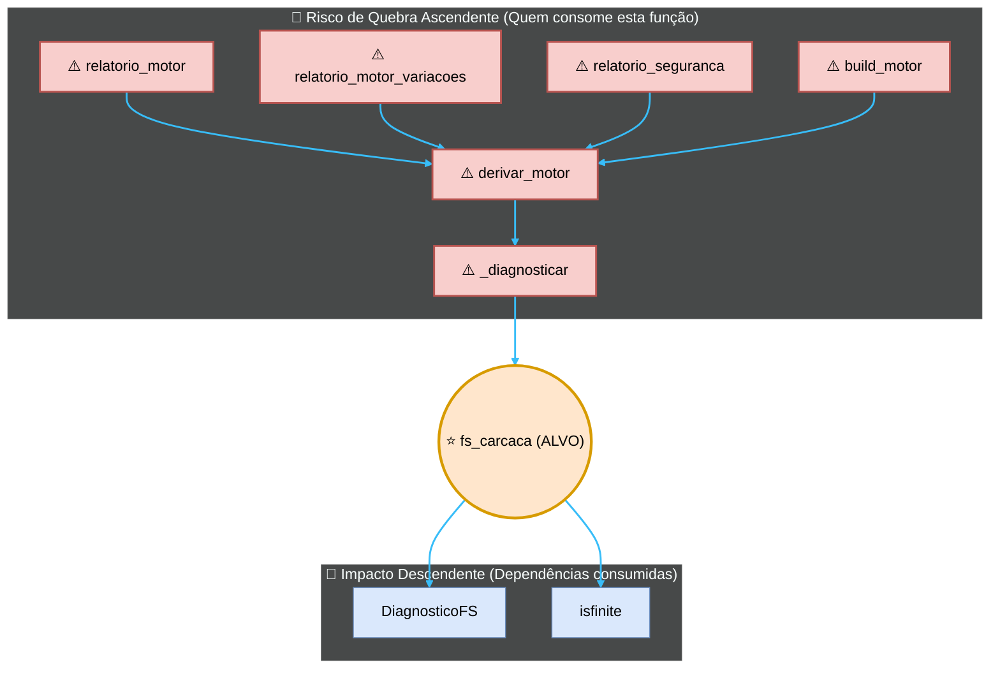
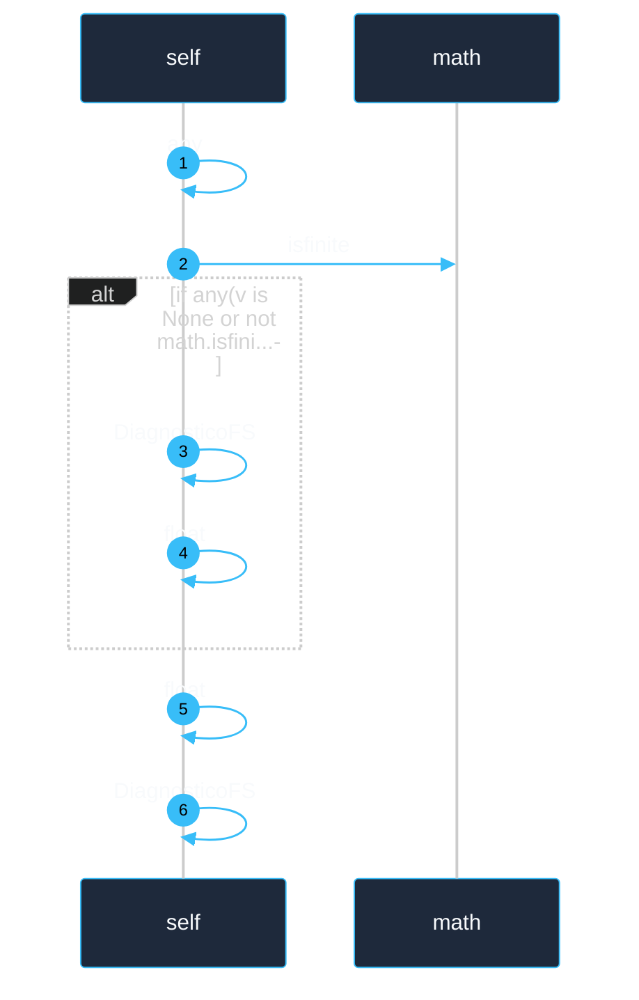
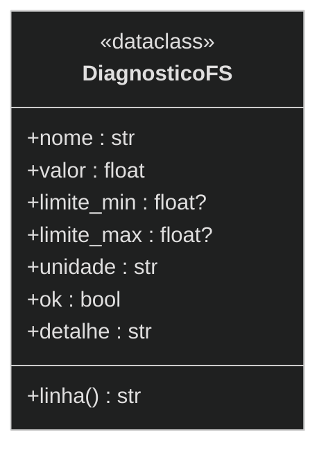
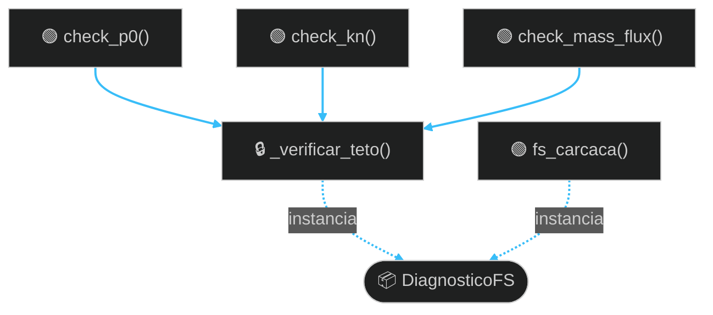

# ⚡ C4 Nível 4 (Código) — `src/motor/seguranca.py`

> [!NOTE]
> **Gerado automaticamente a partir da AST do código-fonte e motor a2m.**
> Pela regra do modelo C4, o Nível 4 nunca é desenhado manualmente — ele reflete
> em tempo real as classes, funções, impacto e chamadas presentes em [`seguranca.py`](../../../src/motor/seguranca.py).

**Navegação na Hierarquia C4:**
[🌐 Nível 1: Contexto](../c1-contexto.md) · [📦 Nível 2: Containers](../c2-containers.md) · [🧩 C3: Subsistema de Motor & Segurança](../c3-subsistema-motor.md) · **⚡ Nível 4: `seguranca.py`** · [📖 Guia de Visualização](../../../centralControle/GUIA_VISUALIZACAO.md)

---

## 1. Propósito do Módulo

Fatores de segurança e verificação de limites operacionais.

Cada função devolve um `DiagnosticoFS` imutável com valor calculado, limite,
status OK/alerta e detalhamento legível. Não importa nada de `configs/`.

---

## 2. Fronteiras e Dependências do Arquivo

#### 🧭 Dependências Internas Navegáveis

| Dependência | Símbolos Importados | Documento C4 |
| :--- | :--- | :--- |
| `🧩 src.especificacoes` | `LIMITES_PADRAO`, `LimitesSeguranca` | [⚡ `src__especificacoes.c4.md`](src__especificacoes.c4.md) |

---

## 3. Impacto Sistêmico e Fluxo de Execução

### Análise de Impacto Sistêmico (`a2m impact`)

> [!IMPORTANT]
> **Mapeamento de Efeito Cascata ao Modificar `fs_carcaca()`:**
> - **Risco de Quebra Ascendente (Vermelho):** Funções e módulos externos que chamam esta lógica.
> - **Impacto Descendente (Azul):** Rotinas internas e dependências consumidas.

#### 🧭 Atalhos Rápidos de Navegação (Impacto Sistêmico)

| Relação | Símbolo / Função | Arquivo C4 Destino |
| :--- | :--- | :--- |
| 🚨 Risco Ascendente (Caller) | `_diagnosticar` | [⚡ `src__motor__derivador.c4.md`](src__motor__derivador.c4.md) |
| 🚨 Risco Ascendente (Caller) | `derivar_motor` | [⚡ `src__motor__derivador.c4.md`](src__motor__derivador.c4.md) |
| 🚨 Risco Ascendente (Caller) | `relatorio_motor` | [⚡ `src__relatorios.c4.md`](src__relatorios.c4.md) |
| 🚨 Risco Ascendente (Caller) | `relatorio_motor_variacoes` | [⚡ `src__relatorios.c4.md`](src__relatorios.c4.md) |
| 🚨 Risco Ascendente (Caller) | `relatorio_seguranca` | [⚡ `src__relatorios.c4.md`](src__relatorios.c4.md) |
| 🚨 Risco Ascendente (Caller) | `build_motor` | [⚡ `src__simulacao__construtor_foguete.c4.md`](src__simulacao__construtor_foguete.c4.md) |

### Diagrama de Sequência de Execução — `fs_carcaca()` (`sequenceDiagram`)

> [!NOTE]
> Mostra o fluxo sequencial real de controle de execução da função,
> incluindo condicionais (`alt ... else`) e laços (`loop`).

---

## 4. Estrutura de Classes e Contratos (`classDiagram`)

---

## 5. Fluxo Lógico de Funções Locais (`flowchart TD`)

---

## 6. Catálogo de Símbolos (Links Diretos para o Código)

### Classes / Contratos

| Classe | Linhas | Tipo | Resumo |
| :--- | :--- | :--- | :--- |
| [`DiagnosticoFS`](../../../src/motor/seguranca.py#L16-L36) | `L16–L36` | `@dataclass` | — |

### Funções do Módulo

| Função | Linhas | Retorno | Resumo |
| :--- | :--- | :--- | :--- |
| [`_verificar_teto`](../../../src/motor/seguranca.py#L39-L66) | `L39–L66` | `DiagnosticoFS` | Verifica um critério de teto (`valor <= limite_max`) em modo fail-closed. |
| [`fs_carcaca`](../../../src/motor/seguranca.py#L69-L101) | `L69–L101` | `DiagnosticoFS` | FS da carcaça cilíndrica de paredes finas (Beer & Johnston: σ_circ = P0 · r / t). |
| [`check_p0`](../../../src/motor/seguranca.py#L104-L105) | `L104–L105` | `DiagnosticoFS` | — |
| [`check_kn`](../../../src/motor/seguranca.py#L108-L109) | `L108–L109` | `DiagnosticoFS` | — |
| [`check_mass_flux`](../../../src/motor/seguranca.py#L112-L123) | `L112–L123` | `DiagnosticoFS` | — |
