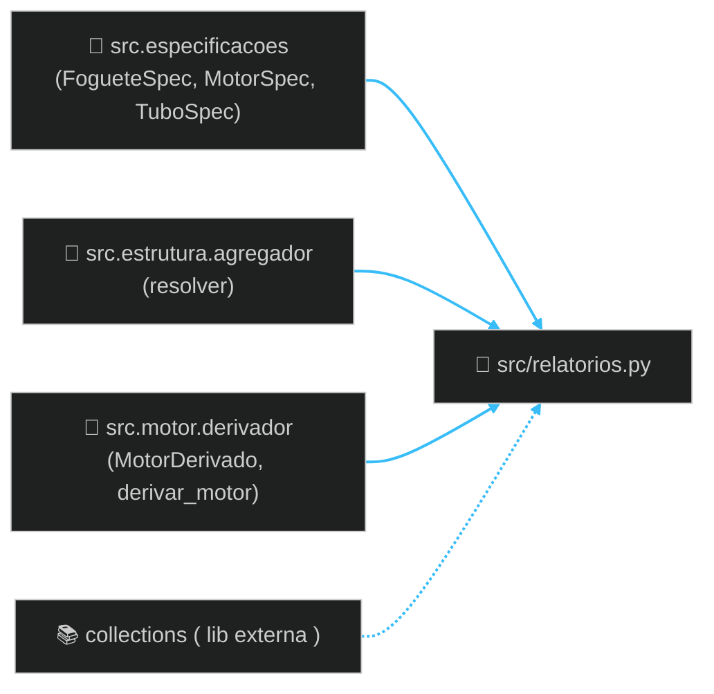
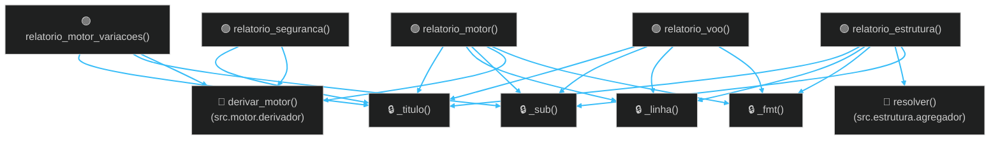

# ⚡ C4 Nível 4 (Código) — `src/relatorios.py`

> [!NOTE]
> **Gerado automaticamente a partir da AST do código-fonte e motor a2m.**
> Pela regra do modelo C4, o Nível 4 nunca é desenhado manualmente — ele reflete
> em tempo real as classes, funções, impacto e chamadas presentes em [`relatorios.py`](../../../src/relatorios.py).

**Navegação na Hierarquia C4:**
[🌐 Nível 1: Contexto](../c1-contexto.md) · [📦 Nível 2: Containers](../c2-containers.md) · [🧩 C3: Pipeline de Execução & Voo](../c3-execucao-voo.md) · **⚡ Nível 4: `relatorios.py`** · [📖 Guia de Visualização](../../../centralControle/GUIA_VISUALIZACAO.md)

---

## 1. Propósito do Módulo

Relatórios de inspeção e diagnóstico estrutural, balístico e de voo.

Módulo puro (não importa `configs/`, recebendo especificações por argumento).

---

## 2. Fronteiras e Dependências do Arquivo

#### 🧭 Dependências Internas Navegáveis

| Dependência | Símbolos Importados | Documento C4 |
| :--- | :--- | :--- |
| `🧩 src.especificacoes` | `FogueteSpec`, `MotorSpec`, `TuboSpec` | [⚡ `src__especificacoes.c4.md`](src__especificacoes.c4.md) |
| `🧩 src.estrutura.agregador` | `resolver` | [⚡ `src__estrutura__agregador.c4.md`](src__estrutura__agregador.c4.md) |
| `🧩 src.motor.derivador` | `MotorDerivado`, `derivar_motor` | [⚡ `src__motor__derivador.c4.md`](src__motor__derivador.c4.md) |

---

## 3. Impacto Sistêmico e Fluxo de Execução

### Análise de Impacto Sistêmico (`a2m impact`)

> [!IMPORTANT]
> **Mapeamento de Efeito Cascata ao Modificar `relatorio_motor()`:**
> - **Risco de Quebra Ascendente (Vermelho):** Funções e módulos externos que chamam esta lógica.
> - **Impacto Descendente (Azul):** Rotinas internas e dependências consumidas.

```mermaid
%%{init: {'theme': 'dark', 'themeVariables': { 'lineColor': '#38bdf8' }}}%%
graph TD
    classDef target fill:#ffe6cc,stroke:#d79b00,stroke-width:3px,color:#000
    classDef upward fill:#f8cecc,stroke:#b85450,stroke-width:2px,color:#000
    classDef downward fill:#dae8fc,stroke:#6c8ebf,stroke-width:1px,color:#000

    ALVO(("⭐ relatorio_motor (ALVO)")):::target

    subgraph Descendente["🧩 Impacto Descendente (Dependências consumidas)"]
        code_motor_adaptador_openmotor_py__function__executar_ric_H49ca99b7["executar_ric"]:::downward
        code_motor_derivador_py__struct__MotorDerivado_Hd4e5d2d3["MotorDerivado"]:::downward
        code_motor_derivador_py__function__derivar_motor_H5b17db9e["derivar_motor"]:::downward
        code_relatorios_py__function___sub_H4f0f9237["_sub"]:::downward
        extern_math__sqrt_H86ccf542["sqrt"]:::downward
        extern_numpy__trapezoid_Hbc102c77["trapezoid"]:::downward
        code_motor_seguranca_py__function__check_p0_H62c1972c["check_p0"]:::downward
        code_relatorios_py__function___linha_H183fb231["_linha"]:::downward
        code_motor_derivador_py__function___resolver_fonte_e_geometria_H35eb7443["_resolver_fonte_e_geometria"]:::downward
        code_motor_derivador_py__function___diagnosticar_H516ee10e["_diagnosticar"]:::downward
        code_relatorios_py__function___titulo_H1c04813d["_titulo"]:::downward
        code_motor_seguranca_py__function__fs_carcaca_H5149385b["fs_carcaca"]:::downward
        code_motor_derivador_py__function___derivar_carcaca_H7f1129db["_derivar_carcaca"]:::downward
        code_relatorios_py__function___fmt_H9a456215["_fmt"]:::downward
        code_motor_seguranca_py__function__check_mass_flux_H946b27da["check_mass_flux"]:::downward
        code_motor_derivador_py__function___derivar_dos_graos_Hd696d94b["_derivar_dos_graos"]:::downward
        code_motor_seguranca_py__function__check_kn_H83a6a604["check_kn"]:::downward
        code_motor_derivador_py__function___ler_eng_H858ba6e1["_ler_eng"]:::downward
        code_motor_derivador_py__function___derivar_inercia_seca_H007f35ab["_derivar_inercia_seca"]:::downward
    end
    code_motor_derivador_py__function___derivar_dos_graos_Hd696d94b --> extern_math__sqrt_H86ccf542
    code_motor_derivador_py__function___diagnosticar_H516ee10e --> code_motor_seguranca_py__function__check_kn_H83a6a604
    code_motor_derivador_py__function___diagnosticar_H516ee10e --> code_motor_seguranca_py__function__check_mass_flux_H946b27da
    code_motor_derivador_py__function___diagnosticar_H516ee10e --> code_motor_seguranca_py__function__check_p0_H62c1972c
    code_motor_derivador_py__function___diagnosticar_H516ee10e --> code_motor_seguranca_py__function__fs_carcaca_H5149385b
    code_motor_derivador_py__function___resolver_fonte_e_geometria_H35eb7443 --> code_motor_adaptador_openmotor_py__function__executar_ric_H49ca99b7
    code_motor_derivador_py__function___resolver_fonte_e_geometria_H35eb7443 --> code_motor_derivador_py__function___ler_eng_H858ba6e1
    code_motor_derivador_py__function___resolver_fonte_e_geometria_H35eb7443 --> extern_numpy__trapezoid_Hbc102c77
    code_motor_derivador_py__function__derivar_motor_H5b17db9e --> code_motor_derivador_py__function___derivar_carcaca_H7f1129db
    code_motor_derivador_py__function__derivar_motor_H5b17db9e --> code_motor_derivador_py__function___derivar_dos_graos_Hd696d94b
    code_motor_derivador_py__function__derivar_motor_H5b17db9e --> code_motor_derivador_py__function___derivar_inercia_seca_H007f35ab
    code_motor_derivador_py__function__derivar_motor_H5b17db9e --> code_motor_derivador_py__function___diagnosticar_H516ee10e
    code_motor_derivador_py__function__derivar_motor_H5b17db9e --> code_motor_derivador_py__function___resolver_fonte_e_geometria_H35eb7443
    code_motor_derivador_py__function__derivar_motor_H5b17db9e --> code_motor_derivador_py__struct__MotorDerivado_Hd4e5d2d3
    ALVO --> code_motor_derivador_py__function__derivar_motor_H5b17db9e
    ALVO --> code_relatorios_py__function___fmt_H9a456215
    ALVO --> code_relatorios_py__function___linha_H183fb231
    ALVO --> code_relatorios_py__function___sub_H4f0f9237
    ALVO --> code_relatorios_py__function___titulo_H1c04813d
    click code_motor_adaptador_openmotor_py__function__executar_ric_H49ca99b7 href "src__motor__adaptador_openmotor.c4.md" "Abrir C4 (executar_ric)"
    click code_motor_derivador_py__function___derivar_carcaca_H7f1129db href "src__motor__derivador.c4.md" "Abrir C4 (_derivar_carcaca)"
    click code_motor_derivador_py__function___derivar_dos_graos_Hd696d94b href "src__motor__derivador.c4.md" "Abrir C4 (_derivar_dos_graos)"
    click code_motor_derivador_py__function___derivar_inercia_seca_H007f35ab href "src__motor__derivador.c4.md" "Abrir C4 (_derivar_inercia_seca)"
    click code_motor_derivador_py__function___diagnosticar_H516ee10e href "src__motor__derivador.c4.md" "Abrir C4 (_diagnosticar)"
    click code_motor_derivador_py__function___ler_eng_H858ba6e1 href "src__motor__derivador.c4.md" "Abrir C4 (_ler_eng)"
    click code_motor_derivador_py__function___resolver_fonte_e_geometria_H35eb7443 href "src__motor__derivador.c4.md" "Abrir C4 (_resolver_fonte_e_geometria)"
    click code_motor_derivador_py__function__derivar_motor_H5b17db9e href "src__motor__derivador.c4.md" "Abrir C4 (derivar_motor)"
    click code_motor_derivador_py__struct__MotorDerivado_Hd4e5d2d3 href "src__motor__derivador.c4.md" "Abrir C4 (MotorDerivado)"
    click code_motor_seguranca_py__function__check_kn_H83a6a604 href "src__motor__seguranca.c4.md" "Abrir C4 (check_kn)"
    click code_motor_seguranca_py__function__check_mass_flux_H946b27da href "src__motor__seguranca.c4.md" "Abrir C4 (check_mass_flux)"
    click code_motor_seguranca_py__function__check_p0_H62c1972c href "src__motor__seguranca.c4.md" "Abrir C4 (check_p0)"
    click code_motor_seguranca_py__function__fs_carcaca_H5149385b href "src__motor__seguranca.c4.md" "Abrir C4 (fs_carcaca)"
    linkStyle default stroke:#38bdf8,stroke-width:2px;
```

#### 🧭 Atalhos Rápidos de Navegação (Impacto Sistêmico)

| Relação | Símbolo / Função | Arquivo C4 Destino |
| :--- | :--- | :--- |
| 🧩 Impacto Descendente (Callee) | `executar_ric` | [⚡ `src__motor__adaptador_openmotor.c4.md`](src__motor__adaptador_openmotor.c4.md) |
| 🧩 Impacto Descendente (Callee) | `_derivar_carcaca` | [⚡ `src__motor__derivador.c4.md`](src__motor__derivador.c4.md) |
| 🧩 Impacto Descendente (Callee) | `_derivar_dos_graos` | [⚡ `src__motor__derivador.c4.md`](src__motor__derivador.c4.md) |
| 🧩 Impacto Descendente (Callee) | `_derivar_inercia_seca` | [⚡ `src__motor__derivador.c4.md`](src__motor__derivador.c4.md) |
| 🧩 Impacto Descendente (Callee) | `_diagnosticar` | [⚡ `src__motor__derivador.c4.md`](src__motor__derivador.c4.md) |
| 🧩 Impacto Descendente (Callee) | `_ler_eng` | [⚡ `src__motor__derivador.c4.md`](src__motor__derivador.c4.md) |
| 🧩 Impacto Descendente (Callee) | `_resolver_fonte_e_geometria` | [⚡ `src__motor__derivador.c4.md`](src__motor__derivador.c4.md) |
| 🧩 Impacto Descendente (Callee) | `derivar_motor` | [⚡ `src__motor__derivador.c4.md`](src__motor__derivador.c4.md) |
| 🧩 Impacto Descendente (Callee) | `MotorDerivado` | [⚡ `src__motor__derivador.c4.md`](src__motor__derivador.c4.md) |
| 🧩 Impacto Descendente (Callee) | `check_kn` | [⚡ `src__motor__seguranca.c4.md`](src__motor__seguranca.c4.md) |
| 🧩 Impacto Descendente (Callee) | `check_mass_flux` | [⚡ `src__motor__seguranca.c4.md`](src__motor__seguranca.c4.md) |
| 🧩 Impacto Descendente (Callee) | `check_p0` | [⚡ `src__motor__seguranca.c4.md`](src__motor__seguranca.c4.md) |
| 🧩 Impacto Descendente (Callee) | `fs_carcaca` | [⚡ `src__motor__seguranca.c4.md`](src__motor__seguranca.c4.md) |

### Diagrama de Sequência de Execução — `relatorio_motor()` (`sequenceDiagram`)

> [!NOTE]
> Mostra o fluxo sequencial real de controle de execução da função,
> incluindo condicionais (`alt ... else`) e laços (`loop`).

```mermaid
%%{init: {'theme': 'dark', 'themeVariables': { 'signalColor': '#38bdf8', 'signalTextColor': '#f8fafc', 'actorBkg': '#1e293b', 'actorBorder': '#38bdf8', 'actorTextColor': '#f8fafc' }}}%%
sequenceDiagram
    autonumber
    %% def relatorio_motor(
    participant self as self
    self->>self: derivar_motor
    self->>self: _titulo
    self->>self: _linha
    self->>self: _linha
    self->>self: _linha
    self->>self: _linha
    alt if spec.overrides
        self->>self: _linha
        self->>self: len
    end
    self->>self: _sub
    self->>self: len
    self->>self: enumerate
    loop for enumerate(d.grains)
        self->>self: print
    end
    self->>self: _linha
    self->>self: _fmt
    self->>self: _linha
    self->>self: _fmt
    self->>self: _sub
    self->>self: _linha
    self->>self: _fmt
    self->>self: _linha
    self->>self: _fmt
    self->>self: _linha
    self->>self: _fmt
    self->>self: _linha
    self->>self: _fmt
    self->>self: _linha
    self->>self: _fmt
    self->>self: _sub
    self->>self: _linha
    self->>self: _fmt
    self->>self: _linha
    self->>self: _fmt
    self->>self: _linha
    self->>self: _fmt
    self->>self: _titulo
    self->>self: _sub
    self->>self: _linha
    self->>self: _linha
    self->>self: _fmt
    self->>self: _linha
    self->>self: _fmt
    self->>self: _linha
    self->>self: _fmt
    self->>self: _linha
    self->>self: _fmt
    self->>self: _sub
    self->>self: _linha
    self->>self: _fmt
    self->>self: _linha
    self->>self: _fmt
    self->>self: _linha
    self->>self: _fmt
    self->>self: _linha
    self->>self: _fmt
    self->>self: _linha
    self->>self: _fmt
    self->>self: _linha
    self->>self: _fmt
    self->>self: _linha
    self->>self: _fmt
    self->>self: _sub
    self->>self: _linha
    self->>self: _fmt
    self->>self: _linha
    self->>self: _fmt
    self->>self: _linha
    self->>self: _fmt
    alt if d.p0_pico is not None
        self->>self: _sub
        self->>self: _linha
        self->>self: _fmt
        self->>self: _linha
        self->>self: _fmt
        self->>self: _linha
        self->>self: _fmt
    end
```

---

## 4. Fluxo Lógico de Funções Locais (`flowchart TD`)

#### 🧭 Chamadas Externas Identificadas

| Chamada Local | Módulo de Origem | Documento C4 |
| :--- | :--- | :--- |
| `🔗 derivar_motor()` | `src.motor.derivador` | [⚡ `src__motor__derivador.c4.md`](src__motor__derivador.c4.md) |
| `🔗 resolver()` | `src.estrutura.agregador` | [⚡ `src__estrutura__agregador.c4.md`](src__estrutura__agregador.c4.md) |

---

## 5. Catálogo de Símbolos (Links Diretos para o Código)

### Funções do Módulo

| Função | Linhas | Retorno | Resumo |
| :--- | :--- | :--- | :--- |
| [`_titulo`](../../../src/relatorios.py#L18-L22) | `L18–L22` | `None` | — |
| [`_sub`](../../../src/relatorios.py#L25-L27) | `L25–L27` | `None` | — |
| [`_linha`](../../../src/relatorios.py#L30-L34) | `L30–L34` | `None` | — |
| [`_fmt`](../../../src/relatorios.py#L37-L41) | `L37–L41` | `str` | — |
| [`relatorio_motor`](../../../src/relatorios.py#L44-L111) | `L44–L111` | `MotorDerivado` | Imprime especificação, propriedades derivadas e balística interna do motor. |
| [`relatorio_motor_variacoes`](../../../src/relatorios.py#L114-L166) | `L114–L166` | `None` | Imprime tabela comparativa lado a lado para um dicionário de variações de motor. |
| [`relatorio_estrutura`](../../../src/relatorios.py#L169-L271) | `L169–L271` | `None` | Imprime o detalhamento estrutural (comparando modo calculado e modo medido). |
| [`relatorio_seguranca`](../../../src/relatorios.py#L274-L292) | `L274–L292` | `None` | Imprime os diagnósticos de segurança do motor. |
| [`relatorio_voo`](../../../src/relatorios.py#L295-L325) | `L295–L325` | `None` | Imprime os parâmetros de lançamento e atmosfera. |
