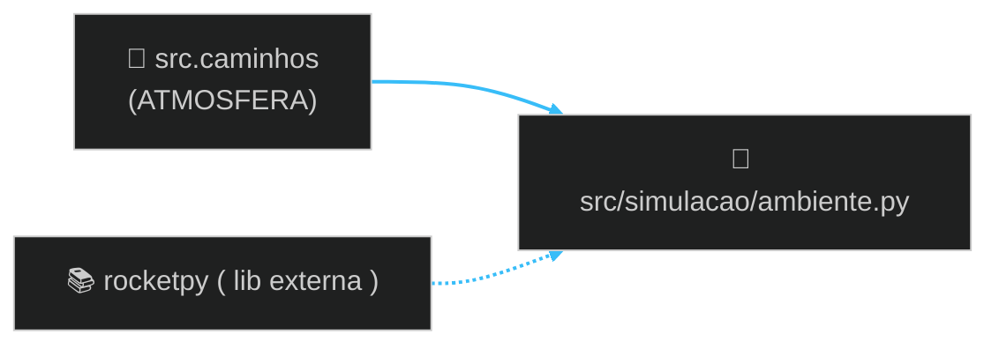
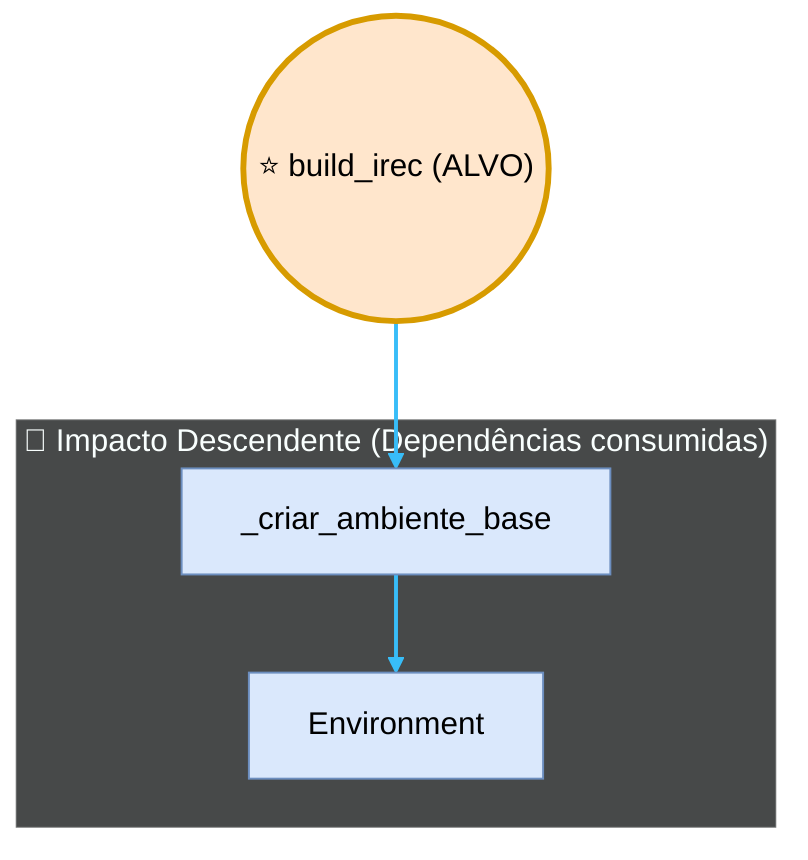
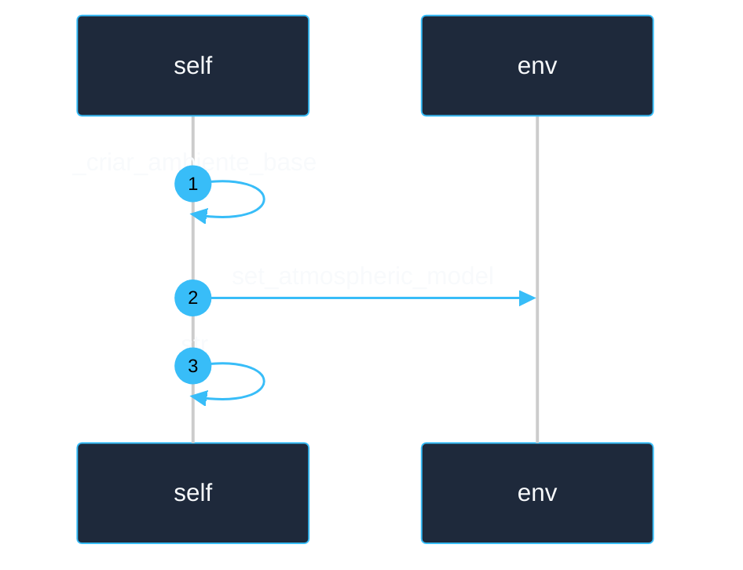
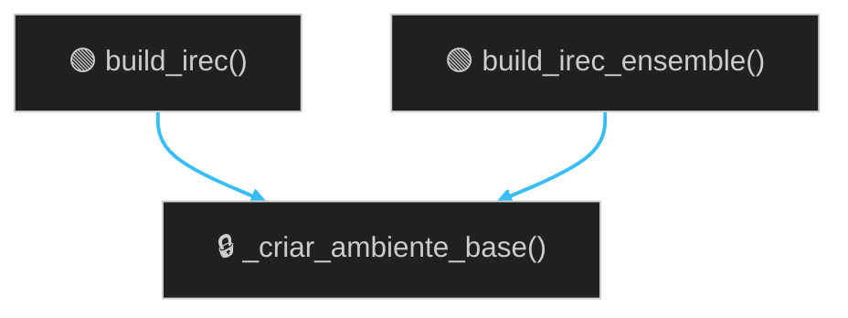

# ⚡ C4 Nível 4 (Código) — `src/simulacao/ambiente.py`

> [!NOTE]
> **Gerado automaticamente a partir da AST do código-fonte e motor a2m.**
> Pela regra do modelo C4, o Nível 4 nunca é desenhado manualmente — ele reflete
> em tempo real as classes, funções, impacto e chamadas presentes em [`ambiente.py`](../../../src/simulacao/ambiente.py).

**Navegação na Hierarquia C4:**
[🌐 Nível 1: Contexto](../c1-contexto.md) · [📦 Nível 2: Containers](../c2-containers.md) · [🧩 C3: Pipeline de Execução & Voo](../c3-execucao-voo.md) · **⚡ Nível 4: `ambiente.py`** · [📖 Guia de Visualização](../../../centralControle/GUIA_VISUALIZACAO.md)

---

## 1. Propósito do Módulo

Fábricas de `Environment` do RocketPy para simulações determinísticas e ensemble.

---

## 2. Fronteiras e Dependências do Arquivo

#### 🧭 Dependências Internas Navegáveis

| Dependência | Símbolos Importados | Documento C4 |
| :--- | :--- | :--- |
| `🧩 src.caminhos` | `ATMOSFERA` | [⚡ `src__caminhos.c4.md`](src__caminhos.c4.md) |

---

## 3. Impacto Sistêmico e Fluxo de Execução

### Análise de Impacto Sistêmico (`a2m impact`)

> [!IMPORTANT]
> **Mapeamento de Efeito Cascata ao Modificar `build_irec()`:**
> - **Risco de Quebra Ascendente (Vermelho):** Funções e módulos externos que chamam esta lógica.
> - **Impacto Descendente (Azul):** Rotinas internas e dependências consumidas.

### Diagrama de Sequência de Execução — `build_irec()` (`sequenceDiagram`)

> [!NOTE]
> Mostra o fluxo sequencial real de controle de execução da função,
> incluindo condicionais (`alt ... else`) e laços (`loop`).

---

## 4. Fluxo Lógico de Funções Locais (`flowchart TD`)

---

## 5. Catálogo de Símbolos (Links Diretos para o Código)

### Funções do Módulo

| Função | Linhas | Retorno | Resumo |
| :--- | :--- | :--- | :--- |
| [`_criar_ambiente_base`](../../../src/simulacao/ambiente.py#L23-L29) | `L23–L29` | `Environment` | — |
| [`build_irec`](../../../src/simulacao/ambiente.py#L32-L40) | `L32–L40` | `Environment` | Constrói o ambiente atmosférico nominal de Spaceport America (ERA5 Reanalysis). |
| [`build_irec_ensemble`](../../../src/simulacao/ambiente.py#L43-L51) | `L43–L51` | `Environment` | Constrói o ambiente atmosférico Ensemble de Spaceport America (Monte Carlo). |
