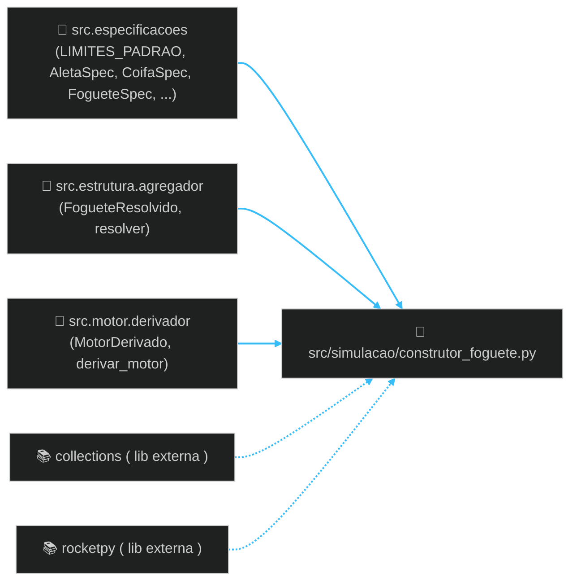
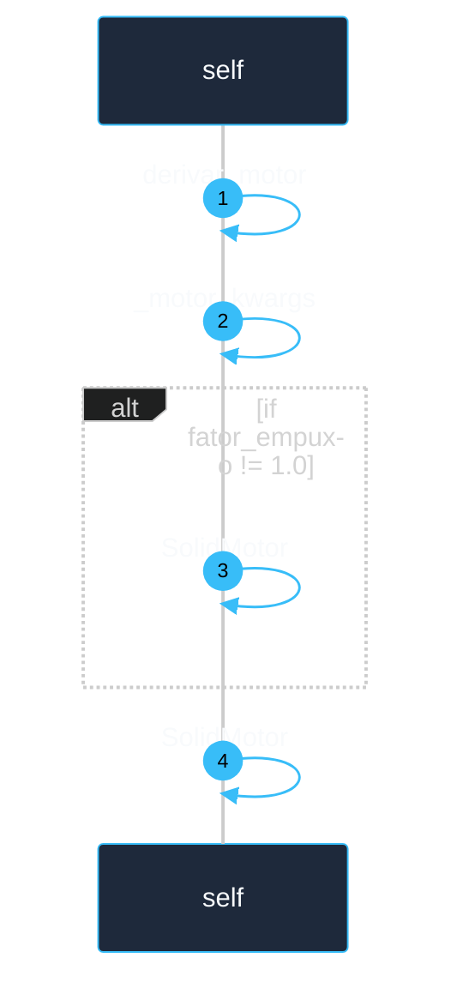
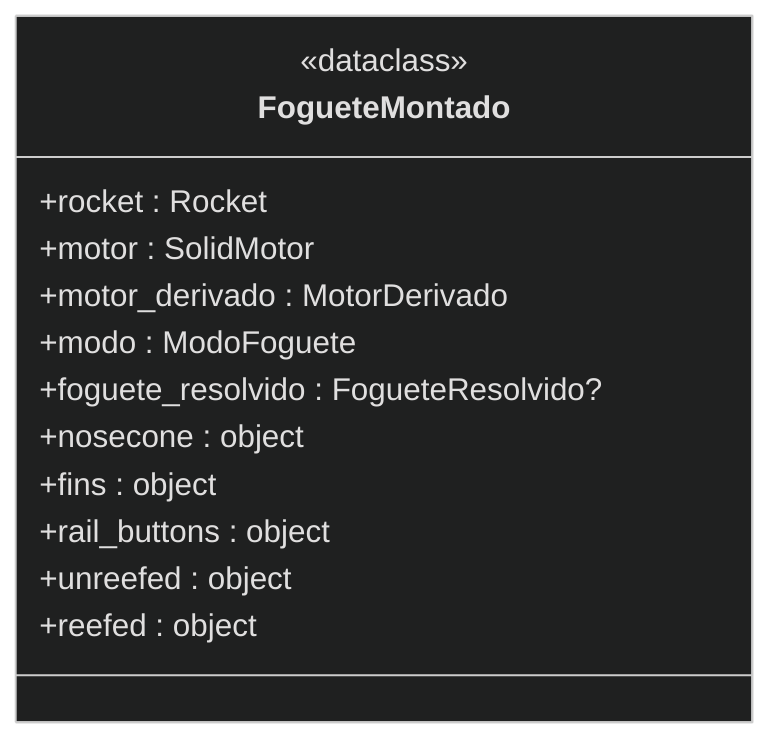
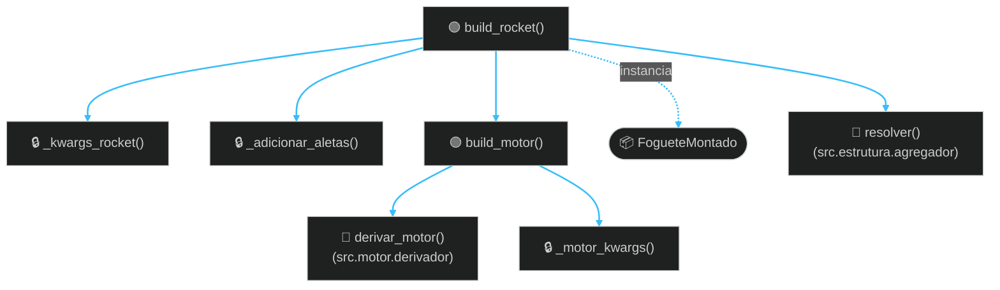

# ⚡ C4 Nível 4 (Código) — `src/simulacao/construtor_foguete.py`

> [!NOTE]
> **Gerado automaticamente a partir da AST do código-fonte e motor a2m.**
> Pela regra do modelo C4, o Nível 4 nunca é desenhado manualmente — ele reflete
> em tempo real as classes, funções, impacto e chamadas presentes em [`construtor_foguete.py`](../../../src/simulacao/construtor_foguete.py).

**Navegação na Hierarquia C4:**
[🌐 Nível 1: Contexto](../c1-contexto.md) · [📦 Nível 2: Containers](../c2-containers.md) · [🧩 C3: Pipeline de Execução & Voo](../c3-execucao-voo.md) · **⚡ Nível 4: `construtor_foguete.py`** · [📖 Guia de Visualização](../../../centralControle/GUIA_VISUALIZACAO.md)

---

## 1. Propósito do Módulo

Monta o `SolidMotor` e o `Rocket` prontos para simulação no RocketPy.

Separa explicitamente os dois modos de representação estrutural do foguete:
  - `modo="calculado"`: massa, CG e inércia vêm de `resolver(componentes, aleta, coifa, raio)`.
  - `modo="medido"`: massa, CG e inércia vêm de `GeometriaMedidaSpec` (bancada/OpenRocket).

Não importa nada de `configs/`; todas as especificações chegam por argumento.

---

## 2. Fronteiras e Dependências do Arquivo

#### 🧭 Dependências Internas Navegáveis

| Dependência | Símbolos Importados | Documento C4 |
| :--- | :--- | :--- |
| `🧩 src.especificacoes` | `LIMITES_PADRAO`, `AletaSpec`, `CoifaSpec`, `FogueteSpec`, `LimitesSeguranca`, ... | [⚡ `src__especificacoes.c4.md`](src__especificacoes.c4.md) |
| `🧩 src.estrutura.agregador` | `FogueteResolvido`, `resolver` | [⚡ `src__estrutura__agregador.c4.md`](src__estrutura__agregador.c4.md) |
| `🧩 src.motor.derivador` | `MotorDerivado`, `derivar_motor` | [⚡ `src__motor__derivador.c4.md`](src__motor__derivador.c4.md) |

---

## 3. Impacto Sistêmico e Fluxo de Execução

### Análise de Impacto Sistêmico (`a2m impact`)

> [!IMPORTANT]
> **Mapeamento de Efeito Cascata ao Modificar `build_motor()`:**
> - **Risco de Quebra Ascendente (Vermelho):** Funções e módulos externos que chamam esta lógica.
> - **Impacto Descendente (Azul):** Rotinas internas e dependências consumidas.

```mermaid
%%{init: {'theme': 'dark', 'themeVariables': { 'lineColor': '#38bdf8' }}}%%
graph TD
    classDef target fill:#ffe6cc,stroke:#d79b00,stroke-width:3px,color:#000
    classDef upward fill:#f8cecc,stroke:#b85450,stroke-width:2px,color:#000
    classDef downward fill:#dae8fc,stroke:#6c8ebf,stroke-width:1px,color:#000

    ALVO(("⭐ build_motor (ALVO)")):::target

    subgraph Ascendente["🚨 Risco de Quebra Ascendente (Quem consome esta função)"]
        code_simulacao_construtor_foguete_py__function__build_rocket_H78d46662["⚠️ build_rocket"]:::upward
    end
    code_simulacao_construtor_foguete_py__function__build_rocket_H78d46662 --> ALVO
    subgraph Descendente["🧩 Impacto Descendente (Dependências consumidas)"]
        code_motor_adaptador_openmotor_py__function__executar_ric_H49ca99b7["executar_ric"]:::downward
        code_motor_derivador_py__function___resolver_fonte_e_geometria_H35eb7443["_resolver_fonte_e_geometria"]:::downward
        extern_math__sqrt_H86ccf542["sqrt"]:::downward
        code_motor_seguranca_py__function__check_mass_flux_H946b27da["check_mass_flux"]:::downward
        code_motor_derivador_py__function___derivar_dos_graos_Hd696d94b["_derivar_dos_graos"]:::downward
        code_motor_derivador_py__function___diagnosticar_H516ee10e["_diagnosticar"]:::downward
        code_simulacao_construtor_foguete_py__function___motor_kwargs_H5a1d1472["_motor_kwargs"]:::downward
        code_motor_seguranca_py__function__fs_carcaca_H5149385b["fs_carcaca"]:::downward
        code_motor_derivador_py__function___derivar_carcaca_H7f1129db["_derivar_carcaca"]:::downward
        extern_numpy__trapezoid_Hbc102c77["trapezoid"]:::downward
        code_motor_derivador_py__struct__MotorDerivado_Hd4e5d2d3["MotorDerivado"]:::downward
        code_motor_derivador_py__function__derivar_motor_H5b17db9e["derivar_motor"]:::downward
        code_motor_seguranca_py__function__check_p0_H62c1972c["check_p0"]:::downward
        extern_rocketpy__SolidMotor_Hfc7e259f["SolidMotor"]:::downward
        code_motor_seguranca_py__function__check_kn_H83a6a604["check_kn"]:::downward
        code_motor_derivador_py__function___ler_eng_H858ba6e1["_ler_eng"]:::downward
        code_motor_derivador_py__function___derivar_inercia_seca_H007f35ab["_derivar_inercia_seca"]:::downward
    end
    code_motor_derivador_py__function___derivar_dos_graos_Hd696d94b --> extern_math__sqrt_H86ccf542
    code_motor_derivador_py__function___diagnosticar_H516ee10e --> code_motor_seguranca_py__function__check_kn_H83a6a604
    code_motor_derivador_py__function___diagnosticar_H516ee10e --> code_motor_seguranca_py__function__check_mass_flux_H946b27da
    code_motor_derivador_py__function___diagnosticar_H516ee10e --> code_motor_seguranca_py__function__check_p0_H62c1972c
    code_motor_derivador_py__function___diagnosticar_H516ee10e --> code_motor_seguranca_py__function__fs_carcaca_H5149385b
    code_motor_derivador_py__function___resolver_fonte_e_geometria_H35eb7443 --> code_motor_adaptador_openmotor_py__function__executar_ric_H49ca99b7
    code_motor_derivador_py__function___resolver_fonte_e_geometria_H35eb7443 --> code_motor_derivador_py__function___ler_eng_H858ba6e1
    code_motor_derivador_py__function___resolver_fonte_e_geometria_H35eb7443 --> extern_numpy__trapezoid_Hbc102c77
    code_motor_derivador_py__function__derivar_motor_H5b17db9e --> code_motor_derivador_py__function___derivar_carcaca_H7f1129db
    code_motor_derivador_py__function__derivar_motor_H5b17db9e --> code_motor_derivador_py__function___derivar_dos_graos_Hd696d94b
    code_motor_derivador_py__function__derivar_motor_H5b17db9e --> code_motor_derivador_py__function___derivar_inercia_seca_H007f35ab
    code_motor_derivador_py__function__derivar_motor_H5b17db9e --> code_motor_derivador_py__function___diagnosticar_H516ee10e
    code_motor_derivador_py__function__derivar_motor_H5b17db9e --> code_motor_derivador_py__function___resolver_fonte_e_geometria_H35eb7443
    code_motor_derivador_py__function__derivar_motor_H5b17db9e --> code_motor_derivador_py__struct__MotorDerivado_Hd4e5d2d3
    ALVO --> code_motor_derivador_py__function__derivar_motor_H5b17db9e
    ALVO --> code_simulacao_construtor_foguete_py__function___motor_kwargs_H5a1d1472
    ALVO --> extern_rocketpy__SolidMotor_Hfc7e259f
    click code_motor_adaptador_openmotor_py__function__executar_ric_H49ca99b7 href "src__motor__adaptador_openmotor.c4.md" "Abrir C4 (executar_ric)"
    click code_motor_derivador_py__function___derivar_carcaca_H7f1129db href "src__motor__derivador.c4.md" "Abrir C4 (_derivar_carcaca)"
    click code_motor_derivador_py__function___derivar_dos_graos_Hd696d94b href "src__motor__derivador.c4.md" "Abrir C4 (_derivar_dos_graos)"
    click code_motor_derivador_py__function___derivar_inercia_seca_H007f35ab href "src__motor__derivador.c4.md" "Abrir C4 (_derivar_inercia_seca)"
    click code_motor_derivador_py__function___diagnosticar_H516ee10e href "src__motor__derivador.c4.md" "Abrir C4 (_diagnosticar)"
    click code_motor_derivador_py__function___ler_eng_H858ba6e1 href "src__motor__derivador.c4.md" "Abrir C4 (_ler_eng)"
    click code_motor_derivador_py__function___resolver_fonte_e_geometria_H35eb7443 href "src__motor__derivador.c4.md" "Abrir C4 (_resolver_fonte_e_geometria)"
    click code_motor_derivador_py__function__derivar_motor_H5b17db9e href "src__motor__derivador.c4.md" "Abrir C4 (derivar_motor)"
    click code_motor_derivador_py__struct__MotorDerivado_Hd4e5d2d3 href "src__motor__derivador.c4.md" "Abrir C4 (MotorDerivado)"
    click code_motor_seguranca_py__function__check_kn_H83a6a604 href "src__motor__seguranca.c4.md" "Abrir C4 (check_kn)"
    click code_motor_seguranca_py__function__check_mass_flux_H946b27da href "src__motor__seguranca.c4.md" "Abrir C4 (check_mass_flux)"
    click code_motor_seguranca_py__function__check_p0_H62c1972c href "src__motor__seguranca.c4.md" "Abrir C4 (check_p0)"
    click code_motor_seguranca_py__function__fs_carcaca_H5149385b href "src__motor__seguranca.c4.md" "Abrir C4 (fs_carcaca)"
    linkStyle default stroke:#38bdf8,stroke-width:2px;
```

#### 🧭 Atalhos Rápidos de Navegação (Impacto Sistêmico)

| Relação | Símbolo / Função | Arquivo C4 Destino |
| :--- | :--- | :--- |
| 🧩 Impacto Descendente (Callee) | `executar_ric` | [⚡ `src__motor__adaptador_openmotor.c4.md`](src__motor__adaptador_openmotor.c4.md) |
| 🧩 Impacto Descendente (Callee) | `_derivar_carcaca` | [⚡ `src__motor__derivador.c4.md`](src__motor__derivador.c4.md) |
| 🧩 Impacto Descendente (Callee) | `_derivar_dos_graos` | [⚡ `src__motor__derivador.c4.md`](src__motor__derivador.c4.md) |
| 🧩 Impacto Descendente (Callee) | `_derivar_inercia_seca` | [⚡ `src__motor__derivador.c4.md`](src__motor__derivador.c4.md) |
| 🧩 Impacto Descendente (Callee) | `_diagnosticar` | [⚡ `src__motor__derivador.c4.md`](src__motor__derivador.c4.md) |
| 🧩 Impacto Descendente (Callee) | `_ler_eng` | [⚡ `src__motor__derivador.c4.md`](src__motor__derivador.c4.md) |
| 🧩 Impacto Descendente (Callee) | `_resolver_fonte_e_geometria` | [⚡ `src__motor__derivador.c4.md`](src__motor__derivador.c4.md) |
| 🧩 Impacto Descendente (Callee) | `derivar_motor` | [⚡ `src__motor__derivador.c4.md`](src__motor__derivador.c4.md) |
| 🧩 Impacto Descendente (Callee) | `MotorDerivado` | [⚡ `src__motor__derivador.c4.md`](src__motor__derivador.c4.md) |
| 🧩 Impacto Descendente (Callee) | `check_kn` | [⚡ `src__motor__seguranca.c4.md`](src__motor__seguranca.c4.md) |
| 🧩 Impacto Descendente (Callee) | `check_mass_flux` | [⚡ `src__motor__seguranca.c4.md`](src__motor__seguranca.c4.md) |
| 🧩 Impacto Descendente (Callee) | `check_p0` | [⚡ `src__motor__seguranca.c4.md`](src__motor__seguranca.c4.md) |
| 🧩 Impacto Descendente (Callee) | `fs_carcaca` | [⚡ `src__motor__seguranca.c4.md`](src__motor__seguranca.c4.md) |

### Diagrama de Sequência de Execução — `build_motor()` (`sequenceDiagram`)

> [!NOTE]
> Mostra o fluxo sequencial real de controle de execução da função,
> incluindo condicionais (`alt ... else`) e laços (`loop`).

---

## 4. Estrutura de Classes e Contratos (`classDiagram`)

---

## 5. Fluxo Lógico de Funções Locais (`flowchart TD`)

#### 🧭 Chamadas Externas Identificadas

| Chamada Local | Módulo de Origem | Documento C4 |
| :--- | :--- | :--- |
| `🔗 derivar_motor()` | `src.motor.derivador` | [⚡ `src__motor__derivador.c4.md`](src__motor__derivador.c4.md) |
| `🔗 resolver()` | `src.estrutura.agregador` | [⚡ `src__estrutura__agregador.c4.md`](src__estrutura__agregador.c4.md) |

---

## 6. Catálogo de Símbolos (Links Diretos para o Código)

### Classes / Contratos

| Classe | Linhas | Tipo | Resumo |
| :--- | :--- | :--- | :--- |
| [`FogueteMontado`](../../../src/simulacao/construtor_foguete.py#L35-L45) | `L35–L45` | `@dataclass` | — |

### Funções do Módulo

| Função | Linhas | Retorno | Resumo |
| :--- | :--- | :--- | :--- |
| [`_motor_kwargs`](../../../src/simulacao/construtor_foguete.py#L48-L78) | `L48–L78` | `dict[str, Any]` | Traduz `MotorSpec` + `MotorDerivado` para os argumentos de `SolidMotor`. |
| [`_kwargs_rocket`](../../../src/simulacao/construtor_foguete.py#L81-L91) | `L81–L91` | `dict[str, Any]` | Constrói os argumentos comuns de `Rocket(...)` a partir de um resolvido ou medido. |
| [`_adicionar_aletas`](../../../src/simulacao/construtor_foguete.py#L94-L142) | `L94–L142` | `object` | Anexa o conjunto de aletas (`freeform` ou `trapezio`) no `Rocket`. |
| [`build_motor`](../../../src/simulacao/construtor_foguete.py#L145-L159) | `L145–L159` | `tuple[SolidMotor, MotorDerivado]` | Constrói o `SolidMotor` e o `MotorDerivado` a partir de um `MotorSpec`. |
| [`build_rocket`](../../../src/simulacao/construtor_foguete.py#L162-L246) | `L162–L246` | `FogueteMontado` | Constrói o `FogueteMontado` no modo estrutural escolhido (`calculado` ou `medido`). |
