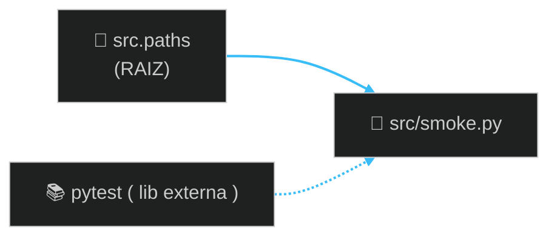

# ⚡ C4 Nível 4 (Código) — `src/smoke.py`

> [!NOTE]
> **Gerado automaticamente a partir da AST do código-fonte e motor a2m.**
> Pela regra do modelo C4, o Nível 4 nunca é desenhado manualmente — ele reflete
> em tempo real as classes, funções, impacto e chamadas presentes em [`smoke.py`](../../../src/smoke.py).

**Navegação na Hierarquia C4:**
[🌐 Nível 1: Contexto](../c1-contexto.md) · [📦 Nível 2: Containers](../c2-containers.md) · [🧩 C3: Pipeline de Execução & Voo](../c3-execucao-voo.md) · **⚡ Nível 4: `smoke.py`** · [📖 Guia de Visualização](../../../centralControle/GUIA_VISUALIZACAO.md)

---

## 1. Propósito do Módulo

Executa a suíte automatizada de testes e validação de contratos (pytest).

---

## 2. Fronteiras e Dependências do Arquivo



#### 🧭 Dependências Internas Navegáveis

| Dependência | Símbolos Importados | Documento C4 |
| :--- | :--- | :--- |
| `🧩 src.paths` | `RAIZ` | [⚡ `src__paths.c4.md`](src__paths.c4.md) |

---

## 3. Impacto Sistêmico e Fluxo de Execução

### Diagrama de Sequência de Execução — `main()` (`sequenceDiagram`)

> [!NOTE]
> Mostra o fluxo sequencial real de controle de execução da função,
> incluindo condicionais (`alt ... else`) e laços (`loop`).

```mermaid
%%{init: {'theme': 'dark', 'themeVariables': { 'signalColor': '#38bdf8', 'signalTextColor': '#f8fafc', 'actorBkg': '#1e293b', 'actorBorder': '#38bdf8', 'actorTextColor': '#f8fafc' }}}%%
sequenceDiagram
    autonumber
    %% def main() -> None
    participant self as self
    participant sys as sys
    self->>self: len
    alt if len(sys.argv) &lt; 2
        self->>self: print
        self->>sys: exit
    end
    alt if arg in ('--todos', '-a', 'todos'...
        self->>self: gerar_todos
        self->>self: print
        self->>self: len
        loop for gerados
            self->>self: print
        end
    else
        self->>self: gerar_arquivo_c4
        self->>self: print
    end
```

---

## 4. Fluxo Lógico de Funções Locais (`flowchart TD`)


---

## 5. Catálogo de Símbolos (Links Diretos para o Código)

### Funções do Módulo

| Função | Linhas | Retorno | Resumo |
| :--- | :--- | :--- | :--- |
| [`main`](../../../src/smoke.py#L10-L14) | `L10–L14` | `None` | — |
