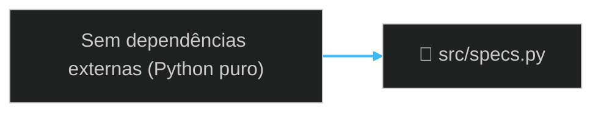
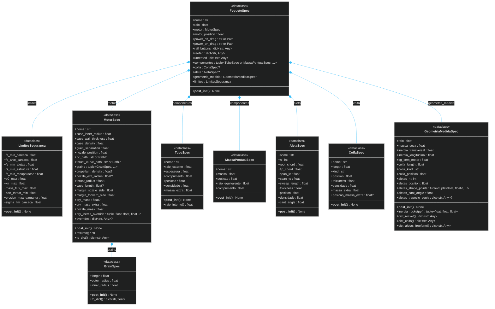

# ⚡ C4 Nível 4 (Código) — `src/specs.py`

> [!NOTE]
> **Gerado automaticamente a partir da AST do código-fonte e motor a2m.**
> Pela regra do modelo C4, o Nível 4 nunca é desenhado manualmente — ele reflete
> em tempo real as classes, funções, impacto e chamadas presentes em [`specs.py`](../../../src/specs.py).

**Navegação na Hierarquia C4:**
[🌐 Nível 1: Contexto](../c1-contexto.md) · [📦 Nível 2: Containers](../c2-containers.md) · [🧩 C3: Pipeline de Execução & Voo](../c3-execucao-voo.md) · **⚡ Nível 4: `specs.py`** · [📖 Guia de Visualização](../../../centralControle/GUIA_VISUALIZACAO.md)

---

## 1. Propósito do Módulo

Especificações de domínio (Specs) e validação de contratos (fail-fast).

Este módulo define todas as estruturas de entrada do projeto. Ele NÃO importa
nada de `configs/`, garantindo que a camada de domínio (`src/`) seja 100%
independente de instâncias concretas de foguetes.

Todas as unidades estão no Sistema Internacional (SI: m, kg, s, Pa, kg/m³),
salvo indicação explícita (como ângulos em graus).

---

## 2. Fronteiras e Dependências do Arquivo

---

## 3. Estrutura de Classes e Contratos (`classDiagram`)

---

## 4. Catálogo de Símbolos (Links Diretos para o Código)

### Classes / Contratos

| Classe | Linhas | Tipo | Resumo |
| :--- | :--- | :--- | :--- |
| [`LimitesSeguranca`](../../../src/specs.py#L24-L50) | `L24–L50` | `@dataclass` | Critérios de aceitação estrutural e operacional (ex.: IREC). |
| [`GrainSpec`](../../../src/specs.py#L57-L79) | `L57–L79` | `@dataclass` | Grão propelente cilíndrico oco (BATES). |
| [`MotorSpec`](../../../src/specs.py#L83-L210) | `L83–L210` | `@dataclass` | Especificação declarativa de um motor sólido. |
| [`TuboSpec`](../../../src/specs.py#L217-L242) | `L217–L242` | `@dataclass` | Cilindro oco (ou maciço quando espessura == raio_externo). |
| [`MassaPontualSpec`](../../../src/specs.py#L246-L266) | `L246–L266` | `@dataclass` | Componente interno com massa fixa e geometria equivalente para inércia. |
| [`AletaSpec`](../../../src/specs.py#L270-L298) | `L270–L298` | `@dataclass` | Conjunto de aletas trapezoidais/freeform em SI. |
| [`CoifaSpec`](../../../src/specs.py#L302-L324) | `L302–L324` | `@dataclass` | Coifa modelada como casca fina sobre o perfil `kind`. |
| [`GeometriaMedidaSpec`](../../../src/specs.py#L331-L392) | `L331–L392` | `@dataclass` | Propriedades globais medidas diretamente na bancada/OpenRocket (`modo='medido'`). |
| [`FogueteSpec`](../../../src/specs.py#L399-L433) | `L399–L433` | `@dataclass` | Identidade completa de um foguete (suporta modos 'calculado' e 'medido'). |
