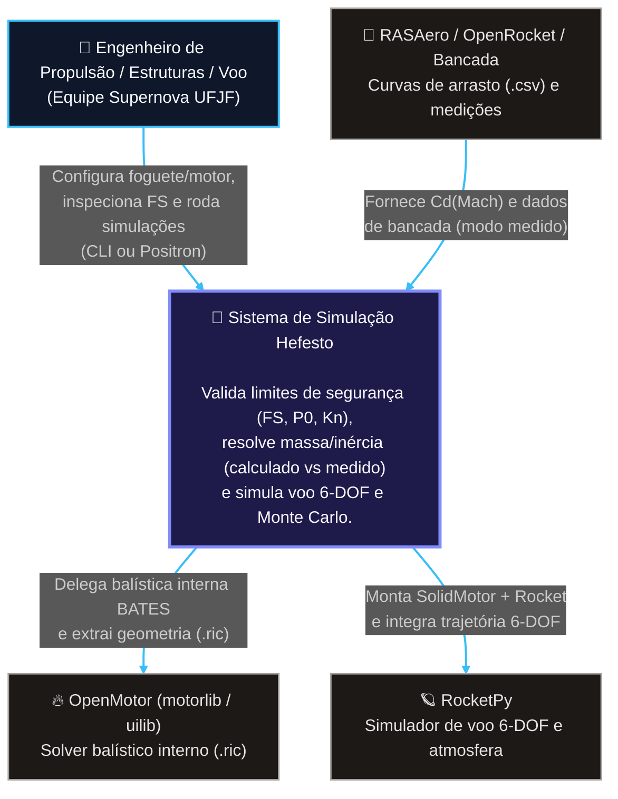

# 🌐 C4 Nível 1 — Contexto do Sistema (Hefesto)

**Navegação na Hierarquia C4:**
**🌐 Nível 1: Contexto** · [📦 Nível 2: Containers](c2-containers.md) · [🧩 C3: Execução & Voo](c3-execucao-voo.md) · [🧩 C3: Subsistema de Motor](c3-subsistema-motor.md)

---

## 1. Visão Geral (Contexto)

O **Hefesto** é a plataforma de engenharia, validação estrutural e simulação de voo 6-DOF da equipe **Supernova Rocketry (UFJF)** para a competição **IREC (Spaceport America Cup)**.

---

## 2. Atores e Sistemas Externos

| Elemento | Tipo | Papel no Ecossistema |
| :--- | :--- | :--- |
| **Engenheiro Supernova** | Pessoa | Ajusta geometria, propelente, garganta e analisa estabilidade/apogeu e fatores de segurança. |
| **Hefesto** | Sistema Alvo | Centraliza a verdade física do foguete, garantindo rastreabilidade e validação *fail-fast*. |
| **OpenMotor (`motorlib`)** | Biblioteca Externa | Resolve pressão de câmara $P_0(t)$, $K_n(t)$, fluxo de massa e empuxo a partir do arquivo `.ric`. |
| **RocketPy** | Biblioteca Externa | Integra as equações de movimento 6-DOF sob atmosfera IREC (Spaceport America). |
| **RASAero / Bancada** | Dados Externos | Fornece tabelas de arrasto (`CDpoweroff.csv`, `CDpoweron.csv`) e medições reais para o `modo="medido"`. |

---

### Próximo Nível
👉 Avance para [📦 C4 Nível 2 — Containers (Camadas e Pastas)](c2-containers.md) para ver como o repositório é dividido internamente.
