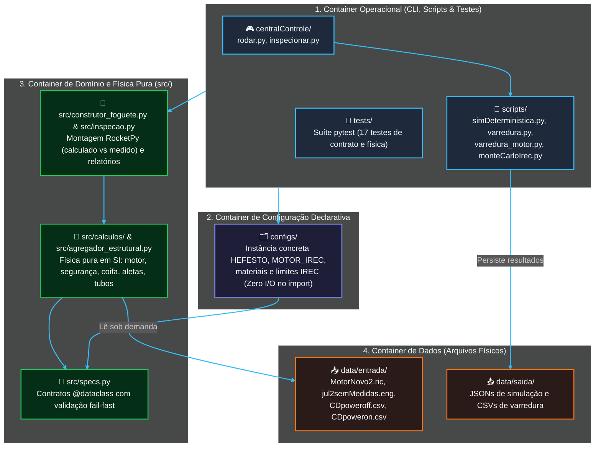

# 📦 C4 Nível 2 — Containers (Camadas do Repositório)

**Navegação na Hierarquia C4:**
[🌐 Nível 1: Contexto](c1-contexto.md) · **📦 Nível 2: Containers** · [🧩 C3: Execução & Voo](c3-execucao-voo.md) · [🧩 C3: Subsistema de Motor](c3-subsistema-motor.md)

---

## 1. Arquitetura em Camadas Unidirecionais

O repositório é dividido em **containers lógicos (pacotes e diretórios)** com uma regra inviolável de dependência: **`src/` nunca importa `configs/`** (garantido por teste de AST em `tests/test_specs_contratos.py`).

---

## 2. Responsabilidade de Cada Container

| Container | Caminho | Regra de Ouro |
| :--- | :--- | :--- |
| **Contratos (`specs`)** | [`src/specs.py`](file:///home/icaro/Hub/01-Projetos_e_UFJF/supernova/simulacoes/github/hefesto%20privado-estrutura-vibe/src/specs.py) | Define os tipos de entrada e valida invariantes no `__post_init__`. Zero dependências externas. |
| **Física (`calculos`)** | [`src/calculos/`](file:///home/icaro/Hub/01-Projetos_e_UFJF/supernova/simulacoes/github/hefesto%20privado-estrutura-vibe/src/calculos) | Toda a matemática em unidades SI. Não sabe qual foguete está sendo simulado. |
| **Configurações (`configs`)** | [`configs/`](file:///home/icaro/Hub/01-Projetos_e_UFJF/supernova/simulacoes/github/hefesto%20privado-estrutura-vibe/configs) | Apenas instancia as `Specs` de `src/specs.py` com os números do foguete Hefesto. |
| **Operação (`centralControle` / `scripts`)** | [`centralControle/rodar.py`](file:///home/icaro/Hub/01-Projetos_e_UFJF/supernova/simulacoes/github/hefesto%20privado-estrutura-vibe/centralControle/rodar.py) | Conecta os dados de `configs/` às funções de `src/` e executa voos/relatórios. |

---

## 3. Índice Geral dos Módulos (C4 Nível 4 — Código)

Abaixo está o índice navegável para os diagramas de **Nível 4 (Código)** gerados automaticamente via AST e análise de impacto:

| Container | Módulo Python | Diagrama C4 Nível 4 (Código) |
| :--- | :--- | :--- |
| **Domínio Central** | [`src/agregador_estrutural.py`](../../src/agregador_estrutural.py) | [⚡ `agregador_estrutural.c4.md`](_gerados_c4/src__agregador_estrutural.c4.md) |
| | [`src/construtor_foguete.py`](../../src/construtor_foguete.py) | [⚡ `construtor_foguete.c4.md`](_gerados_c4/src__construtor_foguete.c4.md) |
| | [`src/specs.py`](../../src/specs.py) | [⚡ `specs.c4.md`](_gerados_c4/src__specs.c4.md) |
| | [`src/inspecao.py`](../../src/inspecao.py) | [⚡ `inspecao.c4.md`](_gerados_c4/src__inspecao.c4.md) |
| | [`src/ambiente.py`](../../src/ambiente.py) | [⚡ `ambiente.c4.md`](_gerados_c4/src__ambiente.c4.md) |
| | [`src/viz.py`](../../src/viz.py) | [⚡ `viz.c4.md`](_gerados_c4/src__viz.c4.md) |
| | [`src/smoke.py`](../../src/smoke.py) | [⚡ `smoke.c4.md`](_gerados_c4/src__smoke.c4.md) |
| | [`src/paths.py`](../../src/paths.py) | [⚡ `paths.c4.md`](_gerados_c4/src__paths.c4.md) |
| | [`src/c4_gerador.py`](../../src/c4_gerador.py) | [⚡ `c4_gerador.c4.md`](_gerados_c4/src__c4_gerador.c4.md) |
| **Cálculos & Física** | [`src/calculos/motor.py`](../../src/calculos/motor.py) | [⚡ `motor.c4.md`](_gerados_c4/src__calculos__motor.c4.md) |
| | [`src/calculos/seguranca.py`](../../src/calculos/seguranca.py) | [⚡ `seguranca.c4.md`](_gerados_c4/src__calculos__seguranca.c4.md) |
| | [`src/calculos/coifa.py`](../../src/calculos/coifa.py) | [⚡ `coifa.c4.md`](_gerados_c4/src__calculos__coifa.c4.md) |
| | [`src/calculos/aletas.py`](../../src/calculos/aletas.py) | [⚡ `aletas.c4.md`](_gerados_c4/src__calculos__aletas.c4.md) |
| | [`src/calculos/componentes.py`](../../src/calculos/componentes.py) | [⚡ `componentes.c4.md`](_gerados_c4/src__calculos__componentes.c4.md) |
| | [`src/calculos/motorlib_wrapper.py`](../../src/calculos/motorlib_wrapper.py) | [⚡ `motorlib_wrapper.c4.md`](_gerados_c4/src__calculos__motorlib_wrapper.c4.md) |
| | [`src/calculos/motorlib_variacoes.py`](../../src/calculos/motorlib_variacoes.py) | [⚡ `motorlib_variacoes.c4.md`](_gerados_c4/src__calculos__motorlib_variacoes.c4.md) |
| | [`src/calculos/aletas_rasaero.py`](../../src/calculos/aletas_rasaero.py) | [⚡ `aletas_rasaero.c4.md`](_gerados_c4/src__calculos__aletas_rasaero.c4.md) |
| **Operação & CLI** | [`centralControle/rodar.py`](../../centralControle/rodar.py) | [⚡ `rodar.c4.md`](_gerados_c4/centralControle__rodar.c4.md) |
| | [`centralControle/inspecionar.py`](../../centralControle/inspecionar.py) | [⚡ `inspecionar.c4.md`](_gerados_c4/centralControle__inspecionar.c4.md) |
| **Configurações (`configs`)** | [`configs/__init__.py`](../../configs/__init__.py) | [⚡ `configs.c4.md`](_gerados_c4/configs.c4.md) |
| | [`configs/limites.py`](../../configs/limites.py) | [⚡ `limites.c4.md`](_gerados_c4/configs__limites.c4.md) |
| | [`configs/material.py`](../../configs/material.py) | [⚡ `material.c4.md`](_gerados_c4/configs__material.c4.md) |
| | [`configs/foguetes/hefesto/motor.py`](../../configs/foguetes/hefesto/motor.py) | [⚡ `motor.c4.md`](_gerados_c4/configs__foguetes__hefesto__motor.c4.md) |
| | [`configs/foguetes/hefesto/voo.py`](../../configs/foguetes/hefesto/voo.py) | [⚡ `voo.c4.md`](_gerados_c4/configs__foguetes__hefesto__voo.c4.md) |

---

### Próximo Nível (Componentes)
- 👉 [🧩 C4 Nível 3 — Pipeline de Execução e Voo](c3-execucao-voo.md)
- 👉 [🧩 C4 Nível 3 — Subsistema de Motor & Segurança](c3-subsistema-motor.md)
- 👉 [📖 Guia de Visualização e Uso](../../centralControle/GUIA_VISUALIZACAO.md)
