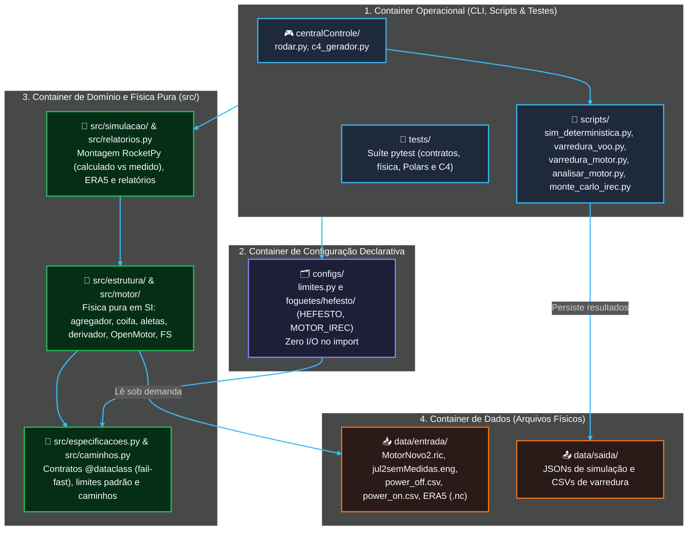

# 📦 C4 Nível 2 — Containers (Camadas do Repositório)

**Navegação na Hierarquia C4:**
[🌐 Nível 1: Contexto](c1-contexto.md) · **📦 Nível 2: Containers** · [🧩 C3: Execução & Voo](c3-execucao-voo.md) · [🧩 C3: Subsistema de Motor](c3-subsistema-motor.md)

---

## 1. Arquitetura em Camadas Unidirecionais

O repositório é dividido em **containers lógicos (pacotes e diretórios)** com uma regra inviolável de dependência: **`src/` nunca importa `configs/`** (garantido por teste de AST em `tests/test_especificacoes.py`).

---

## 2. Responsabilidade de Cada Container

| Container | Caminho | Regra de Ouro |
| :--- | :--- | :--- |
| **Contratos (`especificacoes` / `caminhos`)** | [`src/especificacoes.py`](../../src/especificacoes.py) | Define os contratos de entrada, `LIMITES_PADRAO`, `validar_overrides()` e valida invariantes no `__post_init__`. |
| **Física (`estrutura` & `motor`)** | [`src/estrutura/`](../../src/estrutura) · [`src/motor/`](../../src/motor) | Toda a matemática e balística em unidades SI. Não sabe qual foguete está sendo simulado. |
| **Simulação & Relatórios (`simulacao` / `relatorios`)** | [`src/simulacao/`](../../src/simulacao) · [`src/relatorios.py`](../../src/relatorios.py) | Constrói `SolidMotor`/`Rocket`/`Environment` do RocketPy e formata diagnósticos. |
| **Configurações (`configs`)** | [`configs/`](../../configs) | Apenas instancia as `Specs` de `src/especificacoes.py` com os parâmetros do foguete Hefesto. |
| **Operação (`centralControle` / `scripts`)** | [`centralControle/rodar.py`](../../centralControle/rodar.py) | Conecta os dados de `configs/` às funções de `src/` e executa voos, varreduras (Polars) e C4. |

---

## 3. Índice Geral dos Módulos (C4 Nível 4 — Código)

Abaixo está o índice navegável para os diagramas de **Nível 4 (Código)** gerados automaticamente via AST e análise de impacto:

| Container | Módulo Python | Diagrama C4 Nível 4 (Código) |
| :--- | :--- | :--- |
| **Domínio Central** | [`src/especificacoes.py`](../../src/especificacoes.py) | [⚡ `src__especificacoes.c4.md`](_gerados_c4/src__especificacoes.c4.md) |
| | [`src/caminhos.py`](../../src/caminhos.py) | [⚡ `src__caminhos.c4.md`](_gerados_c4/src__caminhos.c4.md) |
| | [`src/relatorios.py`](../../src/relatorios.py) | [⚡ `src__relatorios.c4.md`](_gerados_c4/src__relatorios.c4.md) |
| **Estrutura (`src/estrutura/`)** | [`src/estrutura/agregador.py`](../../src/estrutura/agregador.py) | [⚡ `src__estrutura__agregador.c4.md`](_gerados_c4/src__estrutura__agregador.c4.md) |
| | [`src/estrutura/componentes.py`](../../src/estrutura/componentes.py) | [⚡ `src__estrutura__componentes.c4.md`](_gerados_c4/src__estrutura__componentes.c4.md) |
| | [`src/estrutura/coifa.py`](../../src/estrutura/coifa.py) | [⚡ `src__estrutura__coifa.c4.md`](_gerados_c4/src__estrutura__coifa.c4.md) |
| | [`src/estrutura/aletas.py`](../../src/estrutura/aletas.py) | [⚡ `src__estrutura__aletas.c4.md`](_gerados_c4/src__estrutura__aletas.c4.md) |
| **Motor & Segurança (`src/motor/`)** | [`src/motor/derivador.py`](../../src/motor/derivador.py) | [⚡ `src__motor__derivador.c4.md`](_gerados_c4/src__motor__derivador.c4.md) |
| | [`src/motor/seguranca.py`](../../src/motor/seguranca.py) | [⚡ `src__motor__seguranca.c4.md`](_gerados_c4/src__motor__seguranca.c4.md) |
| | [`src/motor/adaptador_openmotor.py`](../../src/motor/adaptador_openmotor.py) | [⚡ `src__motor__adaptador_openmotor.c4.md`](_gerados_c4/src__motor__adaptador_openmotor.c4.md) |
| **Simulação (`src/simulacao/`)** | [`src/simulacao/construtor_foguete.py`](../../src/simulacao/construtor_foguete.py) | [⚡ `src__simulacao__construtor_foguete.c4.md`](_gerados_c4/src__simulacao__construtor_foguete.c4.md) |
| | [`src/simulacao/ambiente.py`](../../src/simulacao/ambiente.py) | [⚡ `src__simulacao__ambiente.c4.md`](_gerados_c4/src__simulacao__ambiente.c4.md) |
| **Operação & CLI (`centralControle/`)** | [`centralControle/rodar.py`](../../centralControle/rodar.py) | [⚡ `centralControle__rodar.c4.md`](_gerados_c4/centralControle__rodar.c4.md) |
| | [`centralControle/c4_gerador.py`](../../centralControle/c4_gerador.py) | [⚡ `centralControle__c4_gerador.c4.md`](_gerados_c4/centralControle__c4_gerador.c4.md) |
| **Configurações (`configs/`)** | [`configs/__init__.py`](../../configs/__init__.py) | [⚡ `configs.c4.md`](_gerados_c4/configs.c4.md) |
| | [`configs/limites.py`](../../configs/limites.py) | [⚡ `configs__limites.c4.md`](_gerados_c4/configs__limites.c4.md) |
| | [`configs/foguetes/hefesto/__init__.py`](../../configs/foguetes/hefesto/__init__.py) | [⚡ `configs__foguetes__hefesto.c4.md`](_gerados_c4/configs__foguetes__hefesto.c4.md) |
| | [`configs/foguetes/hefesto/corpo.py`](../../configs/foguetes/hefesto/corpo.py) | [⚡ `configs__foguetes__hefesto__corpo.c4.md`](_gerados_c4/configs__foguetes__hefesto__corpo.c4.md) |
| | [`configs/foguetes/hefesto/geometria.py`](../../configs/foguetes/hefesto/geometria.py) | [⚡ `configs__foguetes__hefesto__geometria.c4.md`](_gerados_c4/configs__foguetes__hefesto__geometria.c4.md) |
| | [`configs/foguetes/hefesto/motor.py`](../../configs/foguetes/hefesto/motor.py) | [⚡ `configs__foguetes__hefesto__motor.c4.md`](_gerados_c4/configs__foguetes__hefesto__motor.c4.md) |
| | [`configs/foguetes/hefesto/voo.py`](../../configs/foguetes/hefesto/voo.py) | [⚡ `configs__foguetes__hefesto__voo.c4.md`](_gerados_c4/configs__foguetes__hefesto__voo.c4.md) |
| | [`configs/foguetes/hefesto/estocastico.py`](../../configs/foguetes/hefesto/estocastico.py) | [⚡ `configs__foguetes__hefesto__estocastico.c4.md`](_gerados_c4/configs__foguetes__hefesto__estocastico.c4.md) |

---

### Próximo Nível (Componentes)
- 👉 [🧩 C4 Nível 3 — Pipeline de Execução e Voo](c3-execucao-voo.md)
- 👉 [🧩 C4 Nível 3 — Subsistema de Motor & Segurança](c3-subsistema-motor.md)
- 👉 [📖 Guia de Visualização e Uso](../../centralControle/GUIA_VISUALIZACAO.md)
