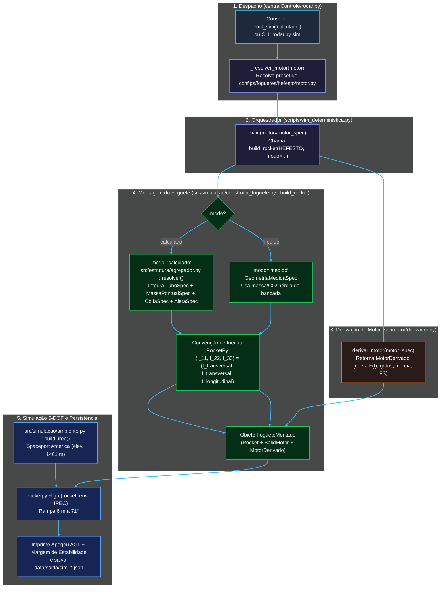

# 🧩 C4 Nível 3 (Componentes) — Pipeline de Execução e Voo

**Navegação na Hierarquia C4:**
[🌐 Nível 1: Contexto](c1-contexto.md) · [📦 Nível 2: Containers](c2-containers.md) · **🧩 C3: Execução & Voo** · [🧩 C3: Subsistema de Motor](c3-subsistema-motor.md)

---

## 1. Como os Componentes Conversam em uma Simulação

Este diagrama mostra o fluxo completo quando você executa `cmd_sim()` no console do Positron ou `python centralControle/rodar.py sim` no terminal.

---

## 2. Componentes Envolvidos (Clique para abrir o código ou gere o Nível 4 pelo botão no topo)

| Componente | Arquivo | Papel |
| :--- | :--- | :--- |
| **CLI / Dispatcher** | [`centralControle/rodar.py`](../../centralControle/rodar.py) | Ponto de entrada unificado para CLI e console interativo. |
| **Orquestrador de Voo** | [`scripts/sim_deterministica.py`](../../scripts/sim_deterministica.py) | Executa o voo nominal e serializa o resultado em JSON. |
| **Construtor RocketPy** | [`src/simulacao/construtor_foguete.py`](../../src/simulacao/construtor_foguete.py) | Monta `SolidMotor` e `Rocket` nos modos `"calculado"` ou `"medido"`. |
| **Agregador Estrutural** | [`src/estrutura/agregador.py`](../../src/estrutura/agregador.py) | Aplica o teorema de Steiner (eixos paralelos) sobre todos os componentes secos. |
| **Ambiente ERA5** | [`src/simulacao/ambiente.py`](../../src/simulacao/ambiente.py) | Fábricas de `Environment` (Reanalysis e Ensemble) para Spaceport America. |
| **Relatórios & Inspeção** | [`src/relatorios.py`](../../src/relatorios.py) | Formata tabelas comparativas (`calculado` vs `medido`, motor e segurança). |
