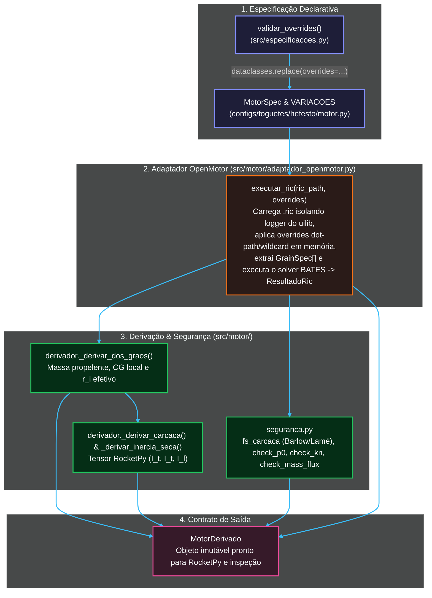

# 🧩 C4 Nível 3 (Componentes) — Subsistema de Motor & Segurança

**Navegação na Hierarquia C4:**
[🌐 Nível 1: Contexto](c1-contexto.md) · [📦 Nível 2: Containers](c2-containers.md) · [🧩 C3: Execução & Voo](c3-execucao-voo.md) · **🧩 C3: Subsistema de Motor**

---

## 1. Arquitetura Interna do Módulo Profundo de Motor

O subsistema de motor foi desenhado como um **Módulo Profundo (Deep Module)**: o chamador entrega apenas um `MotorSpec` declarativo para `derivar_motor(spec)` e recebe um `MotorDerivado` completo, com a garantia de que **qualquer `override` aplicado ao `.ric` atualiza simultaneamente a curva balística e a geometria dos grãos/tubeira**.

---

## 2. Componentes do Subsistema

| Componente | Arquivo | Responsabilidade |
| :--- | :--- | :--- |
| **Configuração & Presets** | [`configs/foguetes/hefesto/motor.py`](../../configs/foguetes/hefesto/motor.py) | Define `MOTOR_IREC`, `PARAMS_LIVRES`, `criar_variacao()` e o mapa `VARIACOES`. |
| **Contratos & Whitelist** | [`src/especificacoes.py`](../../src/especificacoes.py) | Define `MotorSpec`, `LimitesSeguranca`, `LIMITES_PADRAO` e `validar_overrides()`. |
| **Fachada Profunda** | [`src/motor/derivador.py`](../../src/motor/derivador.py) | Coordena a derivação completa (`.ric` ou fallback `.eng`) e produz `MotorDerivado`. |
| **Adaptador OpenMotor** | [`src/motor/adaptador_openmotor.py`](../../src/motor/adaptador_openmotor.py) | Encapsula `motorlib`/`uilib`, aplica overrides e retorna `ResultadoRic` via `executar_ric()`. |
| **Verificador de Segurança** | [`src/motor/seguranca.py`](../../src/motor/seguranca.py) | Calcula tensão circunferencial na carcaça ($\text{FS} \ge 2.0$), $P_0 \le 8\text{ MPa}$, $K_n \le 250$ e fluxo de massa. |
