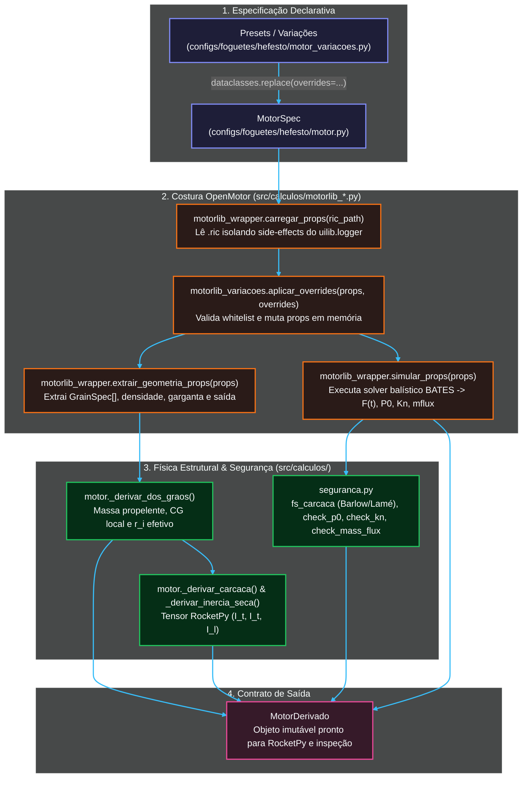

# 🧩 C4 Nível 3 (Componentes) — Subsistema de Motor & Segurança

**Navegação na Hierarquia C4:**
[🌐 Nível 1: Contexto](c1-contexto.md) · [📦 Nível 2: Containers](c2-containers.md) · [🧩 C3: Execução & Voo](c3-execucao-voo.md) · **🧩 C3: Subsistema de Motor**

---

## 1. Arquitetura Interna do Módulo Profundo de Motor

O subsistema de motor foi desenhado como um **Módulo Profundo (Deep Module)**: o chamador entrega apenas um `MotorSpec` declarativo para `derivar_motor(spec)` e recebe um `MotorDerivado` completo, com a garantia de que **qualquer `override` aplicado ao `.ric` atualiza simultaneamente a curva balística e a geometria dos grãos/tubeira**.

---

## 2. Componentes do Subsistema

| Componente | Arquivo | Responsabilidade |
| :--- | :--- | :--- |
| **Fachada Profunda** | [`src/calculos/motor.py`](../../src/calculos/motor.py) | Coordena a derivação completa (`.ric` ou fallback `.eng`) e produz `MotorDerivado`. |
| **Costura OpenMotor** | [`src/calculos/motorlib_wrapper.py`](../../src/calculos/motorlib_wrapper.py) | Encapsula `motorlib`/`uilib`, silencia logs intrusivos e extrai geometria/balística de `props`. |
| **Mutador de Overrides** | [`src/calculos/motorlib_variacoes.py`](../../src/calculos/motorlib_variacoes.py) | Aplica alterações via dot-path (`grains.*.properties.coreDiameter`, `nozzle.throat`) com whitelist. |
| **Verificador de Segurança** | [`src/calculos/seguranca.py`](../../src/calculos/seguranca.py) | Calcula tensão circunferencial na carcaça ($\text{FS} \ge 2.0$), $P_0 \le 8\text{ MPa}$, $K_n \le 250$ e fluxo de massa. |
